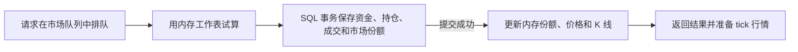

# TouhouCCB 系统架构总览

> 面向贡献者的中文架构速查文档。更深层专题见同目录下 `api.md` / `migrations.md` / `holdings-value-semantics.md` / `development.md`。

---

## 1. 仓库地图

| 目录 | 职责 |
|---|---|
| `backend/` | FastAPI 后端：HTTP API、ORM 模型、业务服务、定时 sweep、SQLAdmin 管理面板 |
| `thccb-frontend/` | Vue 3 + Vite 前端 SPA：页面、组件、Pinia store、SSE 客户端 |
| `quant/` | 独立 Python 量化 bot（`thccb_quant`），通过公开 REST API 自动交易 |
| `docs/` | 专题设计文档（api、migrations、style、holdings-value-semantics 等） |
| `deploy/` | Nginx 配置（`nginx.conf`）与部署脚本（`deploy.sh`） |
| `loadtest/` | k6 负载测试场景与结果 JSON |

顶层 `docker-compose.yml` 编排两个 service：`postgres`（Postgres 16）和 `backend`（FastAPI 容器，监听 `127.0.0.1:8004`）。前端由独立构建产物静态托管，通过 Nginx 反向代理到后端。

---

## 2. 后端分层

### 2.1 层次概览

```
thccb-backend
├── app/api/v1/        HTTP 路由层（FastAPI Router）
├── app/core/          基础设施层
├── app/models/        数据库模型层（SQLModel / SQLAlchemy ORM）
├── app/schemas/       Pydantic 数据契约层（请求体 & 响应体）
└── app/services/      业务逻辑层
```

**`app/api/v1/`**：纯 HTTP 层——声明路由、鉴权依赖、限速注解、参数校验，把请求委托给 services 处理并返回响应。不包含业务计算。

**`app/core/`**：基础设施——`config.py`（Settings + 环境变量）、`database.py`（async engine + session 工厂 + `managed_transaction`）、`oidc.py`（轻量 OIDC 客户端，通过 `.well-known` 自动发现 Casdoor 端点）、`users.py`（本站 HS256 JWT 签发 & 验证）、`admin.py`（SQLAdmin 管理面板，JWT 鉴权，超管专用）。

**`app/models/`**：SQLModel（SQLAlchemy + Pydantic 合体）定义 DB 表结构。核心表在 `base.py`；`ledger.py`、`audit.py`、`redemption.py`、`title.py` 各管自己的附属表（注册到 SQLModel.metadata 后 alembic 自动迁移）。**重要**：`User.positions`、`User.transactions`、`Outcome.positions`、`Outcome.transactions` 四个反向集合均配置 `lazy="raise_on_sql"`，未显式 `selectinload` 则直接访问会抛异常——这是热路径性能护栏，详见 `CONTRIBUTING.md` 的「ORM 查询守则」。

**`app/schemas/`**：Pydantic 模型定义 API 的入参/出参契约（与 ORM 模型解耦）。Money 字段必须使用带 `serialize→float` 的 `Money` 类型，否则 `Decimal` 会以字符串输出触发前端 `TypeError`（见 `docs/` 内 schema-conventions）。

**`app/services/`**：所有业务逻辑收口于此，各模块职责如下：

| 模块 | 职责 |
|---|---|
| `lmsr.py` | LMSR 做市商定价核心：`calculate_lmsr_cost`、`get_current_price`、`calculate_lmsr_with_prices`；内部用 float 计算，边界处通过 `quantize_cost`/`quantize_price` 转 Decimal（6/8 位精度） |
| `realtime.py` | 内存 pubsub broker（`MarketEventBroker`）：SSE 订阅/取消/发布，per-market 序号递增，慢消费者踢出；`IpConcurrencyLimiter` 控制同 IP 并发 SSE 数 |
| `market_locks.py` | 并发锁助手：`lock_market` / `lock_user` / `lock_outcomes_for_market`，通过 `SELECT FOR UPDATE` 实现数据库行级锁；锁顺序约定：market → user → outcomes，违者引发死锁 |
| `wealth.py` | 持仓估值双口径：`compute_users_holdings_value`（LCV，含滑点+fee，用于强平/风控）和 `compute_users_holdings_value_mtm`（MTM，按瞬时价×数量，用于 UI 显示） |
| `wealth_stats.py` | 平台净值分布统计（纯 math，无 DB 依赖）：均值、分位数、基尼系数、按称号档位分桶 |
| `audit_service.py` | 审计事件写入助手：`record` / `record_trade` / 快照构造；与业务变更同事务 |
| `audit_replay.py` | 审计事件折叠（T 时刻状态）、独立增量校验、与线上表比对；`scripts/audit_verify.py` / `audit_export.py` 的核心 |
| `ledger_service.py` | 资金账本写入助手：`record_entry` 构造 `LedgerEntry`，与资金变动同事务提交，调用方负责 user 字段已反映操作后的最终值 |
| `credit/execution.py` | 统一强平执行编排；LMSR 操作提交 writer，FX 操作在受保护事务内执行 |
| `liquidation_sweep.py` | APScheduler 定时扫描全体借贷用户的保证金水位，调用统一信贷 `credit/sweep.py` |
| `loan_service.py` | 借款业务原子操作：复利结息（`accrue_interest`）、借款/还款资金变动，写 `LedgerEntry` |
| `loan_sweep.py` | APScheduler 定时结息：扫全体 `debt > 0` 用户，按 `(1+r)^(Δt/天)` 按日复利增加 debt（分段精确可合成，与 tick 间隔无关；增量不足 1 LSB 不推进锚点） |
| `title_service.py` | 称号目录 admin 端 CRUD + 状态查询 |
| `title_code_service.py` | 称号激活码：batch 创建/列表/CSV 解析、用户兑换激活码 |
| `market_title_gating.py` | 市场准入 title 门槛（ANY-of 语义），仅 gate buy，sell/quote/settle 不调用 |
| `redemption.py` | 实物兑换码：CSV 批量解析、购买事务（单用户单批次上限 5 张）、库存查询 |
| `danmuku.py` | 弹幕系统兑换：HMAC 激活码生成（base64url + HMAC-SHA256），站内 cash → yuan/huo 汇率 1:1 |
| `rank.py` | 净值称号映射（`rank_title`）：按 net_worth 区间返回东方主题称号（"人类灵(已爆仓)" → "ZUN"） |
| `market_writer.py` / `writer_ops.py` | LMSR 唯一经济写路径：队列串行执行命令、独立事务提交，再更新内存价格与历史 ring |
| `candle_writer.py` / `candle_flusher.py` | 计算四档 OHLCV candle；writer 更新 ring 并交给 flusher 批量落库 |
| `anti_bot.py` | L2 HMAC client_token 验证（30s 时间窗），buy 请求携带前端生成的 HMAC 才能通过 |
| `bot_detection.py` | L4 行为监控（APScheduler 每 30min 扫近 2h 交易），触发信号写 `BotSuspicion` |
| `site_config.py` | 站点运行时 key-value 配置读写（借款利率、强平阈值等，超管可热改） |

### 2.2 lifespan 启动顺序

`main.py` 的 `lifespan` 依次执行：

1. 获取经济写所有权；只读实例跳过建表、迁移和所有写调度器。
2. 写 owner 执行 `init_db()` 和 `auto_migrate()`，加载统一信贷参数。
3. 写 owner 挂载受限 SQLAdmin；启动 FX 行情 runtime，只读实例仅预热持久数据。
4. 写 owner 重建近期 candle，然后始终启动 market writer 和 candle flusher。
5. 写 owner 启动结息、强平、bot 检测、PvE 和 FX publisher；tick broadcaster 在只读实例也可以启动。
6. 停机先停止经济调度器，再停止 writer/broadcaster/flusher，最后释放数据库连接和所有权。

### 2.3 已注册的 API 路由

| 前缀 | 模块 | 限速（nginx） |
|---|---|---|
| `/api/v1/auth` | `auth.py` | 5 r/s |
| `/api/v1/user` | `user.py` | — |
| `/api/v1/market` | `market.py` | buy/sell/quote 10 r/s |
| `/api/v1/chart` | `chart.py` | — |
| `/api/v1/stream` | `stream.py`（SSE） | — |
| `/api/v1/loan` | `loan.py` | — |
| `/api/v1/redemption` | `redemption.py` | — |
| `/api/v1/danmuku` | `danmuku.py` | — |
| `/api/v1/title` | `title.py` | — |
| `/api/v1/admin` | `site_config.py` + `admin_redemption.py` + `admin_stats.py` + `admin_liquidation.py` + `admin_bot.py` + `admin_title.py` | 2 r/s |

SQLAdmin 管理面板挂载在 `/api/v1/admin`（由 `core/admin.py` 的 `setup_admin` 完成），通过粘贴本站 access token 登录，只有 `is_superuser=True` 的用户可用。

---

## 3. 前端结构

前端位于 `thccb-frontend/src/`，Vue 3 + TypeScript + UnoCSS，状态管理用 Pinia，路由用 Vue Router 4。

| 目录 | 职责 |
|---|---|
| `pages/` | 路由页面组件（按功能域分子目录：home / market / user / admin / auth / loan / redemption / danmuku / redeem） |
| `components/` | 复用组件（chart / global / home / layout / legal / market / title / user 分类） |
| `composables/` | 组合式函数；`useMarketRealtime.ts` 封装 SSE 订阅、per-market seq 跟踪、gap 检测、`pricesByOutcome` 反应式价格 map |
| `stores/` | Pinia 状态仓库（auth / market / user / loan / redemption / notification / title），持久化业务状态并暴露 actions 调 API |
| `api/` | 后端 HTTP 接口封装（axios / fetch 调用）；`stream.ts` 封装 `EventSource`（`MarketStream` 类） |
| `router/` | Vue Router 路由表（`routes.ts`）+ 全局导航守卫（`guards.ts`，鉴权重定向） |
| `types/` | TypeScript 接口定义（api / chart / stream / trade / market / user 等）；前端类型来源，与后端 Pydantic schema 对应 |
| `utils/` | 工具函数（`formatter.ts` 数值/时间格式化、`palette.ts` 涨绿跌红配色、`errors.ts` 错误处理、`clientToken.ts` HMAC 生成、`validation.ts`） |

---

## 4. 核心概念

### 4.1 LMSR 做市商定价

本站采用 **对数做市规则（LMSR，Logarithmic Market Scoring Rule）** 定价。系统总成本函数：

```
C(q) = b · ln(Σ exp(q_i / b))
```

其中 `q_i` 是选项 i 的累计份额，`b` 是流动性参数（每个市场独立设置，`Market.liquidity_b`）。

**关键特性**：某一选项被买入/卖出时，全市场所有选项的瞬时价格均会联动变化，因为价格 `P_i = exp(q_i/b) / Σ exp(q_j/b)` 取决于所有选项的份额。图表必须按全市场逐笔重放，不能只看目标选项的成交数据。

实现见 `backend/app/services/lmsr.py`。内部计算用 float（math 运算），边界处量化为 `Decimal`（资金/份额 6 位，价格 8 位）。

单笔交易对价格的影响可达 ±10%，远超传统交易所，quant 策略参数（滑点上限/网格步长）需据此校准，详见 `docs/` 内 LMSR 相关记录。

#### 4.1.1 Writer 内存与 SQL 的关系：通俗解释

可以把 writer 的内存看作交易台上的**市场工作表**，SQL 数据库看作**保存下来的正式账本**。
工作表让系统随手就能拿到份额和价格；账本保存每笔资金和持仓变动，服务重启后也从这里恢复。

每个市场有自己的工作表。例如，一个市场有 A、B、C 三个选项，内存里会有类似这样的内容：

```text
选项顺序：A、B、C
份额向量 q：100、80、60
流动性参数 b：100
价格：根据 q 和 b 算出的 A、B、C 当前价格
状态：交易中；截止时间：某个时刻
```

**q 是定价用的市场份额数。** 买入 A 10 份，就把 A 对应的数从 100 改为 110；
卖出 A 10 份，就减少 10。LMSR 用整组 q 和 b 算价格，所以 A 的买卖也会改变 B、C 的价格。
初始化时可以加入用于设定起始价格的“种子份额”，因此 q 可能包含这些起始值；
查“某个用户持有多少份”要读个人持仓表，不能直接拿市场 q 代替。

内存工作表对应代码里的 `MarketState`，内容如下：

| 保存的内容 | 通俗含义 | 与 SQL 的关系 |
|---|---|---|
| `market_id`、`outcome_ids`、`outcome_labels` | 这是哪个市场，选项按什么顺序排列 | 从 `Market`、`Outcome` 加载；份额和价格数组用同一顺序 |
| `q_dec` | 用于更新和保存的精确份额数，保留 6 位小数 | 从 `Outcome.total_shares` 恢复；成交时新值随账务事务写回 SQL |
| `q` | 同一组份额的浮点数版本，方便计算对数等数学函数 | 由 `q_dec` 转换，恢复时可以重新生成 |
| `b`、`prices` | 流动性参数，以及已经算好的当前价格 | b 来自 `Market.liquidity_b`；prices 由 q 和 b 算出 |
| `status`、`closes_at`、`unavailable` | 市场是否开门、何时截止，以及当前工作表是否可用 | 状态和截止时间从 `Market` 加载；unavailable 是进程内的暂停标记 |
| `rings` | 每个选项的一段近期 K 线，方便直接供给图表 | 启动从 `OutcomeCandle` 加载，成交后先在内存中更新，随后批量写入 SQL |
| `last_ring_trade_id` | 图表这份内存数据已经处理到哪笔成交 | 随快照发给前端，帮助它跳过历史尾段里已包含的成交，避免重复计入成交量 |

这里同时存 q_dec 和 q，是为了兼顾记账精度与数学计算。正式份额按 Decimal 保存；
计算 LMSR 时使用 float。prices 也可以根据份额重新计算，无需逐笔扫描历史交易。

writer 还在内存里维护**每个市场的指令队列和一个处理任务**。可以想象成每个市场有一个柜员，
同一个市场的请求排队办理，不会有两个请求同时拿着同一份旧价格修改市场。
不同市场有各自的柜员；跨市场的账户操作还要由用户行锁和风控门闩协调。
队列临时保存待处理指令，处理完成便移除，服务重启时不会恢复这份排队列表。

**用户的现金、债务、个人持仓、完整成交记录和审计记录，仍保存在 SQL 中。**
writer 会在交易事务里读取、锁定和更新相关账户行；这些数据没有全部搬进市场工作表。

**一笔买入如何连接内存和 SQL？** 假设玩家买入 A 10 份，流程是：

1. 指令进入这个市场的队列。writer 根据内存里的 q 和 b 试算价格、费用和滑点，准备一份新的份额数；此时正式工作表还保持原值。
2. 开启 SQL 事务，锁定用户，检查余额、准入和风控。通过后，在同一个事务里扣现金、增加个人持仓、记录成交与审计，并把新的市场份额写入 `Outcome.total_shares`。
3. 等 SQL 提交成功，再把内存的 q_dec 更新为新值，重新生成 q 和 prices，同时更新内存 K 线。
4. 将成交和最新价格交给 tick broadcaster，再返回成交结果。行情随后通过 tick 帧推给前端。



因此，“内存中的 q 是权威”指的是**运行时的市场定价和串行处理以 writer 的份额为准**。
SQL 则保存已提交的经济结果，承担持久化和恢复。一次操作正常完成后，内存 q_dec 与 SQL 的
`Outcome.total_shares` 对齐；提交成功到更新内存之间有短暂的先后顺序，它们通过 writer 的流程保持一致。
普通 SQL UPDATE 不会自动通知内存重读，所以直接修改数据库可能让运行中的工作表继续使用旧值。

**K 线的落库节奏与账务不同。** 现金、持仓、成交和市场份额每笔都在 SQL 事务中提交；
K 线是根据成交整理出的图表数据，先更新内存 ring 和待写缓冲，flusher 正常每 5 秒合并一批写入
`OutcomeCandle`。数据库写入失败或拥堵时，这段延迟可能更长。K 线表暂时晚一点更新，不代表这笔成交尚未记账。

**重启时会发生什么？** 进程内的工作表、队列和行情缓冲会消失。写实例启动时先按现有的最近
1 小时窗口重放已落库交易，修补近期 K 线，再从 SQL 加载交易中和熔断中的市场，重建份额、价格和 ring。
启动前已经结算的市场不加载交易工作表，其历史和重复结算结果仍可从 SQL 读取。
如果进程在 SQL 已提交、响应尚未返回时中断，交易可能已经成功；应根据已有成交流水确认结果。

这套实现的性能收益主要来自：定价所需的市场数据常驻内存，同市场操作按队列处理，近期图表直接读取 ring，
K 线落库按批合并。**每笔真实交易仍需等待 SQL 账务提交。** SQL 在当前实现中仍是成交过程中的必要环节。

实现入口：[`MarketState` 与 writer 生命周期](../backend/app/services/market_writer.py)、
[`买卖事务与命令处理](../backend/app/services/writer_ops.py)、
[`K 线批量落库](../backend/app/services/candle_flusher.py)。

#### 4.1.2 FX 与 LMSR 的内存、SQL 分工有什么不同？

两者都把资金、持仓和真实成交保存进 SQL。区别在于：**LMSR 的运行时定价份额常驻 writer 内存，
FX 的权威池储备仍保存在 SQL。** FX 的内存服务主要整理行情和图表。

继续用交易台作比喻：LMSR 的柜员手边有一张份额工作表，用它计算本次价格，然后把结果记到账本。
FX 的柜员办理交易时，会从 SQL 取出池里的金币、外币数量，锁住这份记录，完成兑换并写回。
FX 的内存更像旁边的行情显示屏：它把已经成交的记录整理成价格变化和 K 线，供玩家查看。

| 对比项 | LMSR | FX |
|---|---|---|
| 核心定价数据 | 每个选项的份额 q，以及流动性参数 b | 池中的金币储备和外币储备 |
| 运行时从哪里取核心数据 | 常驻内存的 `MarketState` | SQL 的 `FxPair`；正式成交时重新读取并锁行 |
| 常驻内存主要保存什么 | 份额、价格、状态、近期 K 线，以及市场指令队列 | 近期 K 线、行情处理进度、历史版本、待推送的成交变化 |
| 同一市场如何协调写入 | 一个市场一个 writer 队列，再配合品种门闩与账户行锁 | 品种门闩配合池子、账户等数据库行锁；没有同类的经济 writer 队列 |
| SQL 中的市场数据承担什么职责 | 保存已提交的份额和状态，供恢复及其他读取使用 | 保存权威池储备和版本，也是报价、成交的输入 |
| 真实资金与持仓 | 每笔在 SQL 事务中更新 | 每笔在 SQL 事务中更新 |
| 图表如何推进 | writer 成交后直接更新内存 ring，并交给 flusher 落库 | 行情服务读取 SQL 中新提交的 `FxTrade`，增量整理 ring 和持久 K 线 |

**FX 定价用的是两桶储备。** 例如，池里有 1,000 金币和 1,000 外币，当前参考价就是
1 金币／外币。玩家用金币买外币时，金币桶变多、外币桶变少，后续价格随之上升。
具体成交价格还要考虑成交数量造成的滑点、手续费和舍入。计算这些结果所用的真实储备来自
`fx_pair.gold_reserve` 与 `fx_pair.foreign_reserve`。

FX 一笔正式交易的过程是：

1. 取得相关品种门闩，在 SQL 事务里锁住池子和账户记录。
2. 用锁内读到的储备重新计算成交，并检查资金、滑点、版本和风控；先前的预估报价不能替代这一步。
3. 在同一事务里更新池储备、账户、钱包或欠币仓位，保存 `FxTrade` 和审计记录；统一跨零交易的多条腿也在同一事务内提交。
4. SQL 提交成功后，通知行情服务这个币种有新成交，并把行情发布任务加入缓冲。
5. 行情服务读取已提交成交，推进内存 K 线和待推送数据，再将派生 K 线批量保存。

```text
LMSR：内存份额试算 → SQL 账务提交 → 更新内存份额与 K 线 → 推送行情
FX：  SQL 读取并锁定储备 → 计算与账务提交 → 行情服务读取新成交 → 更新图表并推送
```

这里的 `FX_MARKET_DATA` 管理的是**行情处理进度**。例如：SQL 中已有某币种的成交 ID 120，
内存图表也已处理到 120，但图表的 SQL 保存进度还停在 115。这表示 115 之后的成交已经记账，
派生图表数据还在等待落库。它不表示池子的储备仍停在 115。

代码分别用 `applied_trade_id` 表示内存已处理到哪笔，用 `durable_trade_id` 表示图表已经保存到哪笔。
SQL 的 `FxMarketDataState.last_trade_id` 保存持久进度，K 线和该进度在同一个事务里更新。
重启后可以读取已保存的 K 线，再从持久进度之后的真实成交继续整理，避免丢掉一段图表或重复累计成交量。
成交通知用于加快整理；行情服务也会周期性检查 SQL，因此恢复进度依赖已提交记录和持久游标。

**两者的内存服务职责不同。** LMSR writer 参与决定和提交经济变动，FX 行情服务负责整理已经提交的结果。
FX 的正式报价和风控不使用行情 ring 作为权威储备。行情落后会影响图表的新鲜程度，
成交仍按锁内 SQL 储备重新计算；交易提交后遗漏一次行情通知，也不会撤销已经成功的交易。

从性能上看，LMSR writer 减少的是市场定价数据的重复读取和同市场写竞争；
FX 现有优化减少重复 SQL 查询，以及行情接口反复扫描、聚合大量成交的工作。
两者仍保留每笔 SQL 账务提交。这个分工来自当前实现选择，定价算法本身并不强制某一种存储方式。

实现入口：[`FX 储备读取与成交](../backend/app/services/fx/trading.py)、
[`FX 统一交易](../backend/app/services/fx/net_trading.py)、
[`FX 行情内存与增量整理](../backend/app/services/fx/market_state.py)、
[`FX K 线与持久游标`](../backend/app/services/fx/candles.py)。

后续优化的阶段划分、尚待确认的模块/存储方案，以及 FX 内存 writer 待办，见
[LMSR 内存行情与恢复计划](superpowers/plans/2026-10-12-lmsr-market-data.md)和
[配套设计](superpowers/specs/2026-10-12-lmsr-market-data-design.md)。用户已将这些方案延期待办，之后明确恢复再实施；本文描述的运行实现保持现状。

### 4.2 SSE 实时广播

- **服务端**：`services/realtime.py` 中的 `MarketEventBroker`（进程内 pubsub，单进程适用；多进程部署需引入外部 broker）维护 per-market 订阅者集合和单调递增序号（`seq`）。writer 提交成交后投喂 tick broadcaster，以 8 Hz 发布帧。topic 只接受 `lmsr:{market_id}` / `fx:{pair_id}` 字符串，两个产品的订阅、seq 和 IP 限额独立。
- **SSE 端点**：`GET /api/v1/stream/market/{market_id}`（`api/v1/stream.py`）。连接建立时先发 `snapshot`（当前市场状态 + 所有选项现价），之后从 broker 队列拉事件推送；每 25s 发 `ping` 心跳保活；单连接最长 1 小时（`MAX_SSE_DURATION=3600`）。连接期间不占用 DB 连接（snapshot 完成后立即归还）。
- **前端**：`api/stream.ts` 中的 `MarketStream` 封装 `EventSource`；`composables/useMarketRealtime.ts` 在其上叠加 seq gap 检测（断线期间漏事件触发 `gapToken` 递增，图表 watch 它做静默重拉）和 `pricesByOutcome` 反应式价格 map。
- **推送内容**：`tick` 帧包含全市场价格、逐笔成交和状态；结算帧携带 `settlement`。LMSR wire 只发送 snapshot、tick、ping。

### 4.3 认证体系

认证采用 **Casdoor SSO（OAuth2 / OIDC）**，流程：

1. 前端调 `POST /api/v1/auth/login-start`，后端生成随机 state + nonce 写入 HttpOnly cookie，返回同值供前端拼 Casdoor authorize URL。
2. 用户在 Casdoor 登录后重定向回前端，前端将 code + state 提交给 `POST /api/v1/auth/callback`。
3. 后端通过 `.well-known/openid-configuration` 发现端点（`core/oidc.py`），用 code 换取 id_token，JWKS 验证签名 + iss + aud + nonce。
4. 首次登录自动创建本站用户记录；**当时全站用户数为 0（即第一个登录者）自动获得 `is_superuser=True`，没有独立的管理员创建接口**（见 `auth.py` L165–L185）。
5. 后端签发本站 HS256 JWT（access token 短期 + refresh token 长期），前端后续请求带 `Authorization: Bearer <token>`，`core/users.py` 验证并从 DB 加载用户。

### 4.4 持仓估值双口径

持仓估值存在两套语义，**绝对不能交叉使用**：

| 口径 | 全称 | 计算方式 | HALT 持仓 | 使用场景 |
|---|---|---|---|---|
| **MTM** | Mark-to-Market | 瞬时价 × 持仓数量（`Outcome` LMSR 边际价 × `Position.amount`） | **计入** | UI 显示净值、排行榜、`/user/summary` |
| **LCV** | Liquidation Cash Value | LMSR cost diff（全部卖出实得），含卖出滑点 + fee | **不计入** | 强平判定、保证金计算、借款额度上限 |

两者对大持仓用户差距可达 20%+（`b=100` 量级时单笔滑点约 10%）。实现见 `backend/app/services/wealth.py`；完整设计见 `docs/holdings-value-semantics.md`。

### 4.5 资金账本

`LedgerEntry`（`models/ledger.py`）记录 cash/debt 发生变动的流水，用于事后追溯：

- **覆盖场景**：`borrow`（借款）、`repay`（还款）、`admin_adjust_cash`（调整现金）、`admin_force_loan`（强制放贷）、`admin_forgive_debt`（免债）、`admin_amnesty`（大赦天下：批量清债 + 现金还原，一人一条，cash_delta 与 debt_delta 同时非零）
- **不覆盖**：buy/sell/结算/强平/兑换/弹幕（各有自己的 `Transaction` / `LiquidationEvent` / 兑换 Event 表记录）；利息（可由公式 + 快照重算）
- 写入由 `services/ledger_service.py` 的 `record_entry` 完成，与资金变动**同一事务**提交，调用方须确保 `user.cash`/`user.debt` 已更新为操作后的值

### 4.5.1 审计事件流（audit_event）

`AuditEvent`（`models/audit.py`）是覆盖**全部**改钱 / 改仓 / 改市场 / 改配置路径的全序事件流，每条带操作后快照（`user_after` / `position_after` / `market_after` 全市场 q 向量），供事后审计、时间点回溯与离线回测。`LedgerEntry` / `Transaction` / `LiquidationEvent` 仍是各自业务的明细表，`audit_event` 通过 `ref_table/ref_id` 指回它们。**新增任何改 `user.cash/debt`、`position.amount`、`outcome.total_shares`、`market.status`、`site_config` 的写路径，必须在同事务内调用 `audit_service.record(...)`**，否则 `scripts/audit_verify.py` 会报线上表与事件流不一致。详见 `docs/audit-events.md`。

### 4.6 Decimal 精度约定

| 数值类型 | Decimal 精度 | DB 类型 |
|---|---|---|
| 资金（cash / debt / cost / gross / fee） | 6 位（`COST_QUANT = 0.000001`） | `Numeric(16, 6)` |
| 份额（shares / amount） | 6 位 | `Numeric(16, 6)` |
| 价格（price / market_price） | 8 位（`PRICE_QUANT = 0.00000001`） | `Numeric(16, 8)` |

前端不能用 `Number()` 直接转 API 返回的价格字段（会丢精度），应使用 `toFixed` 配合 `Money` 序列化类型（序列化为 float）。

---

## 5. 典型数据流：用户买入

1. API 完成鉴权和反 bot 校验，释放请求读事务，再提交 `BuyCmd`。
2. market writer 持有对应品种门闩，执行内存定价与滑点检查，在独立事务中锁定用户并校验准入与全仓风控。
3. 同事务更新资金、持仓、成交、审计和数据库份额镜像；提交成功后更新 writer 内存、历史 ring 和 flusher 待写 candle。
4. tick broadcaster 发布 `lmsr:{market_id}` 帧；前端按帧内逐笔成交更新列表和图表。

writer 停止或活跃市场缺少 state 时，API 明确拒绝经济写，不回退到直接 SQL 写入。
已结算市场重启后可以从 DB 读取重复结算结果；只读实例、历史市场和超出 ring 窗口的行情仍读取持久数据。

---

## 6. 关键限制与设计决策

- **单进程 pubsub**：`MarketEventBroker` 是进程内对象，多 uvicorn worker 会各自独立，订阅者只能收到同 worker 处理的交易事件。当前单 worker 部署无问题；横向扩展需引入 Redis pub/sub。
- **Schema 迁移**：加列/改字段必须走 `alembic revision --autogenerate` 流程，不允许裸改模型；见 `docs/migrations.md`。
- **交易手续费**：`SELL_FEE_RATE = Decimal("0")`，当前硬编码为 0，待后续决策后才开启。
- **初始余额**：新用户注册获得 `settings.INITIAL_BALANCE` 的初始现金（由 `.env` 配置，`.env.example` 示例为 100）。注：`User.cash` 模型层另有 `default=500`，与 `INITIAL_BALANCE` 存在双重定义不一致（已知待清理项）。
- **强平死锁处理**：`liquidation_sweep` 的锁顺序（user → outcomes）与 `market.py` hot path（market → user → outcomes）存在潜在环形等待；sweep 层捕获 `DeadlockError` 后跳过该用户本轮，下次 sweep 再试。


## 浏览器本地交易预估与账户同步

2026-10-12隔离分支已实现，尚待最终整段审阅，未发布。后端 trading_context 只批量读取账户基准、有效规则和依赖覆盖；trading_prices 只维护已提交定价投影及组 stamp。账户 economic_version 与定价 epoch/revision 分域，账户安装须覆盖 minimum_group_stamps。读接口不拥有资金状态、不在内部调用旧 HTTP，也不读取称号／图表／成交历史。

原事务 owner 在成功 commit 后发布轻量本人提示；回滚、失败和成功幂等回放不新增通知。通知故障不能改变资金结果。account_events 使用短生命周期有界队列，认证交易流在短数据库会话结束后进入 generator。不存在长连接占用资金行锁／连接。当前单进程投影由生命周期启动／关闭，错过通知可由新首包或15s版本校对重新读取权威状态。

前端 fxSimulation/tradingRisk 负责纯模拟、整组LMSR滚动清算、账面与清算双净值；tradingSession 负责版本覆盖、统一时钟及单个在途刷新。行情只改变定价组和本地派生，不触发 summary／net quote；200ms合并账户事件，活跃页面15000ms只核对版本，1000ms只本地计息。后台停止校对，回前台先恢复权威覆盖，账号切换废弃旧 HTTP／SSE／通知。账户改变刷新 context，只有定价落后补 prices；规则身份变更单独同步。

非线性利息及LMSR仍有近似误差；无法约束的边界／缺价保持 unknown，stale 不能显示健康或授权增险。纯减仓沿原服务端路径。旧 pending 保留账号、入口、完整请求和编号，不因提示推定成功；融资同意捕获金额，后续行情不扩大授权。旧 spot 本来没有持久 pending 存储，本轮没有宣称为其新增恢复机制。图表仍沿用公共流，与私有账户流分离。

[验证记录](browser-local-trading-validation-2026-10-12.md)列出检查、指标限制及未验收范围；尤其不能将 mock 请求计数当成真实网络吞吐。

业务重置使用独立空目标实际升级新基线，旧 schema 不走普通升级；入口与恢复边界见[业务重置操作单](business-reset.md)。
