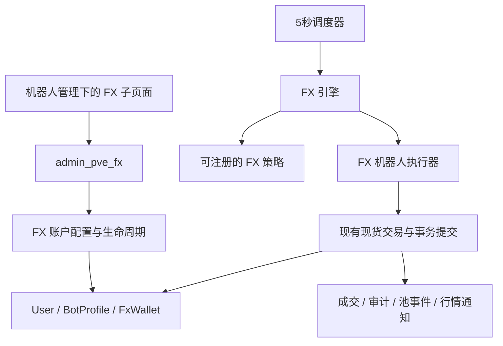

# FX 机器人基础设施与冻结策略接入

日期：2026-10-16。状态：路线已在会话中确认；本文将细节具体化，供实施计划与最终审阅使用。本轮只写文档，不迁移数据库、不创建账户、不启用交易。

## 1. 范围与已确认选择

- 共用现有 User、BotProfile、管理员账户池和真实资金体系；FX 使用独立引擎，LMSR 保持现有策略和注意力模型。
- 管理入口保留“PvE 机器人”，下面分为 LMSR、FX 两个独立路由子页面；继续共用 BotProfile，不改为独立 FxBotProfile 表。
- 一个机器人账户绑定一个 FX 交易对和一个策略，不让同一小号同时受 LMSR 与 FX 引擎管理。
- 只接入冻结的随机、库存调节、短线轮次策略；不接入 `research/fx/lmsr_borrowing/` 实验。
- 初始现金和初始外币在创建时自定义。5000／1000 仅是研究预设；库存基准等于该账户实际初始外币量。
- 真实成交复用现有普通现货内核。仅使用自有资产，不借钱、不借币、不通过统一净买卖入口隐式开空。
- 保存短线轮次所需的最小状态；不建设请求恢复系统、资金影子账、持久决策流水或额外 worker。
- 排行榜复用 `leaderboard_include_bots`；财富统计复用 `wealth_stats_include_bots`。不自动改变现有值，不新增 FX 专属隐藏机制。
- 沿用 FastAPI、SQLModel、Alembic、APScheduler、Vue、Naive UI 和已有 NumPy 依赖，不新增重要依赖。

依据：`research/fx/IMPLEMENTATION_HANDOFF.md`、`research/fx/reversion/repeated/FROZEN_CONFIG.json`，以及本次三个只读 subagent 的审查结果。

## 2. 选定边界

后端新增 `app/services/pve_fx/`，只负责机器人配置、按 tick 组织信号和到达、策略状态、执行编排。AMM 数学、现金钱包变动、手续费、成交审计与行情派生继续由 `app/services/fx/` 承担。生产代码不 import research 包，也不把模拟器的 Pool／Account 钱包复制进生产。

旧 LMSR 的查询、调度、修改和销毁入口必须明确限于 `market_kind=lmsr`；FX 有独立管理 API。不能仅凭 template 名称猜账户所属引擎。

## 3. 数据与配置

### 3.1 BotProfile 的增量

在现表增加：

|字段|用途|
|---|---|
|`market_kind`，默认 `lmsr`|`lmsr`／`fx`，迁移时既有账户全部保留为 LMSR|
|`fx_pair_id`，可空外键|FX 账户唯一绑定的交易对；LMSR 为 null|
|`strategy_state`，JSON，默认空对象|短线轮次状态，不存账户现金或总持仓|

保留 `user_id` 唯一约束、现有 params/status/last_trade_at。增加组合约束：LMSR 无 FX 绑定，FX 必须有绑定，FX 的 market_scope 必须为空。迁移不改用户资金、钱包、原模板参数和开关。

`params` 保存已验证的策略参数及只读 `inventory_baseline_foreign`；基准来自创建时实际发放数量，后续注资不重置它。FX 绑定和基准不能通过普通改参改变；需要另一交易对时创建新账户。

短线状态包括方向、实际剩余数量、剩余成本／卖出收入基准、收益峰值、已锁定退出原因、轮次标识及建仓时间。Decimal 在 JSON 中使用十进制字符串。实际钱包仍以 User/FxWallet 为唯一权威。

### 3.2 SiteConfig

- `fx_pve_enabled`：总开关，默认 false。
- `fx_pve_pair_configs`：JSON 字符串，以 pair_id 为键存独立配置；不存在时按关闭处理。
- 每个交易对：enabled、activity_b=0.25、tau_seconds=2700、mean_arrivals_per_20=1、psi=0.0008、max_pool_fraction=0.005、death_floor_gold=3。
- tick 第一版固定 5 秒；管理页显示时间单位，不允许把它当作单户看盘间隔调整。库存窗口30分钟；短线趋势和均价窗口各150秒。
- 总到达强度为 `(参与调度人数/20)*((1-b)*mean_arrivals_per_20+b*z²)`；参与人数为 profile active 且 User active 的绑定账户数，先做死亡判定再计算人数；资金不足但尚未达到死亡水位者仍参与。
- 参数保存后下一 tick 使用。已开始的 tick 固定其共享参数与信号；任何经济写仍重新检查账户、profile、开关和交易对状态。

管理端只通过专用已验证 schema 写入这些配置；不允许管理员把未验证 JSON 直接送给引擎。保留现有配置缓存失效方式，不增加分布式配置协议。

### 3.3 创建预设与个体系数

“冻结研究预设”：随机10、库存5、短线5，现金5000、外币1000，所有值创建前可改。人数沿用现有单项1–50的限制；批量请求可包含多项。金额非负、有限、最多6位小数，现金沿用现有上限100000，外币不超过 FxWallet Numeric(16,6) 的存储上限。

默认新账户 paused，由管理员显式启用；这是本设计的安全默认，不是研究要求。三套策略均不使用旧 `spawn_params` 的随机扰动。5位短线个人 trend/reversion/sigma 从冻结快照原样复制到生产预设；按创建顺序循环分配，存入 params，以后不因重启或更名重新抽取。管理页可显示并修改这些数值。

## 4. 创建资金与生命周期

### 4.1 一次性初始资产

创建、现金 ledger、外币钱包、profile 和外币分配审计在一个事务完成：

1. 新建 is_bot=true 的 User，沿用系统机器人身份，不伪造真人 TOS 接受时间。
2. 现金沿用 `admin_adjust_cash` ledger；记录经济版本。
3. 创建绑定交易对的 FxWallet，foreign_amount 为用户配置值，cost_basis 为发放数量乘发放时池边际价，保守量化到6位；创建前同时验证数量和乘积均不超过 Numeric(16,6)，超出明确拒绝。成本只作持仓记账基准，不从现金重复扣除。
4. 正数外币发放写 `pve_fx_initial_allocation` 审计事件，包含 pair、发放量、参考价、钱包 before/after、操作者和账户快照；零外币不写发放事件。明确为管理员初始发放，不从池或金库扣币。
5. 在 audit_replay 中支持该钱包增量，后续真实成交能连续核对。该动作不生成 FxTrade、池价格事件、成交量或 K 线，不修改池储备和金库。

这项外币发放仅用于创建新 FX bot，不扩展为任意玩家钱包调账或自动补钱系统。总初始市值在提交创建前可见。

### 4.2 状态与资产

- active：可调度；paused：不再产生策略交易，资产和短线轮次保留。
- dead：自有现金＋绑定钱包整仓卖出的可得现金低于水位，停止调度；只持外币、现金为零不得因此误判。显示净值另用边际价 MTM，明确不等于清算价值。
- 现金注资沿用 ledger；dead 注资后按既有复活语义恢复 active，paused 仍保持 paused，retired 拒绝注资。
- 有短线未结束轮次时，暂停可以做；切换模板或修改短线参数须先完成该轮退出或管理员清仓。库存／随机参数可在下一 tick 生效。所有参数修改都保留真实钱包和初始基准。
- 管理员清仓：仅对 paused FX bot 提供一次真实卖出操作，卖出绑定钱包现有外币；采用管理员明确的 min_out，复用受控现货执行器。成功后清除短线状态，仍为 paused。失败只反馈原因和当前余额，不创建后台重试流程。
- 退休：钱包须为零、短线状态须已结束、无债务，然后回收现金并停用账户。已有 FxTrade 必须保留用户与流水；真正空白账户才允许删除。后台正常调度只允许 active，管理员清仓只允许 paused，两个用途的准入不能混淆。
- 正数初始外币账户未卖出时仍有钱包余额，不能真删；卖出后已有真实FxTrade，只能退休。因此不需要增加删除初始外币审计的流程。零外币空白账户沿用现有现金ledger删除语义；其他需保留的业务引用存在时拒绝真删，保留身份。
- 销毁沿用 User.debt 检查，并拒绝存在 FxShortPosition 本金／利息的账户；这是防止删除既有义务的拒绝条件，不加入机器人借贷支持。

不顺带重构 LMSR 生命周期。旧 retired 现金注资缺口只在共用注资入口加明确拒绝，不扩展成其他管理功能。

## 5. 通用策略合同

策略同步计算，不读数据库、不发 HTTP、不改真实钱包；随机性由引擎提供的独立随机流输入。

|类型／方法|合同|
|---|---|
|`FxTickFrame`|tick标识、过去5秒收盘窗口、该 tick 固定参考价及预计算信号；不包含本 tick 后续信息|
|`FxBotSnapshot`|profile/user/pair、已验证 params、真实可用现金与外币、strategy_state|
|`FxExecutionView`|执行时最新储备和双向费率；提供纯数学报价，含整笔 exact-out 回购估值|
|`prepare_tick(bot, frame, rng) -> prepared`|每 tick 每个账户运行，短线必须抽私有噪声，即使没到达|
|`decide(bot, prepared, execution_view) -> FxDecision`|产生等待或交易意图，可更新收益峰值／退出原因；无成交时也保存必要状态|
|`on_fill(state, fill) -> state`|只按真实 input/output/fee 更新剩余数量、基准及已实现收益|
|`FxOrderIntent`|`buy_gold`／`buy_foreign`／`sell_foreign`、amount、reason；单位不可混用|
|`FxFill`|真实成交ID、输入输出币种与数量、费用、实际前后钱包、成交时间|

注册表输出 template 名称、中文说明、字段类型／单位／默认值／上下界、允许改参条件。配置表单由此渲染；新增策略通常只改策略文件和注册 import。

策略产生意图后，执行器根据最新钱包、池外币0.5%上限及费用裁剪：随机与短线使用指定外币量，库存买入保持“裁剪后的意向外币量×本 tick 观察价”的预算语义。短线止盈止损估值使用全部剩余量，不先用单笔上限裁剪估值；实际退出仍可部分成交并保留已锁定原因。

## 6. 交易内核与受控准入

扩展现有普通现货内核的内部数量模式，不另建记账实现：

- buy_gold：现有 quote_buy。
- sell_foreign：现有 quote_sell，库存不足拒绝或由机器人执行器在提交前裁剪。
- buy_foreign：持锁最新储备上 quote_buy_exact_out；不得先报价得到现金再进行预算买入。钱包不足时，受控机器人可在同一资金锁内用quote_buy(可用现金)计算可负担的六位外币上限，再对裁剪量quote_buy_exact_out；执行始终按外币数量，不要求花光剩余现金，可能留少量量化尘额。裁剪后不可执行则拒绝。复用 `_write_spot_ledger`。利用现有 FxTrade.requested_foreign_amount 保存原请求量，纳入幂等参数核对；实际输出可以因明确的余额裁剪而更少，fill必须标明。legacy预算买卖行为保持不变。
- 内部机器人调用带 profile_id 和用途 scheduled／admin_liquidate，公开 HTTP schema 不接受这些权限参数。缺少受控上下文的 bot 请求仍被拒绝；真人 TOS 规则保持。两种内部用途都检查 User.is_active、is_bot、market_kind=fx 和绑定关系，scheduled 额外要求 active 和 FX bot 开关；admin_liquidate 需超管调用且 profile paused。普通 FX 总开关、交易对状态、余额、费用、min_out 均不绕过。
- bot 账户必须无现金债务及外币欠币，调用不允许 borrow_amount、short_open 或 auto_borrow。遇到非预期债务报告并拒绝，人工处理。

收益峰值和退出原因是观察状态：本人到达且观察后即保存，不以订单成交为前提；即使本次退出未成交，已锁定原因也保留。观察状态更新采用资金锁之后再更新profile的顺序，不覆盖暂停或管理员已结束的轮次。

用一个最小的事务提交前回调扩展现有 `trading.execute_trade` 编排：执行器把 `on_fill` 产生的剩余数量、成本和盈亏更新交给回调，在交易和审计写入后、commit前执行；异常则交易和这些成交相关状态一起回滚，不回滚此前已保存的观察状态。幂等重放不再次调用成交回调。保持已有 gate 和锁顺序，profile 状态更新放在资金锁之后，不另造锁管理器。

提交成功后沿用账户通知、`notify_market_data_committed`、publisher；真实成交进入成交量、池事件、K线、SSE。source 字段继续沿用现货体系，通过 User.is_bot 识别机器人；不为此新增成交来源列。

## 7. 三套策略和物理时间

- 随机：每次到达正态意向外币量，sigma=120；可以同 tick 多次成交。
- 库存：过去最多360个对数收盘价均值与上一收盘价之差 d，目标净库存 `500*tanh(100*d)`，相对该账户初始外币，向差额调整50%。历史不足时使用已有历史，每 tick 最多成交一次。
- 短线：趋势和均价各30tick，趋势分母保留30，短历史返回0；个人趋势×1/4＋个人回归＋个人噪声，入场阈值个人sigma，每轮200外币。正向买入后卖回，负向卖自有外币后买回。止盈0.4%、止损0.5%、移动启动／回撤各0.2%。只在本人到达时估值和退出，没有超时退出。
- 热度：`a=exp(-5/tau_seconds)`，`z_next=a*z+sqrt(1-a*a)*r/psi`，各户独立 Poisson(Lambda/N)，事件打乱。每个交易对独立，不将一个市场冲击扩散到全部机器人。
- tick 开始固定过去数据、参考价和每户信号；然后执行事件；tick 结束读取真实最新储备记为收盘，包含真人和管理员实际发生的池变化，供下一 tick 使用。池价仍持续变化，5秒采样不是行情冻结。

一个进程内 APScheduler job，max_instances=1、coalesce=true，逐交易对、逐事件串行。只在现有经济写 owner 启动；停机等待正在执行的那次交易结束。漏掉的周期不补跑，不追补停机期订单。

收盘窗口与热度只存在内存，重启以当前池价开始新窗口，z=0。短线轮次从数据库恢复，继续使用真实钱包。10秒 K线不冒充5秒历史。现有参数下短历史处理与研究一致；不承诺重启前后随机序列逐位连续，也不以生产行情复现研究 seed 路径为验收条件。

## 8. 管理 API 和页面

新增超管路由 `/api/v1/admin/pve/fx`，不改变现有 LMSR 请求结构：

|方法与路径|用途|
|---|---|
|GET `/overview`|模板及参数元数据、预设、各交易对热度／运行状态|
|GET／PUT `/config`|总开关和按交易对配置|
|GET `/bots`|按pair/template/status过滤的账户、真实钱包、MTM与清算价值、轮次摘要|
|POST `/bots/generate`|pair_id、items、initial_cash、initial_foreign、naming_style；创建paused账户|
|PATCH `/bots/{id}`|暂停／恢复、验证后的策略参数或允许的模板切换|
|POST `/bots/batch`|同一交易对／模板选中账户的批量启停或改参，使用同一验证逻辑|
|POST `/bots/{id}/fund`|现金注资，复用ledger和状态规则|
|POST `/bots/{id}/liquidate`|超管对paused账户提交真实全仓现货卖出，含min_out|
|DELETE `/bots/{id}`|满足条件后真删除或退休|
|GET `/bots/{id}/log`|现有风格的内存环形决策日志，重启可丢弃|

沿用现有 `/admin/fx` 的父页面＋子路由模式：

- `/admin/pve` 保留父入口，默认跳转 `/admin/pve/lmsr`，兼容原入口书签及侧栏链接。
- `/admin/pve/lmsr`：LMSR bot 子页面，承接当前 PveManage 的管理内容，继续请求旧API。
- `/admin/pve/fx`：FX bot 子页面，使用独立FX管理API，显示创建预设、人数与资产自定义、策略字段表单、批量操作、单户余额／持仓／轮次／日志，以及清仓和退休。

PveManage 改为轻量父壳及 RouterView，两个子页面各自加载自己的数据，不在同一组件内按市场类型切换全部业务。入口可用路由导航切换子页面；不是仅通过本地tab状态显示不同面板。侧栏保留“PvE 机器人”入口，现有路径前缀高亮已覆盖子路由，无需为此改造侧栏。复用现有组件，不做全站UI改版。

排行榜和财富统计开关直接复用现有配置 API，不重复存入FX配置；说明它们影响全部机器人。配置不自动修改，排行榜现有短缓存到期后反映变化。

## 9. 验证、上线边界与不做项

以真实逻辑行为为检查对象：迁移保留原LMSR数据；创建自定义资产且池不变／审计可重放；零现金外币账户不误死；普通HTTP与机器人入口在同一初始状态下的现货钱包、储备、手续费和审计等价；成交与短线状态同事务；exact-out不超量；冻结策略时间顺序及部分退出正确；停用／暂停阻止下一次策略交易；榜单沿用现有过滤。

相关已有测试优先复用；新增测试只覆盖上述新增关键行为。UI只做类型检查、构建及最多截图，不运行浏览器自动交互。不要求新建E2E环境、不追加研究扫参、不运行生产交易作验证。

season_reset/business_reset 关闭新总开关并清空按交易对配置。BotProfile 在 FxPair 之前清理，独立FX清理函数需先拒绝或清除相关FX profile，不能破坏新增外键。新增发放审计纳入FX审计清理。重置前原有停写要求不变。

部署、迁移运行、初始资产实际发放和打开总开关在实现与检查完成后再交付审批；文档及一般实现授权不表示已授权这些操作。未确认前不新增恢复队列、自动补款、策略组合净仓、跨市场统一调度、正手续费研究或其他策略。
