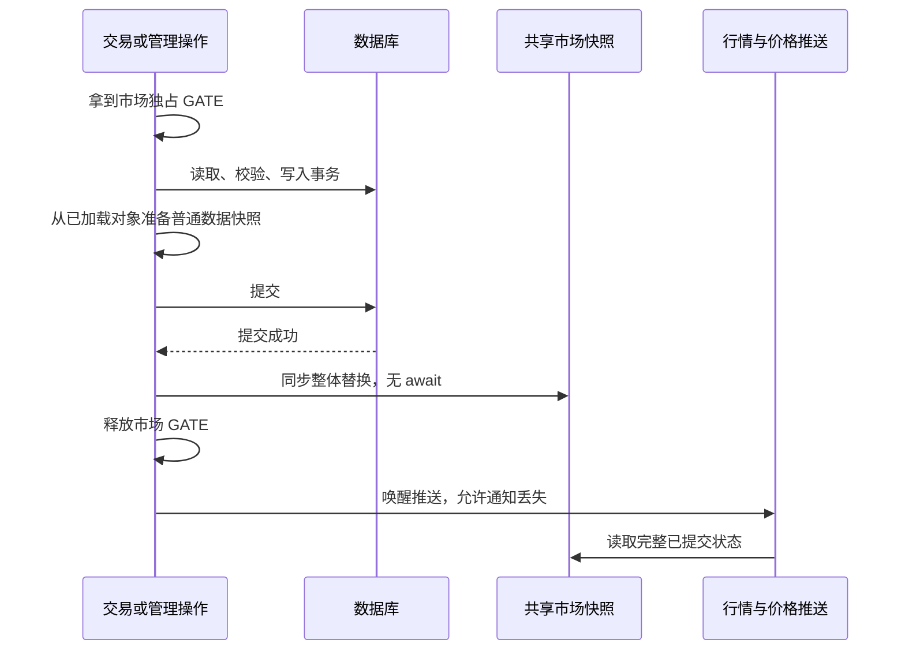

# 当前市场行情迁移到进程内存

日期：2026-10-18。状态：根据已确认方向形成的设计，供实施计划使用；尚未实施。

本次修订结合了[100 人真实高压 profile](../../../output/fx-stress-profile-20261018/report.md)和再次读码。内存化优先消除当前市场输入的重复 SQL/ORM 工作；SSE 消费者的任务创建、取消和断连检查另行评估，不把这些 CPU 全部计作内存化收益。

## 目标与范围

当前市场状态变化少、读取多。将 FX 储备、手续费、状态、版本及当前公开展示字段保存为进程内的已提交快照，让行情读取、交易上下文和价格 SSE 共享；LMSR 复用已有 writer 的提交更新时序。数据库继续持久化全部交易事实。

用户已经确认：行情默认读内存；FX 实际交易仍读取数据库并在原事务中校验、写入；提交成功后、释放市场锁前更新内存。用户余额、债务、持仓不建立跨请求内存账本。用户依赖身份查询的合并可独立实施。

以下细节是本计划建议的实现选择，不代表已有代码已经具备这些能力：复用 PricingRegistry 作为唯一共享读快照入口；只在经济写实例启用常驻快照；只读实例继续权威读库；沿用已有 GATES 和事务持有者管理更新。

## 数据分工

| 数据 | 本次读取来源 | 更新方式 |
| --- | --- | --- |
| FX 储备、买卖手续费、pool_version、status、archived、reduce_only | 写实例内存 | 业务事务提交后同步替换 |
| FX 当前公开展示字段（币种名称、代码、创建/更新时间） | 同一份 FX 快照 | 创建、修改、交易等提交后一起替换 |
| LMSR b、outcome_ids、q_dec、状态、截止时间 | 已提交读快照 | writer 应用提交结果、注册、重载时同步替换 |
| 由上述输入计算的当前价格 | 同一快照派生 | 输入变化时计算或按现有精确算法计算 |
| 账户资金、持仓、借款、权限和准入 | 现有数据库路径 | 保留现有检查与事务 |
| 成交历史、K 线、精确滚动 24h 量、历史游标 | 现有数据库/历史 runtime | 保留现有历史协议 |
| 用户依赖身份集合 | 数据库，一次查询返回三类身份 | 不新增跨请求缓存 |

市场列表的枚举、筛选与分页本次仍可读库；列表中需要当前行情的部分再使用快照。net-quote、short-quote、borrow-buy quote 含用户资金、借贷或金库约束，本次保留数据库计算；纯市场 quote 和价格展示可迁移。不能把所有名称含 quote 的函数直接替换。

FX 对外响应字段保持不变，内部快照包含储备及费率不代表公开接口新增这些字段。Decimal 精度及字符串表示沿用原接口；LMSR 的 q_dec 不改成 float。再次核查 `models/base.py` 后确认 liquidity_b 本身就是 float，正常 writer 的 b 可沿用同一 `decimal_string` 转换，不增加一份所谓高精度 b 镜像。

FX 管理入参费率未限制 8 位小数，数据库列是 Numeric(10,8)。创建/修改时应把原有 post-commit refresh 的必要部分移至 flush 后、commit 前，读取数据库实际舍入和 scale，再准备快照；不另写一套费率舍入算法，也不改变 API 接受范围。交易从数据库加载的费率已归一化，AMM 储备沿用原有 6dp，不为每笔交易增加 refresh。

## 提交和读取的时序

- 写入失败或回滚，不安装准备中的快照；幂等重放不以旧成交结果覆盖当前快照。
- 一笔净交易可能包含多个交易腿，只安装整个事务结束时的最终储备；同一事务重复修改同一市场只留下最终描述。
- 本次新接入的 FX 提交路径，内存更新必须早于账户变更通知和价格通知。LMSR 保留现有 op 内账户通知位置，由仍持有的市场 GATE 保证补读在 `_apply_outcome` 和快照安装之后通过，不为统一通知位置改造 writer。通知仅唤醒消费者，不负责维护快照正确性。
- 暖态行情允许看到上一份完整已提交状态；要求账户与价格覆盖一致的 context/versions/prices 路径，在复制所需快照时整批拿共享 GATE，关闭数据库提交返回与内存安装之间的观察窗口。不持账户读 session 等待 GATE。
- PricingPublisher 和纯市场报价的暖读不取 GATE，直接复制已提交不可变快照；它们不宣称覆盖刚读取的账户版本。高压时不能让每次普通行情热读排到百余个交易请求之后。冷加载仍遵循下一条的锁顺序。
- 冷加载也使用共享 GATE，先取 GATE，再取 Registry 单市场加载锁，再查数据库并安装，避免旧读覆盖新写。禁止在已持有 GATE 的写路径里调用会再次取 GATE 的读取函数。
- 多市场读取一次声明全部键，遵守现有全序和禁止重入约定。共享锁只保护必要的快照复制/冷加载；不把用户网络发送放进锁内。
- 新建 FX 的 ID 在 INSERT/flush 后才得到，现有创建路径只有容量/管理锁，不应在此时持着数据库事务追加市场 GATE。创建是明确例外：commit 后同步安装新键、再通知；冷加载的“不存在”不得写回/删除已安装条目，也不永久负缓存。已有市场的变更继续严格遵守市场 GATE → 数据库锁的顺序。

## 启动、故障和进程边界

1. Registry reset 和 FX 预热放在经济写调度器启动之前；不能保留目前 lifespan 在 `_startup()` 完成后 reset 的顺序。先获得所有权、完成必要初始化，再加载快照，最后启动能交易的任务和推送。
2. writer 注册、重载与提交结果应用均维护 LMSR 读快照；已结算市场仍可通过数据库冷加载读取，不能因 writer 只加载交易/暂停市场就变成 missing。
3. 未预热的键从数据库加载；内存缺失不等于市场不存在。数据库确认缺失才按原接口返回 missing/404；不建立永久的不存在缓存。
4. 提交成功后安装失败，先使该市场快照不可用，禁止继续返回旧值，再按需从数据库恢复。安装发生异常需明确记录“数据库已提交”，不把后续 rollback 描述成交易已撤销。对提交结果不确定的连接故障，同样使相关快照不可用，交给原幂等请求和数据库恢复处理。
5. 进程退出后重新预热；不引入持久化缓存、Redis、新表、新队列或自动恢复状态机。丢失写所有权后停止信任本进程常驻快照，走现有读库路径。
6. 只读实例没有本地提交更新，继续逐次查库；本次不增加跨进程缓存同步。上线前核对实际 worker/只读实例配置，不能声称多个进程共享一份 Python 内存。
7. 正常业务修改必须通过本计划覆盖的业务入口。运维直接 SQL 不会自动更新内存，完成后需重启/重新加载；本次不另加后台全市场轮询。
8. 按产品完成写入覆盖后才开启该产品的暖读。FX 阶段先只开启 FX；LMSR writer 尚未接入时继续读库，不能因为 FX 已完成就缓存未覆盖写入的 LMSR。该选择由启动代码设置，不新增配置表、环境开关或运行期控制接口。

写实例的 versions 和 SSE 周期检查继续存在，但价格部分读取的是由提交路径保证的新快照。即使最后一个唤醒通知丢失，下一轮仍能发现变化；只读实例继续通过读库校对。保留账户版本、依赖集合、封禁和应急停增险的原有数据库检查。

## 版本及公共历史协议

沿用 epoch、revision、input_hash、minimum_group_stamps、missing_groups。相同定价输入不提升 revision；名称变化可以更新公开对象而不改变定价 hash。返回对象不向外暴露可修改的共享字典或 ORM 实例。as_of 表达该份输入被观察或安装的时间，server_time 表达响应时间，不能每次读取都把旧输入标成刚读取。

公共 SSE 的 envelope 还包含历史状态。第一阶段同时覆盖 `publish_pair_frame` 后台广播和 `api/v1/fx_stream.py:gen` 首帧，保留原数据库 FOR SHARE 与历史版本/覆盖判断。根据高压队列证据，建议两处不新增 GATE，而把原 `SELECT pair.id FOR SHARE` 改为 `SELECT pair.pool_version FOR SHARE`：

1. 拿到数据库共享锁，取得该已提交行的 pool_version。
2. 同步 peek 已提交 FX 内存快照，只有其 pool_version 相同且当前进程有暖读资格时才复用。
3. 版本不匹配、冷启动或只读实例，就用当前已锁 session 读取 Pair，供本次响应使用，不把它安装回 Registry。
4. 继续既有成交量/历史覆盖检查，提交/释放行锁，再发送。

该建议利用已有版本和锁，不新增版本字段、队列或跨模块补偿。核查过的正常业务储备/手续费/状态/公开元数据修改均推进 pool_version；直接 SQL 维护仍按重载约定。它关闭 commit 返回前的内存安装间隙，又避免行情排到整条 GATE 写队列后面。仍需承受原有数据库读写锁等待，不承诺消除它。

HTTP snapshot、纯市场 quote 在尚未开始数据库事务时调用普通读取入口；已持行锁的两个 SSE 调用方显式传入 pair_state，禁止再调用会补拿 GATE 的冷加载方法。不可顺手删除 `/history` 的共享锁或用 K 线 ring 替代精确成交量。此为本次读码后的修订建议，后续实施以这版边界为准。

这意味着：当前价格字段默认从内存来，整个 snapshot/SSE 构建过程仍可能为成交量和历史证明查库。解除公共行情共享锁属于后续独立优化，本计划不承诺解决该行锁等待。

## 完成标准

- 全部受支持的 FX 市场修改入口，在提交后、市场 GATE 释放前更新或删除快照；失败与重放不污染它。
- 暖态 context/prices/versions/pricing publisher 的市场输入不再执行 FxPair/Market/Outcome 查询；纯市场 quote 同理。账户和历史查询单独统计。
- 一份状态供多个订阅者共享，定价 DTO/字典按市场按版本或每轮复用，不按订阅者重复生成。
- 相关现有测试与必要的真实 PostgreSQL 并发用例通过；本机 A/B 同时报告 SQL 次数、CPU、延迟和成功吞吐，不预设提升倍数。

## 参考

- [读取审核](../../fx-read-memory-review-2026-10-18.md)
- [CPU/IO profile](../../../output/fx-cpu-io-profile-20261017/report.md)
- [100 人高压 CPU 与等待诊断](../../../output/fx-stress-profile-20261018/report.md)
- [依赖身份查询合并 A/B](../../../output/fx-dependency-query-ab-20261018/report.md)
- [实施计划](../plans/2026-10-18-committed-market-reads.md)
