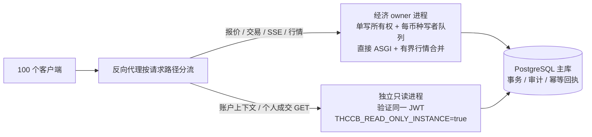

# 100 人、合计 54 笔/秒：FX 整站容量分析

本次在上一轮数据库优化的提交 `75d33eb` 上，验证 100 个普通用户各持有公共、私人两条 SSE，同时集中交易同一 FX 币种的容量。目标是合计 54 笔/秒，不是每人 54 笔/秒。

**本机原型在 54 次/秒的合成负载下通过了 5 分钟验证：16,200 次计划流程中成功 16,111 笔，报价拒绝 89 次（0.55%），没有忙碌跳过，交易 POST P99 为 81 毫秒。** 采用行情合并、直接 ASGI 中间件及账户快照/个人成交 GET 的独立只读进程，60 秒同条件完成吞吐从 24.13 提高到 53.60 笔/秒，约 2.22 倍。

单纯减少写事务中的 SQL，不能解决 HTTP、SSE、报价、页面刷新与写者竞争同一个 Python 事件循环的问题。这里提供可运行的隔离原型和实际测量；生产入口、部署配置与数据库 schema 没有改动。**owner 仍使用约 96% 单核 CPU，本机通过目标负载不代表已有生产容量余量。**

## 目标及测试口径

- 100 个普通用户、200 条真实 HTTP SSE 长连接，同一活跃币种。
- 固定到达 54 次交易流程/秒；每个用户约每 1.85 秒轮到一次。HTTP 报价后实际提交，交易后保留账户上下文、市场快照、个人成交记录、图表刷新及版本轮询。**这是保守的合成负载，不是逐行复刻当前前端**：当前 `Fx.vue` 的普通净交易主要用 `tradingSession.previewFx` 本地报价，HTTP 净报价主要用于特殊减仓回退；本工具沿用 `fx_http.py`，每笔额外执行一次服务端报价。报价版本冲突是该合成场景的失败，不应直接宣称为普通前端同等比例的交易失败。
- 角色为 60% 现货、20% 融资、20% 做空，包含跨零和全额回补。每次买入预算 10–50 金币，初始每人 10,000 金币，池中两币各 10,000,000，手续费为 0，保留默认每日 1% 借贷利率。
- 每轮全新 PostgreSQL 16.15 测试库，真实 Alembic 升级和应用生命周期、写者、后台调度器；`fsync=on`、`synchronous_commit=on`。
- Python 3.13.16，SQLAlchemy 2.0.45，FastAPI 0.127.0，Starlette 0.50.0，Uvicorn 0.40.0；没有另外安装 uvloop、httptools、orjson。环境及脚本摘要见 [environment.json](environment.json)。
- HTTP 使用 Unix socket，客户端、应用、PostgreSQL 是独立进程，运行于同一台 i7-14700 / WSL2 主机。没有 TLS、反向代理、跨机网络；没有把该结果换算成普通云主机或低 CPU 配额的保证。
- 验收按交易 POST P99 < 2 秒、计划交易流程失败比例 < 1%、没有忙碌跳过、200 条 SSE 保持连接评估。窗口结束后的排空独立记录，不计入“窗口内完成/s”。报价返回 HTTP 200 但 `executable=false` 也算业务流程失败。
- 预热、角色准备不计入测量。短程 pilot 用于检查工具，正式比较采用相同 60 秒窗口，最终方案另做 300 秒持续验证。
- 初始对照发现客户端连接池混杂因素后作废：旧客户端把 SSE 和短请求混在同一池，分流 GET 时同时减轻了 httpx 的连接池扫描负担。最终所有方案均使用相同的三个池（SSE、普通请求、两个 GET），只有 GET 的服务端 socket 随方案改变；另记录客户端 CPU 和到达计划延误。旧数据保存在 [initial-client-pools](initial-client-pools/README.md)，不作为最终收益依据。

## 四组方案

| 方案 | 与上一组相比的变化 | 数据库查询语义 |
|---|---|---|
| `current` | 上一轮已经优化 SQL 的现有应用 | 原样 |
| `cadence8` | 公共行情与私人 pricing 更新最多约 8 Hz，沿用现有合并队列与完整 pool event 增量 | 降低可替代行情的读取频率，不改交易查询 |
| `asgi_cadence8` | 日志/写权限中间件改为直接 ASGI 转发，保留写权限门、日志、API no-store 头 | 交易与页面读取原样 |
| `split_reads` | 增加 `THCCB_READ_ONLY_INSTANCE=true` 进程，分担 `GET /api/v1/user/trading-context` 与 `GET /api/v1/fx/pairs/{id}/my-trades` | 不删这两种读取，换进程执行；仍读同一 PostgreSQL 主库 |

`split_reads` 中报价、全部资金写入、账户通知、订单结果、公共和私人 SSE、行情历史仍在经济 owner。没有绕过 owner 校验、取消事务锁、提高数据库并发上限或关闭持久化。只读进程走项目原有的只读启动流程，不启动第二个经济写者。

## 正式测量

完整数值由 [summarize.py](summarize.py) 从每轮 JSON 生成到 [comparison.json](comparison.json)。表中成功数包含排空，吞吐列仅计算固定测量窗口内收到的成功交易响应。

| 方案 | 时长 | 计划 / 提交 / 成功（含排空） | 窗口内成功/s | 交易 POST P99 | 未完成计划 | 采样队列最大值 | owner CPU |
|---|---:|---:|---:|---:|---:|---:|---:|
| 当前已做 SQL 优化版本 | 60s | 3240 / 1527 / 1527 | 24.13 | 3940ms | 52.87% | 96 | 102.3% |
| + 行情合并至 8 Hz | 60s | 3240 / 2290 / 2290 | 37.37 | 2166ms | 29.32% | 95 | 101.5% |
| + 直接 ASGI 中间件 | 60s | 3240 / 2749 / 2749 | 45.07 | 1854ms | 15.15% | 90 | 102.3% |
| + 两类 GET 独立只读进程 | 60s | 3240 / 3216 / 3216 | 53.60 | 79ms | 0.74% | 4 | 95.6% |
| 同一分进程方案持续验证 | 300s | 16200 / 16111 / 16111 | 53.70 | 81ms | 0.55% | 4 | 96.4% |

“未完成计划”包括报价拒绝和用户仍忙导致的跳过，不能只看交易 POST 的 HTTP 错误率：各轮已经提交的交易都成功了，但前三组分别跳过 1665、873、372 次计划流程，无法维持目标负载。后两组没有跳过，剩余 24 / 89 次失败均为 HTTP 报价返回 `version_conflict`，没有伪装成成功或自动重试。队列数字为每秒采样观察到的最大值，不是连续监测的绝对峰值。

300 秒组中，完整流程 P99 为 **108.76ms**，确认交易在首个公共订阅者中的可见性 P99 为 **173.45ms**，全部已确认成交均能对应到公共 pool event，200 条 SSE 在测量结束时仍连接。owner / 只读进程 CPU 分别约 **96.4% / 41.0%**；客户端约 **29.4%**，到达计划延误 P99 为 **4.14ms**。统一客户端后五组客户端 CPU 为 28%–39%、计划延误 P99 为 3.6–4.5ms，未再出现初始对照的客户端饱和干扰。

writer handler 的 P50 从约 **38.12ms** 降到 **8.50ms**，P99 从 **135.02ms** 降到 **19.39ms**，说明原有等待包含共享事件循环的竞争。数据库连接池采样期间的 checkout 峰值从 22 降到 owner 10，未通过扩大池来换吞吐。

应用侧 SQL 执行总数反而从约 1141 次/秒增加到 owner 1819 + reader 625 ≈ 2444 次/秒，因为完成了更多交易。以采样总 SQL 除以完成吞吐，约为 47 与 46 次/笔，包含报价、页面读取和后台工作，仅作近似诊断。**完成能力翻倍的主要解释不是每笔 SQL 数量减半，而是减少扇出/中间件调度成本，再用不同进程执行读取。**

以上是每方案一次 60 秒对照，加最终方案一次 300 秒验证；没有用单轮结果推断精确的最大吞吐或微小百分比差异。三项技术的边际收益依赖叠加顺序，不应机械相加。

## 为什么收益与上一轮不同

上一轮 [数据库分层报告](../fx-writer-db-review-20261018/report.md) 测的是直接提交写者，不包含 HTTP/SSE。减少 SQL 查询的收益约为 0%–10%；叠加静态参数化 SQL、复用已锁定用户后的总收益约为 1%–18%。该结果不能直接当成整站吞吐。

本轮从同一已优化版本出发，对比的是完整交易页面产生的工作。单进程有两个放大因素：

1. 每笔交易改变行情，通知向 100 个公共订阅和 100 个私人 pricing 订阅扩散。代码已经复用编码后的字节，但每个连接仍需事件循环调度、队列收发和 ASGI 发送。若每笔都产生两种行情帧，54 笔/秒可对应约 10,800 次连接投递/秒；实际次数要以现有合并队列的实测为准。8 Hz 把两种可替代行情的计划扇出压到约 1,600 次/秒，账户和订单事件另外发送。
2. `@app.middleware("http")` 生成的 `BaseHTTPMiddleware` 会让流式响应经过任务组和内存消息通道；忽略 SSE 的日志输出并不会取消这些转发。直接 ASGI 包装只在 `http.response.start` 处理头部和日志，后续数据块直接送出。最后再把交易后两类高频 GET 移到第二个进程，写者不再等待它们在同一解释器中执行。已核对本地安装的 0.50.0 源码。[Starlette 0.50.0 BaseHTTPMiddleware](https://github.com/Kludex/starlette/blob/0.50.0/starlette/middleware/base.py)、[直接 ASGI 中间件文档](https://starlette.dev/middleware/#pure-asgi-middleware)

这是对事件循环工作量、扇出频率和进程职责的调整。`split_reads` 仍执行账户和成交历史查询，甚至只读进程需要从数据库读取价格状态；它的收益不应归类为“继续少查几条 SQL”。Python 官方文档明确说明同一事件循环中的任务不能同时执行 Python 回调；CPU 工作会延迟同线程其他任务。[Python asyncio 开发说明](https://docs.python.org/3.13/library/asyncio-dev.html#concurrency-and-multithreading)

## 可以落地的进程边界



第一阶段可以沿用已有只读实例能力，避免引入第二个资金写者。生产化需要把原型的 ASGI 实现移入正式中间件，以共享 JWT 配置启动只读服务，并在反向代理中只分流上述 GET；不是直接把同一 owner 应用启动成多个 Uvicorn worker。

目前 `REGISTRY`、私人事件总线、FX 写者、行情 runtime 都含进程内状态；普通多 worker 会触发全局经济所有权冲突，或者读不到另一进程的提交通知。只读服务与 owner 的 pricing epoch 不同，跨实例读与 SSE 的版本修复仍需验收。此次负载保留版本轮询和修复请求，没有假装共享 registry。

原型中的公共发布延时包在现有单发布 worker 上，适合本次单热点币种实验；生产实现应使用按币种记录 dirty 状态和下次截止时间的调度，避免一个币种的等待阻塞别的币种。私人账户和订单事件保持有序即时发送。公共 pool event 增量不能按“只保留最新价格”一起丢弃；超过现有事件缓冲时必须明确失效并按游标恢复历史。

## 更进一步的改造顺序

| 改造 | 解决的剩余问题 | 本次证据及成本 |
|---|---|---|
| 直接 ASGI + 行情按固定频率合并 + 两个 GET 分进程 | 写者与 SSE、页面读取争抢同核 | 已有运行原型与同条件实测；落地成本最低的系统改造候选 |
| 提交回执/账户增量驱动页面，减少成功交易后的全量刷新 | 每笔都重新取账户、快照和最近 50 笔历史 | 可继续减少请求与 ORM 构建；尚未实测，需正确处理经济版本、重放回执、费用、利息、跨零、其他标签页及断线恢复。不能直接把现有报价字段当成提交后的完整账户快照 |
| 只读报价使用一致的账户与市场快照 | 高负载下报价因 `version_conflict` 拒绝 | 本次将这些拒绝计入失败；需要独立的只读快照语义，执行时仍在 owner 锁内重新核验，不能为了成功率去掉版本校验 |
| 写者独立为命令进程，SSE/读模型独立服务 | 在更大在线人数、更多行情和后台任务下保护写入延迟 | 下一阶段主要扩展方向。需明确命令身份、排队期限、提交后 ACK、幂等查询、owner 失效和重启恢复；本次未实施完整命令 RPC |
| 提交事务内 outbox + 按游标消费的行情/账户投影 | 跨进程通知丢失、断线重放、SSE 横向扩展 | 涉及 schema、事件生命周期及恢复协议；不是把内存队列换成 Redis 就完成。现有 `fx_pool_event` 可作为行情来源，私人资金事件另行定义 |

PostgreSQL `NOTIFY` 可用作“有新游标”的唤醒提示，其交付发生在事务提交后；它不应充当完整、永久的资金事件日志。消费者仍需从持久化 outbox/事件表按游标恢复。[PostgreSQL 16 NOTIFY](https://www.postgresql.org/docs/16/sql-notify.html)

不建议把本轮重点放到群组提交：上一轮诊断中 commit 仅占 handler 约 7.5%–11.3%，即使把这部分全消掉，吞吐上限也只提高约 8%–13%。实际批量提交还会增加等待、失败隔离和回执语义的复杂度。`commit_delay` 本身就是以延迟换取合并 WAL flush 的机制，收益依赖磁盘和并发条件。[PostgreSQL 16 WAL 配置](https://www.postgresql.org/docs/16/wal-configuration.html)

54 笔/秒要求同币种串行写者的平均服务时间小于 $1/54 \approx 18.52$ 毫秒；若按 70% 利用率预留余量，应争取小于约 12.96 毫秒，或约 77 笔/秒的独立服务能力。端到端仍必须同时有报价、读取、SSE 的 CPU 预算。一次 54 笔/秒测试通过，不代表已有足够容量余量。

## 完整性与限制

每个正式完成轮次保存事务成交腿与 `fx_pool_event` 数量，核对含国库、借贷利息的金币净额和外币实物守恒，精确到六位小数，五轮全部通过。不能把利息导致的账户净值变化误判为账务不平；初期 pilot 的两项原始差值没有加利息/国库，正式校验字段为 `gold_with_treasury_and_interest_delta` 与 `foreign_with_treasury_delta`。

公共流目前使用 pool event ID，旧压测工具只识别 trade ID。此次补充 event ID 的接收记录，在停服后通过数据库的 `trade_id → pool_event.id` 关系核对已确认交易在首个公共订阅者中的可见性。该观察不等价于逐条验证全部 100 个订阅者的网络交付；其他连接的存活与总帧数另有记录。

这些结果验证本机、单热点币种、较短历史、给定交易规模的负载能力，不包括弱云主机、TLS、代理缓冲、广域网、庞大历史/多市场资产组合、真实机器人成交与清算并发、完整崩溃恢复测试。下一轮生产验收应在目标机器做至少 30 分钟持续压力、短时突发、SSE 断线重连和 owner 重启，并核对数据库与审计。

## 行为验证与交付状态

- 将现有测试套在实验性 ASGI / 行情合并实现上，**67 项通过**，覆盖私人 SSE 的鉴权、账户隔离、订单结果、封禁/规则重检、只读写入门禁、历史缓存及压测驱动；没有另建一套重复业务断言。[验证脚本](validate_prototype.py)、[日志](validation-prototype.log)
- 使用正式 300 秒实验的 PostgreSQL 库启动真实只读生命周期：验证经济 owner 为 false、FX writer 未启动、合法账户上下文 GET 为 200、匿名请求为 401、交易 POST 被 503 拒绝、API 缓存头正确，前后余额和审计计数不变。[验证脚本](validate_readonly.py)、[日志](validation-readonly.log)
- 脚本语法检查、git diff 空白检查通过。此前提交的业务代码没有在本轮再改动；上一轮完整后端验证记录见原数据库报告。
- 原型与测试工具在 `loadtest/`，正式应用仍使用原入口。部署化还需要正式中间件、支持多币种的发布调度和代理分流配置，以及上述目标机器验收；本报告不宣称已经完成生产部署。
- 分支为 `ralph/2026-10-18-fx-writer-db`。上一轮优化及验证已提交为 `259204f` / `75d33eb`；实际尝试向原仓库推送时，GitHub 返回 `Permission to renko6626/touhouccb.git denied to HEoCarnot` / HTTP 403。推送需要有写权限的账号，或用户确认 fork 去向。

## 复现

使用已授权的 `touhouccb` 环境；先启动独立 PostgreSQL Unix socket 实例。脚本只接受本地 socket 和新的 `fxcapacity_*_test` 数据库名，重名会失败，不覆盖或删除已有数据库。

```bash
/home/tonrac/miniforge3/envs/touhouccb/bin/python loadtest/fx_capacity.py run \
  --database fxcapacity_example_test --variant split_reads --rate 54 --seconds 300 \
  --output output/fx-capacity-example

/home/tonrac/miniforge3/envs/touhouccb/bin/python output/fx-capacity-54-20261018/summarize.py
```

`current`、`cadence8`、`asgi_cadence8`、`split_reads` 是四个可选方案。临时 JWT 仅保存在权限为 0700 的临时目录内，不进入报告或 git；应用通过 Unix socket 服务，不开放防火墙端口。运行结束自动停止本轮应用进程，测试库保留便于只读复查。

较大的原始 JSONL 和事件对应记录以 `.gz` 无损压缩，`summarize.py` 同时支持原始文件与压缩文件。压缩前后摘要保存在 `archive-sha256.json`；正式测量用脚本的摘要保存在 `environment.json`。校验和覆盖数据文件，不包含临时 JWT。
