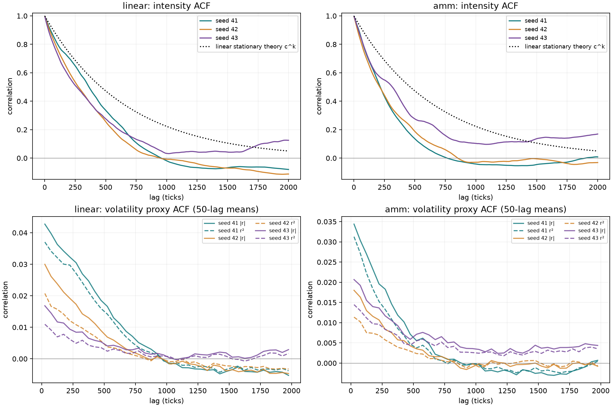
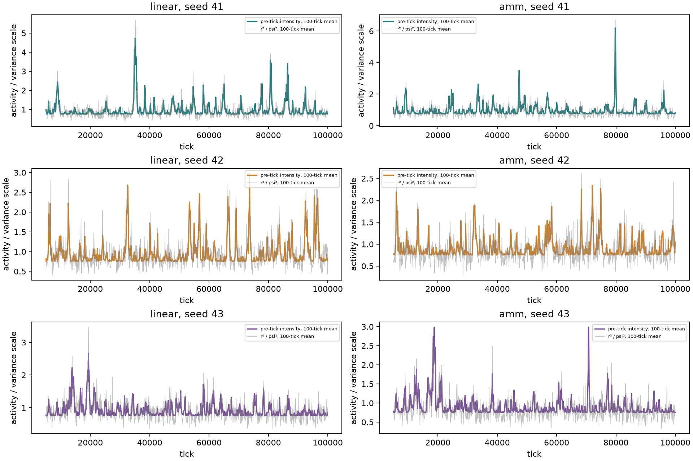

# 活动反馈第一轮：线性参照与有限钱包 AMM

2026-10-15。按第五轮讨论独立实现，固定参数跑完四格×三个种子，共12条10万tick路径。归档M/R未恢复，线上市场未改动。

本地结果：AMM反馈组三个种子的101–300、301–1000段绝对/平方收益相关，以及下一100/240块关系均为正。平方收益301–1000段跨种子均值，线性为0.00514，AMM为0.00311（两组实现值之比60.6%）。这是各自内生路径的描述性比较，不能据此把差额全部归因于钱包：AMM曲率、池深和反馈路径也一并改变了。

这说明该反馈在此次AMM设置下保留了有限尺度的波动持续性。它不代表全部市场典型事实已经复现，也没有证明严格幂律长记忆。三种子不足以作显著性或稳健性结论；本轮没有调参或新设通过门槛。

## 1. 实验设置与复算

| 设置 | 固定取值 |
| --- | --- |
| 环境与反馈 | linear/amm，各b=0及0.25 |
| 长度与预热 | 每条100000tick；去除tick1–5000，分析tick5001–100000，共95000收益 |
| 种子 | 41、42、43；每格单独运行 |
| 状态 | z初值0；tau=1000，a=exp(−1/tau) |
| 强度与尺度 | 目标平均总到达1/tick；psi=0.0004，固定不拟合 |
| 账户与钱包 | 20账户；AMM每户金币5000、外币1000；线性无钱包 |
| AMM | 恒定乘积池，初始金币1000000、外币200000，初价5；费率0 |
| 订单 | 独立标准高斯epsilon；AMM外币意向q=40epsilon；单笔按成交时池外币储备的0.005限额，再按钱包裁剪与6位量化 |
| 机制限制 | 无目标库存、M/R身份、分数选择、额外价格噪声、补钱、持仓重置、强制成交或活动强度上限 |

从仓库根目录运行（已有NumPy/SciPy/Matplotlib环境）：

```bash
OPENBLAS_NUM_THREADS=1 python -m research.fx.activity.run --workers 3
MPLCONFIGDIR=/tmp/fx-matplotlib OPENBLAS_NUM_THREADS=1 python -m research.fx.activity.report
python -m unittest discover -s research/fx/tests -v
```

输入为[reference.json](../../configs/reference.json)，代码为[model.py](../../model.py)、[run.py](../../run.py)、[report.py](../../report.py)，复用[common](../../../common/README.md)。每条路径保存series.npz、result.json（含参数、钱包、来源SHA256、完整诊断）；[metrics.csv](metrics.csv)提供种子级指标，[validation.json](validation.json)提供全长旧对照一致性证据。JSON中未定义相关为null，CSV空单元格/本文“不适用”同义，不替成0。

## 2. 模型、时序与理论边界

每个tick t先记录已知的z_t与Lambda_t=(1−b)×1+b z_t²，再由20个账户各抽Poisson(Lambda_t/20)，重复到达分别计数，事件顺序打乱；每次由该账户独立mark流抽epsilon~N(0,1)。线性环境r_t=psi×sum(epsilon)；AMM环境依次以当前池、当前钱包真实报价成交，收盘r_t=ln(P_t/P_(t−1))。最后更新z_(t+1)=a z_t+sqrt(1−a²)r_t/psi。数组index0是初始化哨兵，不进入任何统计；z_pre[t]、intensity[t]均在returns[t]之前决定。

各账户到达流种子为seed×1000003+i×101+1，mark流为+2，事件洗牌用Python Random(seed×1000003+4)。b=0时两种环境到达与原始需求完全配对；b>0的实际反馈会让事件次数及后续mark消费分叉，同编号种子不意味着动态组逐点配对。

线性条件均值0，精确条件二阶矩W_t=psi² Lambda_t。在线性平稳且四阶矩存在时，E[z²]=1，E[Lambda]=1，强度ACF=c^k，c=a²+b(1−a²)。b=0强度常数，强度/W相关均不适用；z仍可递推但不再改变到达率。

当前b=0.25时c=0.998501499000，理论e倍衰减时间666.83tick；q4=a^4+6a²(1−a²)b+3(1−a²)²b²=0.998999751831<1。解四阶递推得到E[z^4]=8.994013、Var(Lambda)=0.499626。这些是平稳总体值，不能要求有限样本精确等于它们，也不能用“已有理论”掩盖经验偏差。

AMM中上述均值、ACF及方向鞅结论不再获得解析保证。本文仍记录psi²Lambda作为参考W；另记期初池深近似W_depth=(2×40/F_pre)²Lambda，只作诊断，不进入反馈更新或重新归一化。这两个W都不是AMM精确条件二阶矩。常数池深/无裁剪近似无法替代真实执行。

该离散模型取自讨论稿的具体定义；文献背景是Blanc、Donier、Bouchaud的[Quadratic Hawkes processes for financial prices](https://arxiv.org/abs/1509.07710)，不能称为其连续时间模型原样复现。讨论稿所附sandbox脚本不在工作区，外部数值仅作独立参考，本地随机流与外部不同，不声称逐点复现。

## 3. 指标定义与口径

- 收益：AMM为相邻tick收盘对数价格差（数值上用ln价格比），线性为复合Poisson高斯和；包含无到达及未成交产生的零收益。
- ACF：对95000样本先全样本去均值，FFT计算各lag乘积和，除以lag0乘积和；不作N/(N−lag)修正。段值为各整数lag ACF的简单均值；最大方向ACF取lag1–1000绝对值最大值。完整曲线保留至5000。
- 波动代理：|r|及r²；W参考与Lambda为固定正比例，二者ACF及块相关相同。代理的噪声与内生反馈决定相关幅度，不能把Lambda、|r|、r²统一0.01当成通用物理门槛。
- 块关系：预热后从头分成不重叠块，分别取块内平均期初Lambda与平均r²；同块用同编号块，下一块用Lambda块j对应r²块j+1做Pearson相关。30/100/240/1000tick分别有3166/950/395/95完整块、3165/949/394/94个下一块配对，尾部不足一块舍弃。下一块相关不等于当期预测的无偏检验，也不是置信区间。
- 分布：标准差ddof=1；偏度及Fisher超额峰度用SciPy bias=False，正态超额峰度0；非零收益单独保存。高峰度也可能来自稀疏到达，不能单独证明波动聚集。
- 状态矩：平均Lambda及z²、z⁴均为样本直接平均；Var(Lambda)为样本去均值平方和除以N（ddof=0）；r²/W比值为两者样本平均值之比，不是逐tick比值平均。
- 聚合：不重叠的1/5/30/60/240/1000tick收益求和再算分布；尾部舍弃。DFA1/2对去均值后累积profile，在固定16–8192尺度双端分块去趋势，保存32–256、512–8192、2048–8192区间拟合。重叠端段不作独立样本；有限区间斜率不作严格长记忆证据。
- 执行：到达包含未成交；raw_demand为q的有符号和，raw_abs_demand为绝对值和；actual_flow为钱包外币净增加，executed_abs_quantity逐笔取绝对值后相加；金币成交额为买入金币输入+卖出金币输出。裁剪含部分和完全未执行，以少执行超过2e−6外币区分常规量化；skipped为无成交，余额边界为该方向事件发生前钱包对应余额为0。
- 下表所有诊断与执行比例采用去预热后的95000tick；summary的到达/成交总数、总金币额覆盖全部100000tick；钱包为最终余额。跨种子均值对三个种子等权，方括号为最小/最大值，均非置信区间。

## 4. 四格核心结果

各格为跨种子均值 [最小, 最大]。


| 环境 / b | r ACF1 | \|r\| 101–300 | \|r\| 301–1000 | r² 101–300 | r² 301–1000 |
| --- | --- | --- | --- | --- | --- |
| linear / 0 | -0.00277 [-0.00381, -0.00104] | -0.00013 [-0.00041, 0.00021] | -0.00013 [-0.00044, 0.00004] | -0.00008 [-0.00032, 0.00028] | -0.00014 [-0.00041, 0.00002] |
| linear / 0.25 | 0.00279 [-0.00044, 0.00508] | 0.02129 [0.01021, 0.03331] | 0.00683 [0.00383, 0.01152] | 0.01646 [0.00646, 0.02974] | 0.00514 [0.00251, 0.00970] |
| amm / 0 | -0.00289 [-0.00333, -0.00203] | 0.00004 [-0.00018, 0.00039] | -0.00009 [-0.00038, 0.00009] | 0.00006 [-0.00015, 0.00047] | -0.00006 [-0.00029, 0.00005] |
| amm / 0.25 | 0.00108 [-0.00495, 0.00667] | 0.01554 [0.01089, 0.02203] | 0.00443 [0.00231, 0.00630] | 0.01129 [0.00689, 0.01728] | 0.00311 [0.00156, 0.00469] |


| 环境 / b | Lambda 301–1000 | 下一100块 | 下一240块 | 下一1000块 | 超额峰度 |
| --- | --- | --- | --- | --- | --- |
| linear / 0 | 不适用 | 不适用 | 不适用 | 不适用 | 3.02336 [2.98605, 3.07969] |
| linear / 0.25 | 0.19614 [0.16209, 0.22272] | 0.68543 [0.57112, 0.78481] | 0.64949 [0.54532, 0.75008] | 0.17836 [0.04990, 0.25903] | 3.62435 [3.52865, 3.80978] |
| amm / 0 | 不适用 | 不适用 | 不适用 | 不适用 | 3.09642 [3.05787, 3.17225] |
| amm / 0.25 | 0.14450 [0.08049, 0.23524] | 0.63764 [0.57063, 0.71292] | 0.53339 [0.50105, 0.59649] | 0.17022 [0.03734, 0.37863] | 3.57978 [3.53444, 3.65043] |


种子级关键结果如下；不要用均值遮盖小相关和不同衰减速度。


| 环境 / b / seed | r ACF1 | max \|r ACF\| | \|r\| 301–1000 | r² 301–1000 | 下一100 | 下一240 | 下一1000 | 超额峰度 |
| --- | --- | --- | --- | --- | --- | --- | --- | --- |
| amm / 0 / 41 | -0.00333 | 0.01119 | -0.00038 | -0.00029 | 不适用 | 不适用 | 不适用 | 3.0579 |
| amm / 0 / 42 | -0.00329 | 0.01049 | 0.00002 | 0.00005 | 不适用 | 不适用 | 不适用 | 3.1722 |
| amm / 0 / 43 | -0.00203 | 0.01023 | 0.00009 | 0.00005 | 不适用 | 不适用 | 不适用 | 3.0591 |
| amm / 0.25 / 41 | 0.00667 | 0.00984 | 0.00468 | 0.00309 | 0.71292 | 0.50105 | 0.03734 | 3.5545 |
| amm / 0.25 / 42 | -0.00495 | 0.01162 | 0.00231 | 0.00156 | 0.57063 | 0.50264 | 0.09470 | 3.5344 |
| amm / 0.25 / 43 | 0.00151 | 0.01314 | 0.00630 | 0.00469 | 0.62937 | 0.59649 | 0.37863 | 3.6504 |
| linear / 0 / 41 | -0.00345 | 0.01149 | -0.00044 | -0.00041 | 不适用 | 不适用 | 不适用 | 2.9860 |
| linear / 0 / 42 | -0.00381 | 0.01019 | 0.00002 | 0.00002 | 不适用 | 不适用 | 不适用 | 3.0797 |
| linear / 0 / 43 | -0.00104 | 0.01004 | 0.00004 | -0.00003 | 不适用 | 不适用 | 不适用 | 3.0043 |
| linear / 0.25 / 41 | 0.00374 | 0.01228 | 0.01152 | 0.00970 | 0.78481 | 0.75008 | 0.22616 | 3.8098 |
| linear / 0.25 / 42 | -0.00044 | 0.01225 | 0.00514 | 0.00322 | 0.70035 | 0.65306 | 0.04990 | 3.5346 |
| linear / 0.25 / 43 | 0.00508 | 0.01361 | 0.00383 | 0.00251 | 0.57112 | 0.54532 | 0.25903 | 3.5287 |


## 5. 活动理论与经验矩

线性反馈组的经验强度均值及方差低于理论平稳值，强度ACF也未普遍贴合c^k。三个种子、每条10万tick不足以验证高阶矩收敛；尤其Var(Lambda)依赖z四阶矩，容易受少数高活动段影响。目前只能报告偏差，不能证明偏差仅由有限样本造成，或据此宣称理论数值已验证。条件矩递推已用独立手算例子检查，线性经验r²/参考W则接近1。

AMM中的r²/参考W约小于1，但这是总体平均比值，不是逐状态校准；也不能直接把下降解释为钱包因果效应。若后续要验证总体矩，应另作更长独立路径的预先规划，当前不据此改参数。


| 环境 / b / seed | 平均Lambda | Var Lambda | 均值z² | 均值z⁴ | 实际到达/tick | 最大Lambda | r²/参考W | r²/池深W |
| --- | --- | --- | --- | --- | --- | --- | --- | --- |
| amm / 0 / 41 | 1.00000 | 0.00000 | 0.92089 | 2.43663 | 1.00769 | 1.000 | 0.96510 | 0.96272 |
| amm / 0 / 42 | 1.00000 | 0.00000 | 0.70460 | 1.70960 | 1.00780 | 1.000 | 0.98185 | 0.98174 |
| amm / 0 / 43 | 1.00000 | 0.00000 | 0.62834 | 1.11976 | 0.99740 | 1.000 | 0.95501 | 0.96344 |
| amm / 0.25 / 41 | 0.97198 | 0.17333 | 0.88793 | 3.56170 | 0.97607 | 10.929 | 0.96201 | 0.95864 |
| amm / 0.25 / 42 | 0.91242 | 0.05893 | 0.64968 | 1.36500 | 0.92007 | 3.346 | 0.96743 | 0.96575 |
| amm / 0.25 / 43 | 0.90332 | 0.06856 | 0.61329 | 1.47316 | 0.90294 | 3.687 | 0.95650 | 0.96338 |
| linear / 0 / 41 | 1.00000 | 0.00000 | 0.96403 | 2.70301 | 1.00769 | 1.000 | 0.99301 | 不适用 |
| linear / 0 / 42 | 1.00000 | 0.00000 | 0.89150 | 2.63803 | 1.00780 | 1.000 | 1.01599 | 不适用 |
| linear / 0 / 43 | 1.00000 | 0.00000 | 0.69920 | 1.26628 | 0.99740 | 1.000 | 0.99365 | 不适用 |
| linear / 0.25 / 41 | 0.97633 | 0.20466 | 0.90533 | 4.09419 | 0.98175 | 7.058 | 1.00348 | 不适用 |
| linear / 0.25 / 42 | 0.95981 | 0.11415 | 0.83923 | 2.53065 | 0.96666 | 3.891 | 1.00754 | 不适用 |
| linear / 0.25 / 43 | 0.91153 | 0.05443 | 0.64610 | 1.28828 | 0.90888 | 3.648 | 0.99879 | 不适用 |




上排虚线是线性平稳理论，右侧仅作参照，不是AMM理论；下排为50lag均值，完整曲线在各result.json。



两条线均以100tick不重叠块平均展示，不表示逐tick条件方差已校准。

## 6. 全部区间、跨块关系、分布与DFA


### 方向收益ACF

| 环境 / b / seed | 1–1 | 2–10 | 11–30 | 31–100 | 101–300 | 301–1000 | 1001–5000 |
| --- | --- | --- | --- | --- | --- | --- | --- |
| amm / 0 / 41 | -0.00333 | -0.00087 | 0.00006 | 0.00034 | -0.00015 | 0.00015 | -0.00015 |
| amm / 0 / 42 | -0.00329 | -0.00091 | 0.00005 | 0.00055 | -0.00041 | -0.00024 | 0.00000 |
| amm / 0 / 43 | -0.00203 | -0.00086 | -0.00016 | -0.00064 | -0.00026 | -0.00008 | -0.00000 |
| amm / 0.25 / 41 | 0.00667 | -0.00025 | -0.00108 | 0.00079 | 0.00002 | -0.00003 | -0.00012 |
| amm / 0.25 / 42 | -0.00495 | -0.00017 | 0.00104 | -0.00074 | -0.00005 | -0.00028 | -0.00001 |
| amm / 0.25 / 43 | 0.00151 | -0.00213 | 0.00020 | -0.00052 | -0.00020 | -0.00023 | 0.00002 |
| linear / 0 / 41 | -0.00345 | -0.00051 | 0.00015 | 0.00037 | -0.00020 | 0.00015 | -0.00015 |
| linear / 0 / 42 | -0.00381 | -0.00051 | 0.00064 | 0.00084 | -0.00029 | -0.00020 | -0.00003 |
| linear / 0 / 43 | -0.00104 | -0.00088 | -0.00008 | -0.00064 | -0.00015 | -0.00009 | -0.00001 |
| linear / 0.25 / 41 | 0.00374 | 0.00001 | -0.00043 | -0.00020 | 0.00016 | -0.00003 | -0.00010 |
| linear / 0.25 / 42 | -0.00044 | -0.00086 | -0.00066 | -0.00018 | -0.00024 | -0.00001 | -0.00007 |
| linear / 0.25 / 43 | 0.00508 | -0.00003 | 0.00022 | -0.00058 | -0.00014 | -0.00025 | 0.00003 |


### 绝对收益ACF

| 环境 / b / seed | 1–1 | 2–10 | 11–30 | 31–100 | 101–300 | 301–1000 | 1001–5000 |
| --- | --- | --- | --- | --- | --- | --- | --- |
| amm / 0 / 41 | -0.00141 | 0.00199 | 0.00103 | -0.00018 | 0.00039 | -0.00038 | 0.00004 |
| amm / 0 / 42 | -0.00183 | 0.00022 | 0.00173 | 0.00038 | -0.00009 | 0.00002 | 0.00008 |
| amm / 0 / 43 | -0.00246 | 0.00169 | 0.00034 | 0.00004 | -0.00018 | 0.00009 | -0.00004 |
| amm / 0.25 / 41 | 0.03508 | 0.03678 | 0.03524 | 0.03096 | 0.02203 | 0.00468 | -0.00110 |
| amm / 0.25 / 42 | 0.02115 | 0.01932 | 0.01853 | 0.01645 | 0.01089 | 0.00231 | -0.00034 |
| amm / 0.25 / 43 | 0.02304 | 0.01968 | 0.02052 | 0.01977 | 0.01370 | 0.00630 | 0.00166 |
| linear / 0 / 41 | -0.00188 | 0.00147 | 0.00092 | -0.00046 | 0.00021 | -0.00044 | -0.00003 |
| linear / 0 / 42 | -0.00150 | 0.00017 | 0.00144 | 0.00038 | -0.00019 | 0.00002 | 0.00007 |
| linear / 0 / 43 | -0.00278 | 0.00144 | -0.00014 | -0.00019 | -0.00041 | 0.00004 | -0.00002 |
| linear / 0.25 / 41 | 0.03963 | 0.04424 | 0.04385 | 0.04012 | 0.03331 | 0.01152 | -0.00217 |
| linear / 0.25 / 42 | 0.03245 | 0.03283 | 0.02943 | 0.02698 | 0.02035 | 0.00514 | -0.00048 |
| linear / 0.25 / 43 | 0.01235 | 0.01675 | 0.01729 | 0.01510 | 0.01021 | 0.00383 | 0.00163 |


### 平方收益ACF

| 环境 / b / seed | 1–1 | 2–10 | 11–30 | 31–100 | 101–300 | 301–1000 | 1001–5000 |
| --- | --- | --- | --- | --- | --- | --- | --- |
| amm / 0 / 41 | -0.00274 | 0.00187 | 0.00169 | 0.00027 | 0.00047 | -0.00029 | 0.00008 |
| amm / 0 / 42 | -0.00187 | -0.00043 | 0.00169 | 0.00051 | -0.00015 | 0.00005 | 0.00009 |
| amm / 0 / 43 | 0.00012 | 0.00105 | -0.00059 | 0.00029 | -0.00014 | 0.00005 | -0.00003 |
| amm / 0.25 / 41 | 0.02909 | 0.03225 | 0.03223 | 0.02799 | 0.01728 | 0.00309 | -0.00088 |
| amm / 0.25 / 42 | 0.01201 | 0.01125 | 0.01256 | 0.01022 | 0.00689 | 0.00156 | -0.00013 |
| amm / 0.25 / 43 | 0.01809 | 0.01311 | 0.01443 | 0.01354 | 0.00971 | 0.00469 | 0.00120 |
| linear / 0 / 41 | -0.00384 | 0.00123 | 0.00170 | -0.00005 | 0.00028 | -0.00041 | -0.00004 |
| linear / 0 / 42 | -0.00217 | -0.00005 | 0.00142 | 0.00061 | -0.00021 | 0.00002 | 0.00006 |
| linear / 0 / 43 | -0.00016 | 0.00064 | -0.00092 | 0.00006 | -0.00032 | -0.00003 | -0.00002 |
| linear / 0.25 / 41 | 0.04485 | 0.03880 | 0.03690 | 0.03465 | 0.02974 | 0.00970 | -0.00185 |
| linear / 0.25 / 42 | 0.02418 | 0.02302 | 0.02038 | 0.01757 | 0.01319 | 0.00322 | -0.00020 |
| linear / 0.25 / 43 | 0.01173 | 0.01119 | 0.01120 | 0.00954 | 0.00646 | 0.00251 | 0.00094 |


### 活动强度ACF

| 环境 / b / seed | 1–1 | 2–10 | 11–30 | 31–100 | 101–300 | 301–1000 | 1001–5000 |
| --- | --- | --- | --- | --- | --- | --- | --- |
| amm / 0 / 41 | 不适用 | 不适用 | 不适用 | 不适用 | 不适用 | 不适用 | 不适用 |
| amm / 0 / 42 | 不适用 | 不适用 | 不适用 | 不适用 | 不适用 | 不适用 | 不适用 |
| amm / 0 / 43 | 不适用 | 不适用 | 不适用 | 不适用 | 不适用 | 不适用 | 不适用 |
| amm / 0.25 / 41 | 0.99784 | 0.98530 | 0.94782 | 0.82946 | 0.53517 | 0.08049 | -0.02844 |
| amm / 0.25 / 42 | 0.99662 | 0.97988 | 0.93119 | 0.79727 | 0.52288 | 0.11775 | -0.00395 |
| amm / 0.25 / 43 | 0.99714 | 0.98310 | 0.94468 | 0.82861 | 0.59867 | 0.23524 | 0.07030 |
| linear / 0 / 41 | 不适用 | 不适用 | 不适用 | 不适用 | 不适用 | 不适用 | 不适用 |
| linear / 0 / 42 | 不适用 | 不适用 | 不适用 | 不适用 | 不适用 | 不适用 | 不适用 |
| linear / 0 / 43 | 不适用 | 不适用 | 不适用 | 不适用 | 不适用 | 不适用 | 不适用 |
| linear / 0.25 / 41 | 0.99787 | 0.98723 | 0.95525 | 0.86905 | 0.69851 | 0.22272 | -0.03992 |
| linear / 0.25 / 42 | 0.99722 | 0.98373 | 0.94703 | 0.84607 | 0.61111 | 0.16209 | -0.00798 |
| linear / 0.25 / 43 | 0.99630 | 0.97799 | 0.93011 | 0.81494 | 0.58072 | 0.20362 | 0.06881 |


### Lambda与r²的同块关系

| 环境 / b / seed | 30 | 100 | 240 | 1000 |
| --- | --- | --- | --- | --- |
| amm / 0 / 41 | 不适用 | 不适用 | 不适用 | 不适用 |
| amm / 0 / 42 | 不适用 | 不适用 | 不适用 | 不适用 |
| amm / 0 / 43 | 不适用 | 不适用 | 不适用 | 不适用 |
| amm / 0.25 / 41 | 0.70190 | 0.86353 | 0.92931 | 0.96444 |
| amm / 0.25 / 42 | 0.51936 | 0.72262 | 0.84818 | 0.90009 |
| amm / 0.25 / 43 | 0.55355 | 0.76123 | 0.86243 | 0.94804 |
| linear / 0 / 41 | 不适用 | 不适用 | 不适用 | 不适用 |
| linear / 0 / 42 | 不适用 | 不适用 | 不适用 | 不适用 |
| linear / 0 / 43 | 不适用 | 不适用 | 不适用 | 不适用 |
| linear / 0.25 / 41 | 0.73921 | 0.88975 | 0.95031 | 0.97688 |
| linear / 0.25 / 42 | 0.63508 | 0.82941 | 0.90738 | 0.96124 |
| linear / 0.25 / 43 | 0.51053 | 0.71783 | 0.82899 | 0.92421 |


### Lambda与r²的下一块关系

| 环境 / b / seed | 30 | 100 | 240 | 1000 |
| --- | --- | --- | --- | --- |
| amm / 0 / 41 | 不适用 | 不适用 | 不适用 | 不适用 |
| amm / 0 / 42 | 不适用 | 不适用 | 不适用 | 不适用 |
| amm / 0 / 43 | 不适用 | 不适用 | 不适用 | 不适用 |
| amm / 0.25 / 41 | 0.66015 | 0.71292 | 0.50105 | 0.03734 |
| amm / 0.25 / 42 | 0.47055 | 0.57063 | 0.50264 | 0.09470 |
| amm / 0.25 / 43 | 0.52705 | 0.62937 | 0.59649 | 0.37863 |
| linear / 0 / 41 | 不适用 | 不适用 | 不适用 | 不适用 |
| linear / 0 / 42 | 不适用 | 不适用 | 不适用 | 不适用 |
| linear / 0 / 43 | 不适用 | 不适用 | 不适用 | 不适用 |
| linear / 0.25 / 41 | 0.69317 | 0.78481 | 0.75008 | 0.22616 |
| linear / 0.25 / 42 | 0.59643 | 0.70035 | 0.65306 | 0.04990 |
| linear / 0.25 / 43 | 0.47734 | 0.57112 | 0.54532 | 0.25903 |


### 收益分布

| 环境 / b / seed | 均值 | 标准差 | 零收益占比 | 偏度 | 超额峰度 |
| --- | --- | --- | --- | --- | --- |
| amm / 0 / 41 | -0.00000044 | 0.00039296 | 36.8842% | -0.0189 | 3.0579 |
| amm / 0 / 42 | -0.00000013 | 0.00039636 | 37.1905% | -0.0078 | 3.1722 |
| amm / 0 / 43 | -0.00000040 | 0.00039090 | 37.3684% | 0.0276 | 3.0591 |
| amm / 0.25 / 41 | -0.00000061 | 0.00038679 | 39.9947% | -0.0039 | 3.5545 |
| amm / 0.25 / 42 | 0.00000006 | 0.00037581 | 41.1811% | -0.0306 | 3.5344 |
| amm / 0.25 / 43 | -0.00000023 | 0.00037181 | 42.0526% | -0.0261 | 3.6504 |
| linear / 0 / 41 | -0.00000022 | 0.00039860 | 36.3495% | -0.0104 | 2.9860 |
| linear / 0 / 42 | 0.00000079 | 0.00040319 | 36.6684% | -0.0004 | 3.0797 |
| linear / 0 / 43 | -0.00000049 | 0.00039873 | 36.8305% | 0.0260 | 3.0043 |
| linear / 0.25 / 41 | -0.00000034 | 0.00039593 | 40.0884% | 0.0070 | 3.8098 |
| linear / 0.25 / 42 | 0.00000082 | 0.00039335 | 39.7379% | 0.0040 | 3.5346 |
| linear / 0.25 / 43 | -0.00000019 | 0.00038167 | 41.4053% | 0.0096 | 3.5287 |


### 聚合收益超额峰度

| 环境 / b / seed | 1 | 5 | 30 | 60 | 240 | 1000 |
| --- | --- | --- | --- | --- | --- | --- |
| amm / 0 / 41 | 3.0579 | 0.6434 | 0.1656 | -0.0055 | -0.1228 | -0.4101 |
| amm / 0 / 42 | 3.1722 | 0.5289 | -0.0714 | 0.0837 | -0.2091 | 0.2569 |
| amm / 0 / 43 | 3.0591 | 0.5812 | 0.0094 | 0.0448 | -0.3355 | 0.0950 |
| amm / 0.25 / 41 | 3.5545 | 1.3268 | 1.1726 | 1.9487 | -0.0202 | 1.3625 |
| amm / 0.25 / 42 | 3.5344 | 0.8560 | 0.4492 | 0.3068 | -0.0975 | 0.8148 |
| amm / 0.25 / 43 | 3.6504 | 0.8828 | 0.2190 | 0.2150 | 0.7373 | 0.4075 |
| linear / 0 / 41 | 2.9860 | 0.6161 | 0.1181 | 0.0021 | -0.0209 | -0.3363 |
| linear / 0 / 42 | 3.0797 | 0.4916 | -0.0612 | 0.1610 | -0.2108 | 0.2961 |
| linear / 0 / 43 | 3.0043 | 0.5758 | 0.0407 | 0.0919 | -0.3367 | -0.0544 |
| linear / 0.25 / 41 | 3.8098 | 1.2715 | 0.7208 | 0.4758 | 0.4404 | 1.5603 |
| linear / 0.25 / 42 | 3.5346 | 0.9625 | 0.5548 | 0.4212 | 1.3082 | 0.0675 |
| linear / 0.25 / 43 | 3.5287 | 0.9001 | 0.5023 | 0.2821 | -0.0397 | 0.4347 |


### 方向收益DFA拟合斜率

| 环境 / b / seed | DFA1 32-256 | DFA1 512-8192 | DFA1 2048-8192 | DFA2 32-256 | DFA2 512-8192 | DFA2 2048-8192 |
| --- | --- | --- | --- | --- | --- | --- |
| amm / 0 / 41 | 0.4911 | 0.5417 | 0.6210 | 0.4957 | 0.5221 | 0.5878 |
| amm / 0 / 42 | 0.5048 | 0.4286 | 0.4014 | 0.4977 | 0.4547 | 0.4037 |
| amm / 0 / 43 | 0.4966 | 0.4051 | 0.3310 | 0.4973 | 0.4399 | 0.4039 |
| amm / 0.25 / 41 | 0.4941 | 0.5186 | 0.5018 | 0.4891 | 0.5403 | 0.5708 |
| amm / 0.25 / 42 | 0.5077 | 0.4614 | 0.4437 | 0.5047 | 0.4592 | 0.4202 |
| amm / 0.25 / 43 | 0.4966 | 0.4340 | 0.4185 | 0.5021 | 0.4382 | 0.3678 |
| linear / 0 / 41 | 0.4938 | 0.5362 | 0.6461 | 0.4973 | 0.5061 | 0.5624 |
| linear / 0 / 42 | 0.5086 | 0.4692 | 0.4595 | 0.4988 | 0.4823 | 0.4519 |
| linear / 0 / 43 | 0.4953 | 0.4305 | 0.3950 | 0.4978 | 0.4510 | 0.4184 |
| linear / 0.25 / 41 | 0.4957 | 0.5559 | 0.5200 | 0.4988 | 0.5418 | 0.5863 |
| linear / 0.25 / 42 | 0.4890 | 0.5125 | 0.5547 | 0.4964 | 0.4970 | 0.5334 |
| linear / 0.25 / 43 | 0.4995 | 0.4385 | 0.3479 | 0.5075 | 0.4586 | 0.3688 |


### 绝对收益DFA拟合斜率

| 环境 / b / seed | DFA1 32-256 | DFA1 512-8192 | DFA1 2048-8192 | DFA2 32-256 | DFA2 512-8192 | DFA2 2048-8192 |
| --- | --- | --- | --- | --- | --- | --- |
| amm / 0 / 41 | 0.5127 | 0.4782 | 0.4179 | 0.5164 | 0.5092 | 0.4247 |
| amm / 0 / 42 | 0.5131 | 0.4749 | 0.4215 | 0.5079 | 0.4943 | 0.4682 |
| amm / 0 / 43 | 0.5097 | 0.5116 | 0.5414 | 0.5065 | 0.4989 | 0.5444 |
| amm / 0.25 / 41 | 0.5734 | 0.9026 | 0.7359 | 0.5262 | 0.9940 | 0.8162 |
| amm / 0.25 / 42 | 0.5520 | 0.8408 | 0.7030 | 0.5240 | 0.8932 | 0.8540 |
| amm / 0.25 / 43 | 0.5420 | 0.9037 | 0.8587 | 0.4979 | 0.8703 | 0.8180 |
| linear / 0 / 41 | 0.5141 | 0.4706 | 0.4113 | 0.5163 | 0.4990 | 0.4256 |
| linear / 0 / 42 | 0.5139 | 0.4660 | 0.3817 | 0.5070 | 0.4916 | 0.4751 |
| linear / 0 / 43 | 0.5064 | 0.4672 | 0.4601 | 0.5051 | 0.4764 | 0.5078 |
| linear / 0.25 / 41 | 0.5570 | 1.0437 | 0.8134 | 0.5278 | 1.1387 | 1.0707 |
| linear / 0.25 / 42 | 0.5697 | 0.9080 | 0.6972 | 0.5371 | 1.0170 | 0.9167 |
| linear / 0.25 / 43 | 0.5413 | 0.7933 | 0.6742 | 0.5132 | 0.8523 | 0.7294 |


## 7. AMM执行与资金约束

以下为去预热口径；部分裁剪及完全跳过均计入裁剪比例。它们没有使所有成交中止，但实际高斯意向分布已被改变。没有额外加入资金或跨账户转账。所有AMM路径期末池+钱包金币精确等于1100000、外币精确等于220000；成交逻辑在每笔交易检查余额，最终钱包非负。


| 环境 / b / seed | 到达 | 成交 | 裁剪比例 | 跳过 | 买入时零现金 | 卖出时零外币 | 实际/意向绝对量 | 金币成交额 |
| --- | --- | --- | --- | --- | --- | --- | --- | --- |
| amm / 0 / 41 | 95731 | 94437 | 2.733% | 1294 | 657 | 637 | 97.639% | 14909438.12 |
| amm / 0 / 42 | 95741 | 94376 | 2.822% | 1365 | 767 | 598 | 97.506% | 14919324.15 |
| amm / 0 / 43 | 94753 | 93477 | 2.616% | 1276 | 652 | 624 | 97.714% | 14641845.26 |
| amm / 0.25 / 41 | 92727 | 91479 | 2.728% | 1248 | 649 | 599 | 97.668% | 14461932.96 |
| amm / 0.25 / 42 | 87407 | 86158 | 2.865% | 1249 | 695 | 554 | 97.457% | 13619522.78 |
| amm / 0.25 / 43 | 85779 | 84659 | 2.580% | 1120 | 582 | 538 | 97.749% | 13259285.14 |


固定率AMM组与归档20N的三个种子，在含初始化点的100001个点上，prices/gold/arrivals/raw_demand(旧noise_demand)/trades/gold_volume六字段逐点完全一致；这支持公共成交与时钟兼容，不意味着活动反馈组与旧组逐点可比。详细最终钱包保存在各result.json，原始路径保存在series.npz。

## 8. 判断与下一步边界

本轮接通了“过去价格变化→到达强度→真实成交→后续价格变化”的闭环。在当前参数及三个种子上，AMM保留正的100/240tick下一块关系，长滞后原始收益代理的相关幅度仍小。1000tick下一块关系与1001–5000段应单独看，不能从较短窗口正相关外推。

下一步先讨论要验证的目标：若目标是活动状态的总体矩与理论曲线收敛，需规划更长的线性独立路径；若目标是判断AMM迁移损失的来源，则需要单独设计执行层对照。当前四格只能显示联合迁移后的实现差别，不能区分钱包、池深与曲率各自的贡献。本轮未运行新消融或扫描，也未加风险/参与机制。

当前模型有20个独立随机账户，但共享一个价格历史活动状态。它可研究内生活动反馈，尚不解释独立交易者的策略选择和竞争涌现；也没有独立基本价值输入。旧统一0.01筛查不再用作通用成功定义，外部线性结果不代替本地AMM验收。

## 9. 已完成的验证

`python -m unittest discover -s research/fx/tests -v`：8项通过，覆盖活动更新时序、关闭反馈、独立手算条件矩、跨环境固定率输入、真实执行守恒和已有统计检查。`python -m research.fx.activity.run --workers 3`及报告生成命令均完成。

另对12条保存的全长序列核对了有限值、期初状态递推、到达率与收益公式、95000样本边界和当前来源hash；直接乘积和独立复算lag1/30/301/1000/5000的收益及波动代理ACF，直接分块及Pearson计算核对全部同块/下一块关系。AMM储备/钱包最小值非负、两类资产期末精确守恒，固定率输入跨环境完全相同，common来源与归档兼容版本一致。证据见[validation.json](validation.json)。这些检查验证实现及统计口径，没有验证更长路径下的高阶矩收敛或现实市场适配性。

一次最终只读审阅未发现其余重要缺陷，发现的Markdown表头竖线转义问题已修复；两张图已人工查看。未运行线上或浏览器交互测试，本轮不涉及线上代码。

