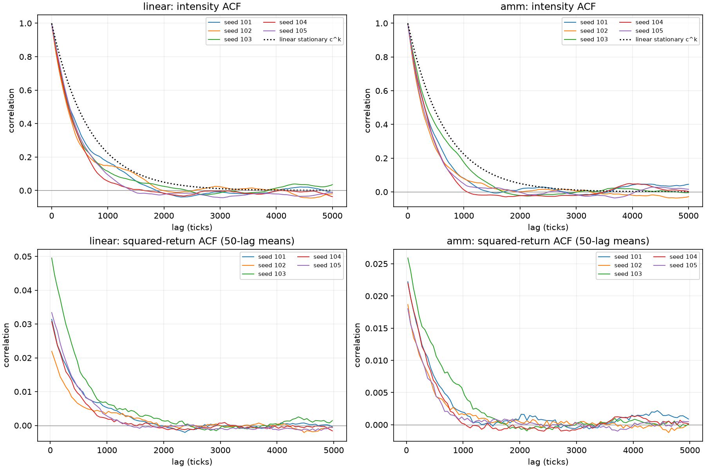
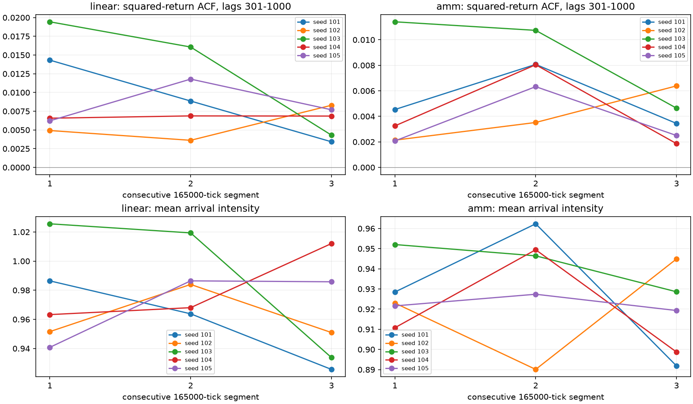

# 活动反馈第二轮：冻结版本的未见种子与长路径验证

2026-10-15。本轮冻结第一版模型，增加五个未见种子101–105，将各路径从10万延长至50万tick；仍为线性/AMM×b=0/0.25四格，共20条路径、1000万模拟tick。所有模型参数与执行规则均保持原值，没有调参、加策略、加活动上限、补钱或重置库存。

在AMM反馈组，完整路径中四项波动相关（绝对/平方收益，101–300及301–1000段）同时为正的种子为 **5/5**；三个连续时段共15个“种子×时段”组合中为 **15/15**。后者共享路径，不能当作15条独立重复或显著性检验。

前、中、后三段的301–1000段平方收益ACF均值分别为0.00468、0.00734、0.00377。末段比中段弱，但下一100tick块相关均值从首段0.652到末段0.657，没有出现所有种子的有限尺度相关在后段共同消失。不能据此承诺永不退化。全程方向收益最大ACF绝对值均值，反馈0.00518、固定率0.00474，仍处于相近量级。

本轮重复性结果支持保留第一版：当前证据已扩展到未见种子与五倍长度。这个结论仍限定于有限尺度活动反馈，不认证严格长记忆、全部现实市场性质或任意长运行的边界。

AMM反馈组在含预热的全部50万tick中，观察到最大预定强度 **11.455次到达/tick**，实际单tick到达峰值 **17**。这些是有限样本峰值，没有构成模型上限。本轮没有预设游戏允许的活动/时延阈值，不能仅凭运行完成认证上线可接受。

## 1. 冻结内容、实验设置与输出

原版来源与首轮结果的SHA256见[frozen-reference.json](../../frozen-reference.json)，执行前后均核对未改。当前新增脚本只调用原run_one/simulate；原model.py、run.py、common和生产报价不改。原[首轮报告](../reference/report.md)保留。

| 设置 | 固定口径 |
| --- | --- |
| 种子与格数 | 新种子101–105；linear/amm，各b=0、.25；20条路径 |
| 长度与预热 | 每条500000tick；删前5000，共495000分析收益 |
| 同路径前缀 | tick5001–100000，95000收益，用来观察原长度统计与长路径差别 |
| 连续三段 | 5001–170000、170001–335000、335001–500000，各165000收益；不重置任何状态 |
| 状态/到达 | z初值0；tau1000；目标总到达1/tick；psi=.0004，固定不拟合 |
| AMM与账户 | 池金币1000000/外币200000；20户各金币5000/外币1000；费用0 |
| 订单与执行 | q=40epsilon，epsilon独立标准高斯；成交时池限额.005、有限钱包裁剪、6位量化，真实恒定乘积报价 |
| 随机流 | 沿用首轮20组独立Poisson/mark流与事件洗牌；b=0跨环境输入完全配对，反馈组内生分叉 |

输入[robustness.json](../../configs/robustness.json)，计划[ROBUSTNESS_PLAN.md](../../ROBUSTNESS_PLAN.md)。从仓库根目录运行：

```bash
OPENBLAS_NUM_THREADS=1 MPLCONFIGDIR=/tmp/fx-matplotlib python -m research.fx.activity.robustness --workers 3
OPENBLAS_NUM_THREADS=1 MPLCONFIGDIR=/tmp/fx-matplotlib python -m research.fx.activity.robustness_report
python -m unittest discover -s research/fx/tests -v
```

完整study.json含每路径/窗口结果，[metrics.csv](metrics.csv)提供100行窗口级指标。每路径保留series.npz、原口径result.json（完整ACF、聚合峰度、DFA及最终钱包）、windows.json。窗口只切保存的原始序列，不重新生成行情。`--analyze-only`可复算已保存路径的窗口汇总，无需再模拟。

## 2. 模型与统计定义

tick t先用期初z_t计算Lambda_t=(1−b)+b z_t²。每户抽Poisson(Lambda_t/20)，打乱事件后抽独立epsilon。线性收益r_t=psi sum(epsilon)；AMM按真实报价成交后r_t=ln(P_t/P_(t−1))。收盘更新z_(t+1)=a z_t+sqrt(1−a²)r_t/psi，a=exp(−1/1000)。无独立基本价值、目标库存或外生波动路径。

收益包含零收益。ACF对所在窗口独立去均值，用各lag乘积和除以lag0乘积和，不作N/(N−lag)修正；段值为全部整数lag的简单均值。方向最大相关为lag1–1000绝对值最大值，不是预测能力或多重检验结论。超额峰度用SciPy bias=False，高斯基准0。

跨块关系比较不重叠块内平均期初Lambda与平均r²；下一块用块j的Lambda对应块j+1的r²。完整窗口495000收益，30/100/240/1000宽度分别有16500/4950/2062/495完整块；三段各165000收益，分别有5500/1650/687/165块；下一块配对再减1，尾部不足一块舍弃。b=0强度常数，强度ACF和块相关未定义，以null/不适用表示。

强度矩为样本平均，方差除以N；99%/99.9%分位取逐tick预定强度的NumPy默认线性插值分位。预定强度与实际到达峰值分开记录。裁剪比例分母为所有到达，含完全跳过；少执行超过2e−6外币计为裁剪，常规量化不计；实际量比例为逐笔绝对执行量之和/逐笔绝对意向量之和。零现金/外币次数按该方向事件前对应钱包余额为0计数；钱包最小值是逐tick收盘账户最小余额的最小值，不是逐笔盘中最小值。

主表均为五个种子等权均值 [最小, 最大]，不是置信区间。没有按统计正负挑种子，没有事后统一通过门槛，也没有把前缀、三段和全程视为相互独立的实验。

## 3. 全长四格对照


| 环境 / b | r ACF1 | max \|r ACF\| | \|r\| 101–300 | \|r\| 301–1000 | r² 101–300 | r² 301–1000 |
| --- | --- | --- | --- | --- | --- | --- |
| linear / 0 | -0.00046 [-0.00103, 0.00013] | 0.00471 [0.00441, 0.00496] | 0.00005 [-0.00006, 0.00014] | -0.00003 [-0.00009, 0.00002] | 0.00003 [-0.00009, 0.00017] | -0.00004 [-0.00007, 0.00002] |
| linear / 0.25 | -0.00011 [-0.00223, 0.00212] | 0.00514 [0.00475, 0.00575] | 0.02641 [0.01989, 0.03577] | 0.01103 [0.00793, 0.01531] | 0.02262 [0.01392, 0.03540] | 0.00895 [0.00569, 0.01404] |
| amm / 0 | -0.00083 [-0.00150, -0.00027] | 0.00474 [0.00440, 0.00497] | 0.00022 [0.00012, 0.00034] | 0.00011 [0.00003, 0.00018] | 0.00022 [0.00014, 0.00035] | 0.00011 [0.00009, 0.00014] |
| amm / 0.25 | -0.00139 [-0.00274, 0.00258] | 0.00518 [0.00467, 0.00609] | 0.01772 [0.01526, 0.02199] | 0.00710 [0.00521, 0.01167] | 0.01440 [0.01171, 0.01811] | 0.00552 [0.00365, 0.00942] |

| 环境 / b | \|r\| 1001–5000 | r² 1001–5000 | 下一100 | 下一240 | 下一1000 |
| --- | --- | --- | --- | --- | --- |
| linear / 0 | -0.00000 [-0.00004, 0.00004] | -0.00000 [-0.00004, 0.00003] | 不适用 | 不适用 | 不适用 |
| linear / 0.25 | 0.00034 [-0.00056, 0.00148] | 0.00020 [-0.00055, 0.00116] | 0.74487 [0.68924, 0.78759] | 0.65853 [0.60566, 0.70357] | 0.31137 [0.22971, 0.39150] |
| amm / 0 | 0.00008 [0.00006, 0.00013] | 0.00010 [0.00006, 0.00014] | 不适用 | 不适用 | 不适用 |
| amm / 0.25 | 0.00039 [0.00001, 0.00095] | 0.00027 [-0.00002, 0.00069] | 0.70110 [0.65788, 0.73470] | 0.63050 [0.58463, 0.67455] | 0.25144 [0.21781, 0.29752] |


### AMM反馈组逐种子

| seed | \|r\| 101–300 | \|r\| 301–1000 | r² 101–300 | r² 301–1000 | r² 1001–5000 | 下一100 | 下一240 | 下一1000 |
| --- | --- | --- | --- | --- | --- | --- | --- | --- |
| 101 | 0.01864 | 0.00745 | 0.01508 | 0.00568 | 0.00069 | 0.70574 | 0.64259 | 0.22258 |
| 102 | 0.01526 | 0.00570 | 0.01171 | 0.00420 | 0.00020 | 0.65788 | 0.58463 | 0.24009 |
| 103 | 0.02199 | 0.01167 | 0.01811 | 0.00942 | 0.00038 | 0.73470 | 0.67455 | 0.29752 |
| 104 | 0.01681 | 0.00546 | 0.01507 | 0.00465 | -0.00002 | 0.71837 | 0.63583 | 0.21781 |
| 105 | 0.01592 | 0.00521 | 0.01202 | 0.00365 | 0.00012 | 0.68882 | 0.61490 | 0.27919 |




理论虚线只对线性平稳强度成立，右上AMM仅作参照。平方收益曲线为50lag均值，完整逐lag曲线在各result.json；不凭图线平滑认证长记忆。

## 4. 同路径延长及前后时段

下表给出AMM反馈组各窗口的五种子均值和范围；前缀是完整路径的一部分，不能将延长前后的差额当作独立重复的处理效应。


| 窗口 | 收益数 | r² 101–300 | r² 301–1000 | r² 1001–5000 | 下一100 | 下一240 | 平均强度 | 裁剪比例 |
| --- | --- | --- | --- | --- | --- | --- | --- | --- |
| prefix100k | 95000 | 0.00863 [0.00335, 0.01226] | 0.00269 [0.00053, 0.00435] | -0.00014 [-0.00070, 0.00038] | 0.60654 [0.49899, 0.68495] | 0.52780 [0.35707, 0.63356] | 0.92382 [0.90047, 0.94213] | 0.02846 [0.02622, 0.03305] |
| third1 | 165000 | 0.01182 [0.00747, 0.02342] | 0.00468 [0.00207, 0.01141] | -0.00007 [-0.00164, 0.00083] | 0.65172 [0.57432, 0.77055] | 0.59147 [0.51937, 0.70750] | 0.92717 [0.91076, 0.95203] | 0.02749 [0.02384, 0.03048] |
| third2 | 165000 | 0.01923 [0.00953, 0.02798] | 0.00734 [0.00352, 0.01074] | 0.00059 [-0.00050, 0.00198] | 0.73169 [0.62860, 0.80335] | 0.64867 [0.57695, 0.69156] | 0.93513 [0.89009, 0.96232] | 0.02950 [0.02619, 0.03229] |
| third3 | 165000 | 0.01082 [0.00641, 0.01725] | 0.00377 [0.00186, 0.00639] | 0.00012 [-0.00057, 0.00091] | 0.65712 [0.58571, 0.71943] | 0.58017 [0.51887, 0.61711] | 0.91666 [0.89182, 0.94489] | 0.02663 [0.02335, 0.02852] |
| full | 495000 | 0.01440 [0.01171, 0.01811] | 0.00552 [0.00365, 0.00942] | 0.00027 [-0.00002, 0.00069] | 0.70110 [0.65788, 0.73470] | 0.63050 [0.58463, 0.67455] | 0.92632 [0.91933, 0.94235] | 0.02788 [0.02671, 0.02892] |


逐种子、逐连续时段如下。负值应保留，不能只看全程平均；15段不是15个独立种子。


| seed | 时段 | r² 101–300 | r² 301–1000 | r² 1001–5000 | 下一100 | 下一240 | 平均强度 | 裁剪比例 |
| --- | --- | --- | --- | --- | --- | --- | --- | --- |
| 101 | third1 | 0.01019 | 0.00453 | 0.00083 | 0.66065 | 0.58342 | 0.92847 | 3.048% |
| 101 | third2 | 0.02281 | 0.00807 | 0.00067 | 0.75332 | 0.66601 | 0.96232 | 2.619% |
| 101 | third3 | 0.01038 | 0.00344 | -0.00000 | 0.65327 | 0.59219 | 0.89182 | 2.335% |
| 102 | third1 | 0.00747 | 0.00213 | 0.00056 | 0.57432 | 0.51937 | 0.92300 | 2.841% |
| 102 | third2 | 0.00953 | 0.00352 | 0.00039 | 0.62860 | 0.57695 | 0.89009 | 3.083% |
| 102 | third3 | 0.01725 | 0.00639 | -0.00057 | 0.71943 | 0.61711 | 0.94489 | 2.558% |
| 103 | third1 | 0.02342 | 0.01141 | -0.00164 | 0.77055 | 0.70750 | 0.95203 | 2.879% |
| 103 | third2 | 0.01805 | 0.01074 | 0.00198 | 0.72682 | 0.63962 | 0.94643 | 2.740% |
| 103 | third3 | 0.01146 | 0.00464 | 0.00091 | 0.68522 | 0.61665 | 0.92859 | 2.852% |
| 104 | third1 | 0.00833 | 0.00325 | 0.00007 | 0.59892 | 0.58699 | 0.91076 | 2.384% |
| 104 | third2 | 0.02798 | 0.00804 | -0.00050 | 0.80335 | 0.69156 | 0.94945 | 3.080% |
| 104 | third3 | 0.00641 | 0.00186 | 0.00034 | 0.58571 | 0.51887 | 0.89871 | 2.721% |
| 105 | third1 | 0.00969 | 0.00207 | -0.00019 | 0.65417 | 0.56008 | 0.92159 | 2.594% |
| 105 | third2 | 0.01778 | 0.00633 | 0.00043 | 0.74636 | 0.66922 | 0.92738 | 3.229% |
| 105 | third3 | 0.00861 | 0.00250 | -0.00005 | 0.64198 | 0.55603 | 0.91929 | 2.852% |




各段没有重置市场。短于总体记忆/尾部收敛所需的有限窗口可能表现不同；不能仅由一次下降断言永久退化，也不能用“有限样本”排除真实退化可能。

## 5. 运行边界与钱包

以下为完整分析窗口。活动峰值不是上限，钱包触零不等于全账户永久停机；后续反向交易可以改变余额。最终钱包和精确资产总额保留在每条result.json。


| 环境 / b / seed | 平均强度 | 强度99% | 强度99.9% | 强度峰值 | 实际到达峰值 | 裁剪比例 | 实际/意向绝对量 | 买入前零现金 | 卖出前零外币 |
| --- | --- | --- | --- | --- | --- | --- | --- | --- | --- |
| amm / 0 / 101 | 1.00000 | 1.000 | 1.000 | 1.000 | 9 | 2.675% | 97.620% | 3140 | 3439 |
| amm / 0 / 102 | 1.00000 | 1.000 | 1.000 | 1.000 | 8 | 2.844% | 97.471% | 3304 | 3767 |
| amm / 0 / 103 | 1.00000 | 1.000 | 1.000 | 1.000 | 8 | 2.807% | 97.525% | 3190 | 3660 |
| amm / 0 / 104 | 1.00000 | 1.000 | 1.000 | 1.000 | 8 | 2.766% | 97.554% | 3727 | 3078 |
| amm / 0 / 105 | 1.00000 | 1.000 | 1.000 | 1.000 | 8 | 2.885% | 97.438% | 3846 | 3273 |
| amm / 0.25 / 101 | 0.92754 | 2.340 | 4.116 | 6.535 | 13 | 2.671% | 97.624% | 2891 | 3166 |
| amm / 0.25 / 102 | 0.91933 | 2.173 | 4.117 | 6.580 | 13 | 2.821% | 97.486% | 3031 | 3457 |
| amm / 0.25 / 103 | 0.94235 | 2.486 | 4.705 | 7.722 | 13 | 2.824% | 97.510% | 3013 | 3486 |
| amm / 0.25 / 104 | 0.91964 | 2.179 | 4.816 | 11.455 | 17 | 2.733% | 97.578% | 3318 | 2870 |
| amm / 0.25 / 105 | 0.92275 | 2.271 | 3.713 | 6.157 | 11 | 2.892% | 97.429% | 3546 | 3029 |


没有提供单tick可处理事件数、延迟预算或允许裁剪比例，因此此处只给观察范围。它不构成自动增加上限或资金恢复机制的授权。

## 6. 高阶矩补充与经验偏差

令d=1−a²、u=z²、lambda0=1−b。给定u，S=sum(epsilon)满足E[S²]=Lambda，E[S⁴]=3(Lambda+Lambda²)，E[S⁶]=15(Lambda+3Lambda²+Lambda³)。所以六阶下一期条件矩多项式是

E[z_next⁶|z]=a⁶u³+15a⁴d u²Lambda+45a²d²u(Lambda+Lambda²)+15d³(Lambda+3Lambda²+Lambda³)，Lambda=lambda0+b u。

用独立Polynomial展开核对最高次系数，与直接公式q6=a⁶+15a⁴db+45a²d²b²+15d³b³一致。当前参数结果：


q6=1.001491765855>1，低次项C4=0.0224998747064、C2=0.00023552194512、C0=3.42097338568e-07均正。因此，若理想线性模型存在平稳分布，该分布不能有有限六阶矩。四阶系数仍q4≈0.9989997518<1，对应E[z⁴]≈8.994、Var(Lambda)≈0.499626，二者并不矛盾。


以线性平稳强度理论ACF c^k计算，原95000样本均值方差换算的N_eff近似为71.232；保留有限N权重的值为71.736。这只是平均强度的方差等效量，不是全部指标通用样本量，也不是实测AMM有效样本量。


有限六阶矩不存在意味着不能套用温和高阶矩下的收敛直觉，不能解释为每条路径爆炸。估计强度方差依赖z四阶矩，估计该统计量的不确定性又涉及更高阶矩；罕见活动片段可能影响很大。它为经验偏差提供理论背景，但不能证明全部偏差已由有限样本解释，更不能将发散结论直接套到有限钱包AMM。

全长经验状态矩如下，五种子均值 [最小, 最大]。不要为逼近理论值而调参。


| 环境 / b | 平均Lambda | Var Lambda | 收益超额峰度 |
| --- | --- | --- | --- |
| linear / 0 | 1.00000 [1.00000, 1.00000] | 0.00000 [0.00000, 0.00000] | 3.01711 [2.99031, 3.04656] |
| linear / 0.25 | 0.97316 [0.95862, 0.99291] | 0.18875 [0.12099, 0.30175] | 3.65655 [3.47186, 3.90625] |
| amm / 0 | 1.00000 [1.00000, 1.00000] | 0.00000 [0.00000, 0.00000] | 3.07915 [3.05190, 3.10085] |
| amm / 0.25 | 0.92632 [0.91933, 0.94235] | 0.10859 [0.09304, 0.13544] | 3.69439 [3.63045, 3.78677] |


## 7. 验证与结论边界

20条路径均完成全长有限值、状态递推、期初强度、收益公式与来源hash核对。10条AMM路径的池+钱包金币精确为1100000、外币为220000；保存的逐tick收盘钱包最小值非负。五个固定率种子的到达与原始需求在两环境逐点完全一致。冻结的原来源/首轮结果执行前后hash一致。分段来自原始数组，覆盖495000收益，无缺口或重叠。另以直接乘积和核对20条路径lag1/301/1000/5000平方收益ACF，以独立分块及Pearson计算核对全程和每个三分段的全部下一块相关。含预热运行峰值单独记录。已有8项单元检查通过，证据见[validation.json](validation.json)。

本轮检验的是同参数在未见种子与更长时间上的重复性及观察运行边界。没有额外做钱包/曲率/池深因果消融，没有引入策略竞争；尾部幂律、杠杆效应、真实成交量与波动的独立检验仍不在范围内。方向ACF小不等于不可套利；正波动相关不等于交易收益；有限尺度DFA高不等于严格长记忆。

是否保留第一版，应据本轮完整路径、分段变化与运行边界共同判断；即便出现更高活动峰值，也不能自动改写原模型。报告没有把首轮“60.6%”当作钱包的因果削弱比例，也没有用旧统一0.01阈值否定或认证全部现象。

