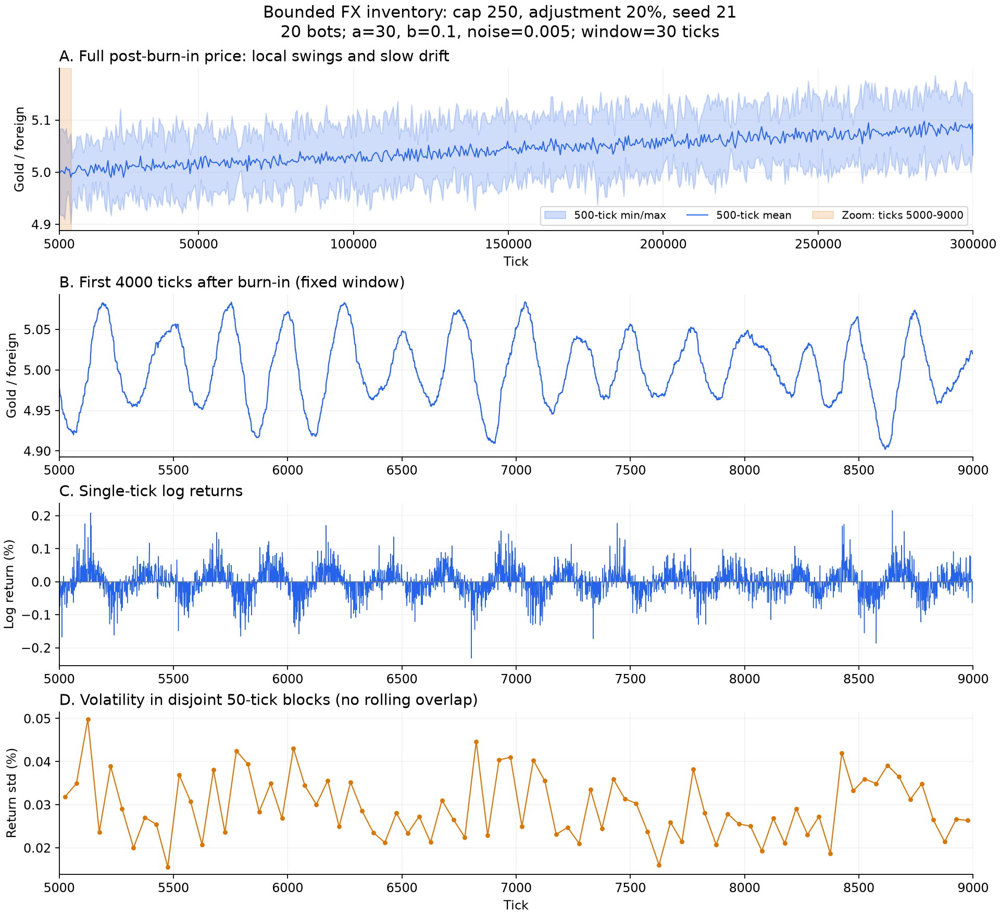
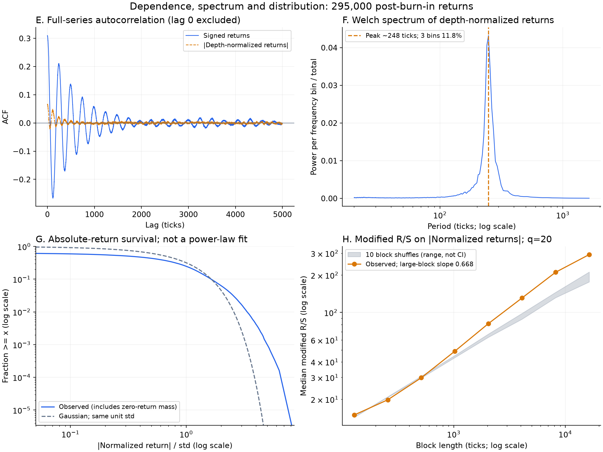

# 典型有界持仓序列：周期、尖峰与波动持续性

固定选择Q=250、alpha=0.2候选的seed21，没有挑选最大R/S种子。参数：20机器人，rate=0.05/tick，a=30，b=0.1，sigma=0.005，窗口30tick，初始汇率5。运行30万tick，前5000tick作预热，统计剩余295000个单tick收益。

[源运行](../../results/position-grid-confirmation/971b40e3667f012a/result.json)、[原始序列](../../results/position-grid-confirmation/971b40e3667f012a/series.npz)、[参数与指标摘要](summary.json)。源文件SHA256记录在摘要中。本次读取旧数据，没有重新模拟或修改算法。

## 行情图怎么读



A展示完整预热后行情：每500tick取均价和最高/最低包络，保留所有极值；价格中心随时间缓慢上移。它与往返震荡属于不同时间尺度，不能用全程最高/最低区间代替单轮振幅。

B固定抽取预热后最初4000tick，即5000～9000。价格4.90186～5.08410，这段最高相对最低约3.72%。每轮强弱不同，但仍能辨认反复上涨、下跌。

C为同一时间段的单tick对数收益乘100，单位%；D为不重叠50tick块的样本标准差。块标准差约0.01555%～0.04981%，有强弱交替；没有使用重叠滚动窗口来人为延长相邻观测的记忆。B/C/D对齐；A使用全程时间轴。

[抽取CSV](zoom.csv)含4001个价格点、4000个收益、每tick实际成交数、本币成交量和本币池深。tick t的收益为ln(P_t/P_(t-1))。抽取首行没有区间内前一个价格，因此收益栏为空值NaN，不补成零。

## 周期能持续多久



E是完整295000个收益的ACF，去掉必为1的零滞后。带符号收益周期性正负交替；绝对归一化收益相关较弱。F对池深归一化收益计算Welch谱，主峰约248tick，邻近三个频率格占总非零频谱功率11.82%。离散谱读数不等于精确且固定的周期。

各周期附近的正相关峰如下。峰的取法：在k*248±35tick范围内取收益ACF最大值；属于描述，不提供统计置信区间。

| 第几轮 | 正峰滞后tick | 收益ACF |
| ---: | ---: | ---: |
| 1 | 241 | 0.211 |
| 2 | 496 | 0.138 |
| 3 | 744 | 0.093 |
| 4 | 979 | 0.059 |
| 6 | 1480 | 0.030 |
| 8 | 1964 | 0.010 |

这表明约四轮后相关明显减弱，八轮后只剩较小相关，远期相位并不牢固。整个30万tick序列仍有稳定谱峰，另外两个种子也出现约248～256tick峰：局部相位记忆有限，产生这一节奏的机制持续存在。暂未进行分段谱稳定性检验，不能声称每一段都有相同周期。

模型内平均每人到达间隔20tick、历史窗口30tick、恒定目标下期望调仓误差衰减尺度100tick，行情主周期约248tick。共同窗口和共同参数的趋势反馈可能形成集体振荡；降低趋势系数或调仓速度的网格对照会明显削弱周期，支持这个解释，但没有记录每tick目标与实际净持仓，尚不能逐笔验证该因果链。

## 与真实股票市场相似到什么程度

G对比绝对归一化收益与同标准差高斯的生存概率，分母包含全部观测；零收益占36.75%。超额峰度约3.70，说明本序列更尖、更易出现大跳动，但并不能证明幂律。既有连续iid Pareto检验p≈0.035，所选尾部仅跨0.286个数量级，幂律证据不足。

H展示绝对归一化收益的q20修正R/S及10次60tick块打乱范围；大块斜率0.668，打乱斜率0.525～0.561。存在超出短块内结构的有限尺度持续性线索；灰带为此次打乱结果的范围，不是置信区间，斜率也不是已经验证的Hurst指数。

与真实股市相似的部分是非高斯尖峰与波动强弱变化。主要差异是本模型带符号收益的一阶相关0.309，高于绝对收益的一阶相关0.065，而且正负周期摆动很清楚。对Dow30实际交易数据的现代研究发现，收益方向相关通常很快减弱，绝对收益相关更持久；这是当前模型没有很好再现的关系。[Ratliff-Crain等，2024预印本，4.1与4.4节](https://arxiv.org/html/2311.07738v2)

实际市场也存在日内波动的季节性，需要在研究持续性时加以区分；这类波动强弱的规律并不自动意味着价格每隔固定时长完成一次上涨与下跌。[Andersen与Bollerslev，1997](https://public.econ.duke.edu/~boller/Published_Papers/joef_97.pdf)

因此目前适合描述为：带噪声、振幅变化的集体周期震荡，附带尚待解释的波动持续性。不能据此说已经复现真实股市。tick还未标定现实时间；只有给定tick长度后，才能把248tick换算成分钟或小时，不能直接称为现实意义上的短线周期。

## 复算与检查

```bash
python -m research.fx.inspect_position_case
python -m compileall -q research/fx/inspect_position_case.py
```

价格图与统计图均提供PNG和SVG。核对了抽取的价格、收益、成交量与计数，样本标准差、超额峰度和一阶ACF与源诊断一致，并查看了导出的图像。没有新增模拟、目标持仓记录或现实市场实证校准。
