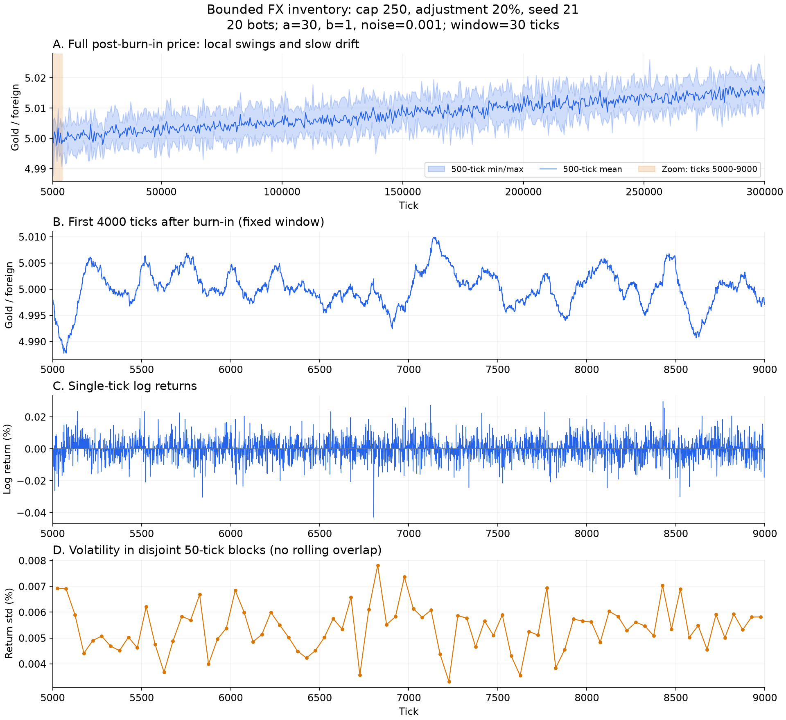
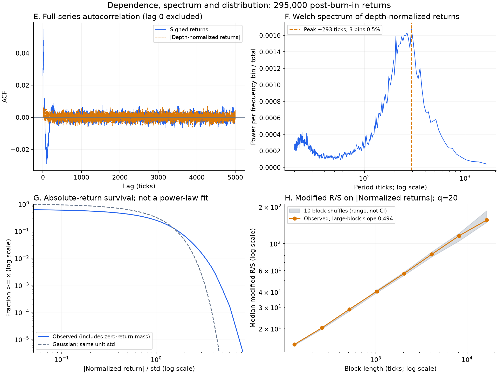

# 单轮对照：增强回归、降低噪声

2026-10-14。按用户要求单独调整此前Q250候选，不扩展成新网格。回归系数b从0.1提高到1，噪声sigma从0.005降到0.001；趋势a30、窗口30、20机器人、到达率0.05、持仓上限250外币、调仓20%、初始池和费用均保持原配置。seed21跑30万tick，预热5000tick；与原序列的逐tick泊松到达完全相同。

[配置](../../configs/position-strong-reversion-single.json)、[本轮结果](../../results/position-strong-reversion-single/229fb18da041f105/result.json)、[原序列分析](../position-cap250-seed21/README.md)、[本轮摘要](summary.json)。

## 实际结果

| 指标 | 原b0.1、sigma0.005 | 新b1、sigma0.001 |
| --- | ---: | ---: |
| 完整价格区间max/min-1 | 5.779% | 0.769% |
| 单tick对数收益标准差 | 0.03290% | 0.00549% |
| 收益ACF(1) | 0.309 | 0.026 |
| 归一化绝对收益ACF(1) | 0.0645 | -0.0009 |
| 归一化绝对收益ACF(100～1000)均值 | 0.00326 | 0.00000454 |
| q20大块R/S斜率 | 0.668 | 0.494 |
| 10次块打乱斜率范围 | 0.525～0.561 | 0.479～0.528 |
| 归一化超额峰度 | 3.696 | 3.315 |
| 本币成交总额 | 3433万 | 637万 |

价格最低4.98776、最高5.02611。新序列仍有宽的谱峰约293tick，但三个邻近频率格占比降至0.466%，原序列为11.82%；谱峰本身不提供显著性或周期存在的二元判断。此前强周期、明显超出打乱对照的R/S现象被这两项调整明显削弱，波动聚集没有更清楚。

## 三因子实际量级

统计所有预热后机器人更新，因子已经乘上对应系数。占比定义为单个因子方差除以三因子方差之和，不含协方差，不是预期总方差或价格贡献的分解。

| 因子 | 原标准差 | 新标准差 | 原方差归一化占比 | 新占比 |
| --- | ---: | ---: | ---: | ---: |
| 趋势 | 0.005471 | 0.0004168 | 54.40% | 14.18% |
| 均值回归 | 0.0002830 | 0.0002254 | 0.15% | 4.15% |
| 噪声 | 0.005001 | 0.001000 | 45.45% | 81.67% |

提交订单时为14.14%/4.14%/81.73%，结论相同。

噪声的绝对输入降低了5倍，但趋势信号下降约13倍；b提高10倍后，实际回归信号的标准差仍略降，说明基础均价偏离缩小约12.6倍。回归属于负反馈，偏离被压小时，它的观测幅度本身也变小；不能把“回归方差占比必须很高”作为回归生效的条件。

这轮提示：直接增强回归、降低噪声，能够把原来的集体震荡推向较弱反馈的行情，但不会自动得到更显著的波动聚集。随机输入驱动价格，价格又反馈到趋势和回归，三个因子不是独立且外生的强度旋钮。两项参数同时改变，本轮不能独立识别各自作用，也没有检查多种子重复性。

仍有约3.3的超额峰度和36.75%的零收益，但没有观察到原来那样的波动持续性。连续iid Pareto自举200次p≈0.060，拟合尾部跨度约0.305个数量级，不能解释为稳定幂律。

## 图表与复算





第一张图A为完整预热后行情的500tick均价与极值包络，B/C/D抽取同一固定5000～9000tick区间。两轮图使用各自纵轴尺度，比较绝对幅度应阅读坐标与上表。第二张图使用完整295000个收益；绘图及统计定义见原序列说明。

```bash
python -m research.fx.experiments --config research/fx/configs/position-strong-reversion-single.json --output research/fx/results/position-strong-reversion-single --workers 1 --bootstrap 200 --shuffles 10
python -m research.fx.inspect_position_case --source research/fx/results/position-strong-reversion-single/229fb18da041f105 --output research/fx/figures/position-strong-reversion-seed21
```

运行正常退出、零拒单、净持仓未越过250外币；模拟内核对双币种含手续费守恒。复核300001个正且有限价格点、原新到达序列相同、独立重算的样本标准差、抽取CSV与源数组一致；查看PNG并完成绘图脚本compileall。没有改交易算法或线上默认值。
