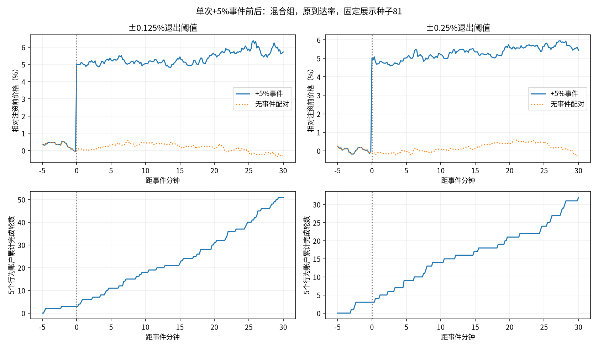

# 单次+5%事件：5～15分钟短线候选的响应

用户明确：目标典型持仓5～15分钟，5%指单次典型大事件涨跌。本轮沿用现有央行注资情形，只验证一次向上+5%的事件，不推断下跌对称性或连续事件效果。

## 设置

15随机＋5行为、移动退出、原到达基准1、tau1000、人口301及行情81/82/83；其余池、钱包、零费用、100外币交易轮与此前相同。比较±.125%候选与±.25%较慢参照，移动启动/回撤各为止盈止损绝对值的一半。正常路径直接复用旧序列。

第1000tick常规成交后，按实际池金圆券储备的5%注入（取六位小数），所以即时价格约上涨5%，每条注入金额稍有不同。六条新路径各8640tick，51840tick；6小时与24小时按前缀统计，含开局、不丢预热。表格等权平均三个种子；5/10/30分钟指事件之后，而非游戏开局。

## 事件后动作

|阈值|事件后分钟|冲击时原有持仓数|原有持仓完成退出数|新入场轮数|全部完成轮数|其中事件后新建且已完成轮数|
|---|---:|---:|---:|---:|---:|---:|
|±0.125%|5|2.33|2.33|15.33|14.00|11.67|
|±0.125%|10|2.33|2.33|26.67|25.67|23.33|
|±0.125%|30|2.33|2.33|61.33|60.33|58.00|
|±0.25%|5|2.33|2.33|12.00|11.67|9.33|
|±0.25%|10|2.33|2.33|20.67|19.00|16.67|
|±0.25%|30|2.33|2.33|40.67|40.00|37.67|

原有持仓上涨止盈卖出或减持后止损买回，新一轮随后按新的真实成本管理。事件期活动增加可以暂时缩短持有；5～15分钟是常态下的典型目标，没有硬性最短/最长持仓。首次退出后继续发生新交易，不能把所有事件后完成轮都当成原有持仓。

## 局末价格与活动

|阈值|局长小时|末30分钟均价仍高于事件前|原始回落|配对回落|三个种子最大预定强度|最大单tick到达数|
|---|---:|---:|---:|---:|---:|---:|
|±0.125%|6|5.79%|-15.7%|-18.8%|8.74|16|
|±0.125%|24|5.85%|-17.0%|-21.9%|8.74|16|
|±0.25%|6|5.68%|-13.6%|-18.1%|8.44|17|
|±0.25%|24|5.73%|-14.5%|-15.1%|8.44|17|

原始回落100%代表回到事件前旧价，配对回落100%代表追上同期无事件价格，两者不同。永久增加池储备后，没有预设旧价吸引力；短线退出不保证恢复旧价。最大值是本次观测，不是硬上限。尚未测实际游戏时延。

## 复现和边界

运行`OPENBLAS_NUM_THREADS=1 OMP_NUM_THREADS=1 python -m research.fx.episodes.rapid.event5`。六条新路径的注资前全部字段与保存控制一致，跳价约5%（误差<1e-11），逐tick资产守恒、钱包非负及每户每tick最多一笔真实成交核对通过；原模拟器内部同时核对成本、残量与钱包。策略与公共代码未改，已有24项研究检查此前通过。

- [事件后动作](actions.csv)、[逐路径响应](responses.csv)、[完整设置及账户结果](summary.json)、[来源与控制哈希](manifest.json)。
