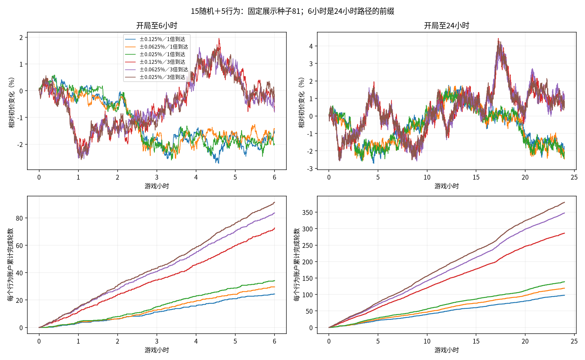
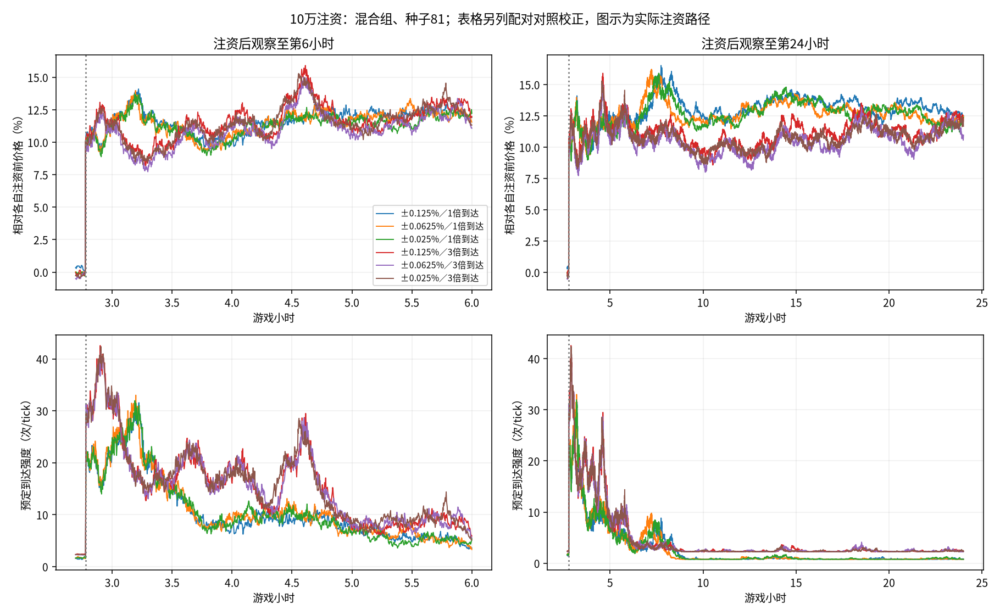

# 更短线的机器人：退出阈值与查看频率探索

在用户要求进一步缩短持仓后，冻结六组更低退出阈值与到达率比较，沿用原有行为代码；旧版本和上一轮五组参数均保留。此处区分持有时间与整轮间隔，完成轮数包括等待下一次入场的影响。

## 设置与口径

1tick为10秒，6小时2160tick、24小时8640tick。20户、池100万金圆券/20万外币、户均5000/1000、零费用、每轮100外币；个人三因子30/30窗口、人口301/spread1、热度tau1000、b=.25保持。仅移动退出版。三种止盈止损绝对阈值为.125%、.0625%、.025%；移动启动和回撤各为其一半。原到达基准1与现有mean_arrivals=3作比较，其他规则不变，见[实验说明](../README.md)和[配置](../config.json)。

提高mean_arrivals会同时提高随机和行为账户的到达机会，并通过价格改变反馈路径；不是单独给行为账户增加监控。Lambda=(1−b)*mean_arrivals+b*z²，因此三倍基准并不保证任意tick的实际到达或成交恰好三倍。仍在到达时观察，退出后最早下tick再入场。

行情81/82/83、20行为及15随机＋5行为，6组共36对/72路径、622080tick。统计从开局开始，不删预热；6小时是24小时的同一路径前缀，不是独立重复。所有表先逐路径计算再平均三个行情种子；已完成持有均值不包含期末未完成的长持仓，二者在原始表分列。并非未见种子验证或人类行为校准。

## 混合组：有多短线

|止盈止损／到达基准|6小时完成轮/户|24小时完成轮/户|24小时已完成轮平均持有分钟|已完成轮中位持有分钟|24小时行为成交占比|
|---|---:|---:|---:|---:|---:|
|±0.125%／1倍到达|24.00|96.20|8.23|6.39|34.5%|
|±0.0625%／1倍到达|27.93|117.73|5.65|4.28|39.2%|
|±0.025%／1倍到达|32.27|133.73|4.52|3.11|42.1%|
|±0.125%／3倍到达|71.87|289.07|2.89|2.28|35.8%|
|±0.0625%／3倍到达|86.67|351.93|2.01|1.44|40.3%|
|±0.025%／3倍到达|96.73|388.27|1.61|1.17|42.8%|

相同tau、相同原到达基准的上一轮参照：±.25%时，6小时每户14.27轮、24小时64.00轮、已完成持仓均值15.55分钟；±.5%时分别8.07轮、30.87轮、39.28分钟。参照来自相同人口与行情种子的[局长实验](../../session/results/report.md)，没有重跑或改写。

很低阈值可能让一两笔其他订单触发退出。更高轮数不能直接说明更像人、盈利或玩家更容易应对；零手续费对这种短线模式尤其有利，加入实际收费后必须另行核验。

## 用户明确的5～15分钟目标

用户随后选定典型持仓5～15分钟，并明确5%指单次典型大事件。原到达率、±.125%记为候选：三个种子已完成持仓均值8.19～8.28分钟，中位数6.33～6.50分钟，6小时每个行为账户平均24轮；移动启动和回撤各.0625个百分点。此选择未替换生产或旧研究基线。

目标描述典型时间，没有强制每轮在区间内结束：24小时已完成轮中约49%～52%持有5～15分钟、35%～38%不足5分钟、12.5%～13.7%超过15分钟；各路径90分位约16.4～17.2分钟。期末还有1～4轮未完成，最老约13～34分钟，不能将其删除或当完成。见[candidate-distribution.json](candidate-distribution.json)及[候选配置](../candidate-5-15min.json)。

5%单次事件与整局振幅分开：该候选常态6小时高低价差/初价约2.56%～3.27%，24小时约4.19%～4.93%，后者恰好接近5%不等于已模拟单次5%大事件，见[candidate-price-scale.json](candidate-price-scale.json)。此前10万注资约跳10%，作为压力情形保留。

另用实际池金圆券储备的5%注入，补跑了[单次+5%事件](event5/report.md)：候选组事件发生时的旧持仓在5分钟内全部完成退出，5个行为账户在事件后30分钟合计平均完成60.33轮。热度让事件期明显快于常态；事件频率尚未设定，不能直接宣称整局都符合5～15分钟目标。仅验证上涨，不推断下跌对称性或连续事件效果。

## 全行为组是否仍会停住

|参数|6小时完成轮/户|24小时完成轮/户|末1小时完全无成交的路径数/3|最后成交时点范围（开局后小时）|
|---|---:|---:|---:|---:|---:|
|±0.125%／1倍到达|23.73|100.12|0/3|23.99～24.00|
|±0.0625%／1倍到达|29.05|121.52|0/3|24.00～24.00|
|±0.025%／1倍到达|29.05|121.52|0/3|24.00～24.00|
|±0.125%／3倍到达|71.40|289.12|0/3|24.00～24.00|
|±0.0625%／3倍到达|88.75|360.35|0/3|24.00～24.00|
|±0.025%／3倍到达|88.75|360.35|0/3|24.00～24.00|

全行为组把阈值从±.0625%降至±.025%，三个种子的常态与注资保存序列逐字段相同（两个到达基准共12对）。在这组100外币订单与池深度下，进一步缩小阈值未改变执行，不能假设更小阈值会无限缩短持仓。

|全行为组参数|24小时收益ACF lag1|abs(r) ACF31–180|
|---|---:|---:|
|±0.125%／1倍到达|-0.00341|0.00023|
|±0.0625%／1倍到达|-0.03026|0.00075|
|±0.025%／1倍到达|-0.03026|0.00075|
|±0.125%／3倍到达|-0.03378|-0.00105|
|±0.0625%／3倍到达|-0.06974|0.00038|
|±0.025%／3倍到达|-0.06974|0.00038|

全行为组持续成交与保留波动聚集是两个目标；本轮其幅度相关接近零，部分更快组的负方向相关更明显。混合组也有取舍：最激进的3倍到达、±.025%组收益lag1约−.066，不能继续称为涨跌几乎无相关。

未加超时退出、补钱、价格锚或多种策略。末1小时是否成交只描述当前窗口，不能保证未来永远持续；阈值足够低时，机器人之间的价格冲击也可能维持频繁反向交易，需要结合方向相关判断。

## 常态市场诊断与资金约束

以下是24小时混合组。ACF含零收益、按整局全局均值计算，使用滞后乘积和/零滞后平方和，不作无偏修正；常数未定义。方向最大值取lag1–100；幅度和平方取31–180tick（约5–30分钟）。短路径下这些是描述性指标，不作不可预测或严格长记忆结论。裁剪分母为实际订单尝试数，持有等待不计入订单。

|参数|收益ACF lag1|收益ACF最大绝对值1–100|abs(r) ACF31–180|r² ACF31–180|订单裁剪比例|
|---|---:|---:|---:|---:|---:|---:|
|±0.125%／1倍到达|-0.01546|0.03401|0.00877|0.00446|0.83%|
|±0.0625%／1倍到达|-0.00157|0.03367|0.01165|0.00897|0.82%|
|±0.025%／1倍到达|-0.02203|0.03741|0.01391|0.01053|0.80%|
|±0.125%／3倍到达|-0.02678|0.04141|0.00538|0.00425|1.80%|
|±0.0625%／3倍到达|-0.04410|0.05065|0.00580|0.00368|1.76%|
|±0.025%／3倍到达|-0.06595|0.06868|0.00631|0.00485|1.73%|

## 央行注资后的本局表现

第1000tick（开局2小时46分40秒）常规成交后向池本币侧加10万。末段取局末180tick/30分钟均价，相对各自注资前即时价格；原始回落100%指回旧价，配对回落100%指追上同期无注资路径，不可混用。下表均为混合组；峰值是三个种子最大值，不是模型硬上限。

|参数|6小时末仍高于旧价|24小时末仍高于旧价|24小时配对回落|最大预定强度|最大单tick到达数|
|---|---:|---:|---:|---:|---:|
|±0.125%／1倍到达|10.36%|10.83%|-10.2%|38.3|44|
|±0.0625%／1倍到达|10.24%|10.66%|-6.5%|38.9|45|
|±0.025%／1倍到达|10.16%|10.82%|-9.2%|40.8|47|
|±0.125%／3倍到达|11.43%|9.93%|10.2%|45.1|53|
|±0.0625%／3倍到达|11.22%|9.67%|9.9%|43.2|58|
|±0.025%／3倍到达|11.41%|9.65%|10.8%|44.6|56|

价格路径由真实成交产生，永久加储备改变池状态，不保证更短线就恢复旧价。没有测定实际游戏运行时延，不能把到达峰值当性能认证。未实现损益与底仓市值不混入已实现轮次利润；完整路径结局保留在summary及逐笔账本。

## 验证与复现

72路径完成；注资前逐字段一致、逐tick两币守恒、成本和现金关系、钱包非负、每户每tick最多一笔成交核对通过。按两个局长另核对417639个截断交易轮的数量/残量与已实现现金损益，报告仅计入当时已经完成的轮次；2062个既有文件哈希未变。研究原有24项检查本轮运行通过，未改策略代码，未新增永久测试。

复现：`OPENBLAS_NUM_THREADS=1 OMP_NUM_THREADS=1 python -m research.fx.episodes.rapid.run`，随后`python -m research.fx.episodes.rapid.report`。

- [全部6/24小时行为及市场指标](sessions.csv)、[注资配对指标](responses.csv)、[路径和账户终态](summary.json)、[冻结参数及源哈希](manifest.json)。各路径目录保存序列、交易轮及行为成交。
