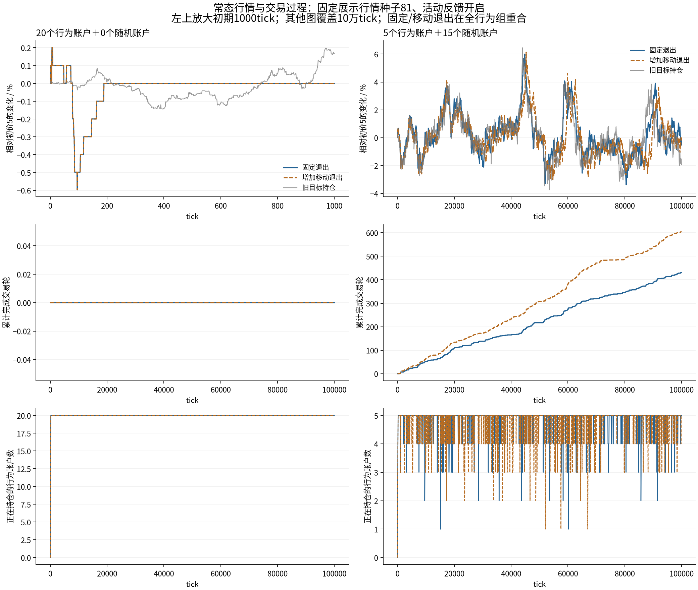
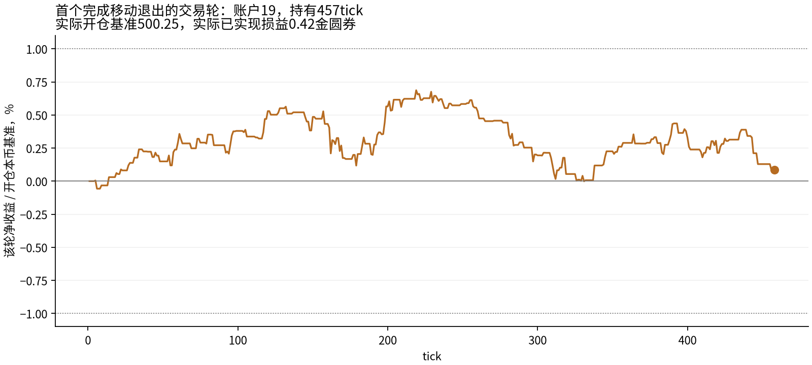
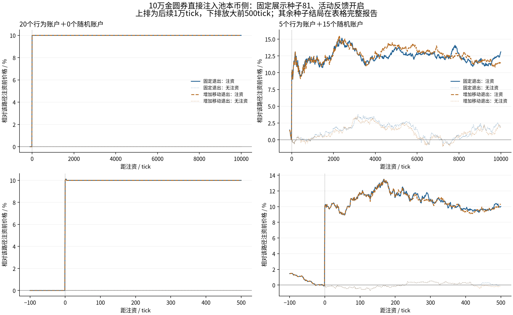

# 一次建仓、持有后退出：常态与央行注资探索

**个人交易过程已经能运行，但结果分成两种情形：全行为组会停盘；混合组能持续完成交易轮。注资后仍没有可靠的旧价恢复。** 这轮没有据结果调整参数或补上强制退出机制。

## 设置与行为规则

用户确认[实验提案](../../../BEHAVIOR_PROPOSAL.md)后直接实施。20户双币钱包，池100万金圆券/20万外币，户均5000/1000，费用0。个人三因子沿用30/30窗口、人口301/spread=1及原两类权重；参数固定。仅在账户到达且空闲、abs(g)>=个人sigma时开一轮，意向100外币；正信号买入后卖出，负信号卖出已有外币后回补，无借贷。每户每tick最多一次实际成交；持有期间不加仓、不调整目标仓位。

固定退出：可兑现收益+1%止盈、−1%止损。移动退出：保留上述条件；观察到收益曾达+0.5%，随后较已观察最高收益回撤0.5个百分点时退出。仅在账户到达时观察/执行，不是逐tick自动挂单。触发后部分成交保留原退出意图，在后续到达处理剩余；没有自动补钱或强制最长持仓。

每轮基准为实际买入付出本币，或实际卖出自有外币取得本币；当前损益用生产AMM全剩余数量的平仓报价计算，含滑点和费用。全部退出可能因现金不足无法支付，实际执行仍裁剪钱包并保留未平数量。初始1000外币底仓不虚构成本；其市值变化与交易轮利润分开，已实现利润不是总钱包收益率。

共享活动反馈仍为a=exp(-1/1000)、z_next=a*z+sqrt(1-a²)*r/.0004、Lambda=(1-b)+b*z²；b=0/.25，20户分别Poisson(Lambda/20)到达并洗牌。常态24条×100000tick、前5000预热；注资24对×11000tick，在第1000tick常规成交后向池本币侧直接加10万，配对不注资。两种退出×两种构成（20行为或15随机+5行为）×开关×行情81/82/83，共72条路径、2928000tick。没有外部价格或基本价值。

旧目标持仓与v1对照复用相同人口/种子的既有结果，不重新跑旧模型。参数与来源检查见[controls.json](controls.json)。本次注资对照只取81–83三种子，不能与上一轮十种子均值直接比较。

## 常态：全行为组停在持仓等待

固定和移动退出、反馈开和关、三个种子共12条全行为路径，均只建20轮、完成0轮、期末20户仍持有。最后成交落在第118–267tick；预热后95000tick没有成交、价格完全不动。持仓在期末仍未结束，不能把它们的持有时长当作已完成样本。

这不是“涨跌相关降到零”的成功：常数收益的ACF、偏度和峰度没有定义，报告保留null。大家都等阈值、却没有其他人持续成交，行情就没有新的变动来源；热度规则只增加到达，不会强迫持仓者下单。

## 常态：15随机＋5行为的交易过程

以下均开启反馈。交易轮覆盖完整10万tick；市场指标随后使用去预热的95000tick。持有时长只对已完成轮次计算，未完成者单列；利润是5个行为账户的新交易轮已实现损益之和，再平均三个行情种子。

|退出规则|每路径完成轮数均值|已完成轮平均持有tick|三个种子合计止盈／止损／移动退出|每路径已实现损益均值|期末未完成轮数均值|
|---|---:|---:|---:|---:|---:|
|固定退出|395.3|1222.6|570／616／0|-82.88|5.00|
|增加移动退出|606.0|784.3|564／664／590|-104.71|4.67|

图示固定取行情种子81，展示一条实现；表格使用全部三个种子，未挑选漂亮路径。移动退出完成的轮次更多、持有更短，但两组已实现损益均值都为负；这不支持“加了退出就能稳定盈利”。未实现损益和全部逐路径结局见[normal.csv](normal.csv)。

示例按时间选择种子81混合组首个完成移动退出的轮次。曲线为每tick收盘储备计算的假设全量平仓收益，仅用于展示；机器人高点只在实际到达时更新，最后一点为真实成交损益。曲线不能理解为每tick都在监控或按收盘价成交。原始记录见[illustrated_episode.json](illustrated_episode.json)。

## 常态：市场指标及成交占比

ACF对全部去预热tick的对数收益r、abs(r)、r²减均值后计算滞后乘积和/零滞后平方和；不作N/(N−lag)修正。区间为逐lag均值；方向R为lag1–1000收益ACF最大绝对值，不是显著性检验。表格是逐路径统计再等权平均，未拼接路径。超额峰度以正态为0，未作幂律尾或严格长记忆检验。

|模型（开启反馈）|abs(r) ACF 101–300|r² ACF 301–1000|方向R|行为成交量占比|每tick外币总成交量|
|---|---:|---:|---:|---:|---:|
|旧目标持仓：15随机＋5三因子|0.01134|0.00243|0.02009|12.52%|23.919|
|固定退出：15随机＋5行为|0.01168|0.00207|0.01071|3.65%|21.544|
|增加移动退出：15随机＋5行为|0.01035|0.00226|0.01143|5.55%|21.894|
|纯随机v1：20随机|0.01125|0.00229|0.01164|不适用|28.284|

**混合组保留了中尺度波动相关，收益方向相关与纯随机参照处于相近量级。**但行为账户仅贡献约3.65%/5.55%的成交量，低于旧目标持仓组约12.52%；统计变化同时包含入场、下单量、交易时机和持有方式变化，不能全归功于退出算法，也不能称为策略生态已涌现。只有固定与移动版本之间是单独增加移动退出的比较。

|混合退出规则|关闭反馈 r² ACF 301–1000|开启反馈 r² ACF 301–1000|开启反馈超额峰度|开启反馈平均预定强度|
|---|---:|---:|---:|---:|
|固定退出|0.00009|0.00207|5.06|0.891|
|增加移动退出|0.00014|0.00226|5.07|0.888|

三等分来自同一预热后序列，边界5001–36667、36668–68334、68335–100000；不重置状态。所有72段结果见[segments.csv](segments.csv)。

## 央行注资：会触发退出，旧价恢复仍不可靠

第1000tick成交完成后直接向池本币侧增加10万，约造成10%直接上涨；不算机器人成交。下一tick活动包含这次跳价，最高观察强度列为有限样本峰值。主表使用最后500tick均价，相对实际注资前即时价格P_minus；原始回落=(P_plus−末段均价)/(P_plus−P_minus)，对照校正回落=1−(注资末段均价−无注资末段均价)/(P_plus−P_minus)。原始回落100%表示回到注资前旧价，负值表示末段高于注资后即时价格；对照校正回落100%表示与同期无注资对照同价，负值表示两条路径价差超过最初跳幅。对照自身可能漂移，两项不能混用。各时点原始值保存在result.json。

|行为规则／构成（开启反馈）|末段仍高于旧价|原始涨幅回落比例|对照校正回落|行为账户净卖出外币均值|最大预定强度|
|---|---:|---:|---:|---:|---:|
|固定退出，20行为＋0随机|10.46%|-4.4%|-4.4%|-400.0|33.12|
|增加移动退出，20行为＋0随机|10.46%|-4.4%|-4.4%|-400.0|33.12|
|固定退出，5行为＋15随机|10.50%|-4.5%|3.3%|-33.3|38.46|
|增加移动退出，5行为＋15随机|10.32%|-2.7%|6.0%|66.7|39.12|

全行为组注资后每条路径完成20轮退出，随后重新建仓，再次停止成交；固定和移动版本此时相同。注资确实让个人成本阈值产生动作，但卖出已有外币的账户在上涨后止损回补，会形成买单，不能把所有止损都理解成下跌卖出。

|规则／构成（开启反馈）|注资后100tick内新入场数均值|退出成交数均值|买入轮止盈卖出量均值|减持轮止损回补量均值|该时段行为净买入量均值|
|---|---:|---:|---:|---:|---:|
|固定退出，20行为＋0随机|20.0|20.0|800.0|1200.0|400.0|
|增加移动退出，20行为＋0随机|20.0|20.0|800.0|1200.0|400.0|
|固定退出，5行为＋15随机|11.3|10.7|233.3|400.0|66.7|
|增加移动退出，5行为＋15随机|16.7|16.0|266.7|433.3|0.0|

全部24条注资路径（含关闭反馈）未触及旧价，末500tick均价也未回到旧价±1%。全行为组每户仅一轮100外币，总净偏离底仓约±2000，注资前后最大可卖出差额约4000，而恢复旧价需近1万：这一组完全恢复在所选容量下本就不可达。混合组没有同样的总容量限制，但本轮仍未出现可靠恢复。不能据此推断所有成本退出模型都不能回落。

|混合退出规则|关闭反馈末段仍高于旧价|开启反馈末段仍高于旧价|开启反馈三个种子末段涨幅范围|
|---|---:|---:|---:|
|固定退出|10.97%|10.50%|7.48%～12.18%|
|增加移动退出|11.12%|10.32%|7.37%～12.25%|

## 当前取舍与范围

这轮支持把成本和回撤作为可理解的持有/退出依据，也暴露了独立运行时的成交停滞。15随机＋5行为可以作为继续研究的背景候选；行为账户占成交量很少，尚未验证玩家参与时的竞争、公平性或可利用性。移动退出增加交易轮数，未证明提高收益或价格修复能力。

本轮不新增强制超时、补钱、价格锚或更多性格，不事后改1%阈值。下一步需要决定是否接受随机背景承担大部分成交，以及如何评价这些交易轮对玩家的意义；不为避免停盘自动追加策略。所有结论仅限一个参数人口、三个行情种子和已跑时段，未经过真人行为校准或跨人口稳健性验证。

## 验证与复现

已有19项加5项关键行为检查，共24项通过：`OPENBLAS_NUM_THREADS=1 OMP_NUM_THREADS=1 python -m unittest discover -s research/fx/tests -v`。保存序列审计覆盖72路径、9506轮、18120笔行为成交、9506个入场信号、96个统计窗口及312项响应。逐笔重放生产报价，核对成本分配、真实盈亏、残量、单tick限制、逐tick发行守恒和下一tick反馈。原2059个文件哈希未变。

实际模拟没有出现部分平仓；现金不足时保留残量的行为由关键单元检查覆盖。零行为账户时的原随机控制，在反馈开关及注资开关下与原循环34个共同字段逐点一致（实际字段数见compatibility.json）；常态前11000tick与注资场景的无注资控制完全相同，注资前所有字段完全相同。报告保留常数ACF未定义，未运行游戏UI或玩家交互测试。

- [配置、个人参数和模拟来源哈希](manifest.json)、[原始序列核对](audit.json)、[原文件哈希快照](preexisting_sha256.json)、[随机控制兼容](compatibility.json)
- [全部常态行为及市场指标](normal.csv)、[三等分](segments.csv)、[注资主要结局](shock.csv)、[注资前后行为动作](shock-actions.csv)
- [全部结果及账户状态](summary.json)，各路径目录含npz、交易轮JSON和逐笔行为成交JSONL。
- 重现：`python -m research.fx.episodes.run`，随后`python -m research.fx.episodes.audit`、`python -m research.fx.episodes.report`。缓存仅在配置与来源哈希匹配时复用。
