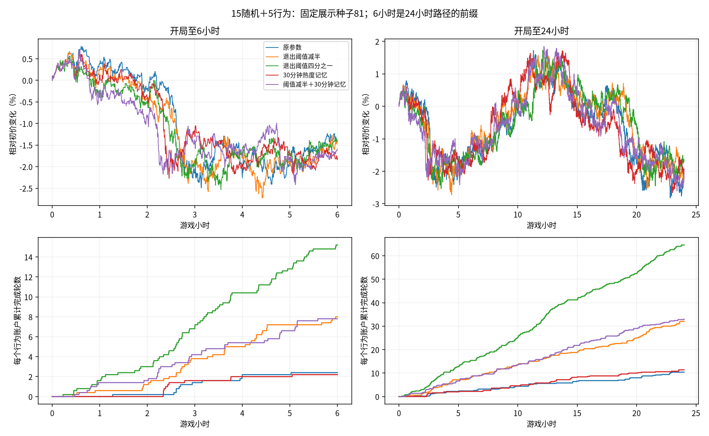
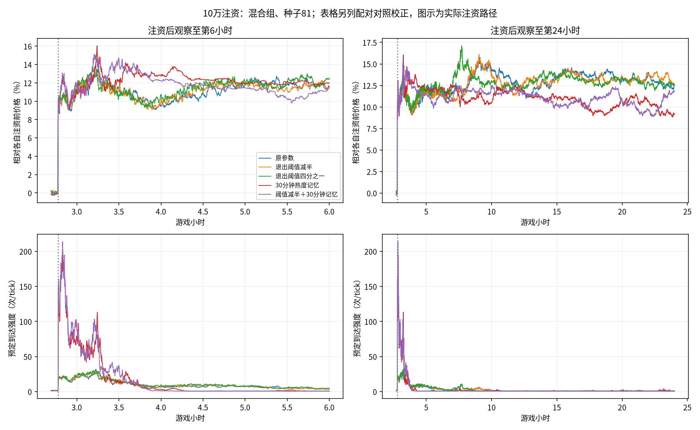

# 10秒tick下的6小时与24小时节奏探索

退出阈值减半明显加快混合组交易轮；只缩短热度记忆改善较小，且放大注资后的瞬时活动。全行为组在24小时结束前仍全部停止成交。参数候选尚未替换旧版本。

## 冻结设置与口径

沿用现有模拟器，20户、池100万金圆券/20万外币、户均5000/1000、零费用、每轮100外币；个人三因子30/30窗口与人口301/spread1固定，到达规则与反馈b=.25保持。仅使用原移动退出版。五组参数、范围与限制见[实验说明](../README.md)和[配置](../config.json)。原版止盈止损±1%，移动启动+.5%、回撤.5个百分点；减半/四分之一同时同比缩放这四项。tau1000/180分别约2小时47分钟/30分钟，只代表z的衰减参数。

行情81/82/83，两个人口构成、五组参数，共30对/60路径、518400tick。每条运行8640tick，在2160/8640截取；含启动阶段，不丢5000tick预热。6小时与24小时来自同一路径，不是独立重复。到达时才观察与退出；最多每户每tick一笔真实成交，不追加最长持仓或补钱。持有时长仅统计已完成轮，未完成单独保留。

表中先逐路径计算再等权平均三个行情种子，持有时长为三个路径均值的平均。未作正式显著性检验或未见种子验证，不能借短样本宣称长记忆、不可预测性或已适合玩家竞争。

## 混合组常态：每个行为账户的节奏

|参数|6小时完成轮数/户|24小时完成轮数/户|24小时完成轮平均持有分钟|24小时行为成交占比|
|---|---:|---:|---:|---:|
|原参数|2.40|10.20|128.55|5.4%|
|退出阈值减半|8.07|30.87|39.28|14.5%|
|退出阈值四分之一|14.27|64.00|15.55|25.8%|
|30分钟热度记忆|3.00|11.60|112.58|5.9%|
|阈值减半＋30分钟记忆|9.20|33.87|35.38|15.1%|

阈值减半把典型已完成持仓缩到约半小时至三刻钟，四分之一约15分钟。更快不等于利润更好或更像真实人类；行为成交占比上升同时改变市场反馈，不能把效果线性外推到更低阈值。

## 全行为组：加快退出仍未消除停止成交

|参数|6小时完成轮数/户|24小时完成轮数/户|三个种子最后成交时间范围（开局后小时）|
|---|---:|---:|---:|
|原参数|0.00|0.00|0.41～0.59|
|退出阈值减半|0.97|0.97|0.59～1.93|
|退出阈值四分之一|12.92|28.60|3.68～17.83|
|30分钟热度记忆|0.00|0.00|0.41～0.94|
|阈值减半＋30分钟记忆|2.57|2.57|0.57～5.59|

四分之一阈值让部分全行为路径维持更久，但三条都在24小时结束前停止成交；不能把短暂循环当成解决了等待结构。混合组保留随机背景，解释时需保留其成交占比。

## 注资：本局结束前的反应

第1000tick（2小时46分40秒）常规成交后向池本币侧加10万；只看本局剩余时段。主结局为局末180tick/30分钟均价，相对实际注资前即时价。原始回落=(注资后即时价−末段均价)/初始跳幅；配对回落=1−(注资末段−同期无注资末段)/初始跳幅。前者100%才是回旧价，后者100%是追上同期对照，两者不能混用。

|混合组参数|6小时末仍高于旧价|24小时末仍高于旧价|24小时配对回落|最大预定强度|最大单tick到达数|
|---|---:|---:|---:|---:|---:|
|原参数|10.04%|10.54%|-6.9%|39.1|49|
|退出阈值减半|9.62%|10.74%|-11.6%|41.0|51|
|退出阈值四分之一|9.93%|10.89%|-8.7%|40.8|50|
|30分钟热度记忆|9.83%|9.10%|6.0%|225.5|223|
|阈值减半＋30分钟记忆|9.18%|9.96%|-3.0%|237.4|237|

较短tau同时增加sqrt(1−exp(−2/tau))的冲击系数。同一次大跳价会更强地抬高下一tick的z和Lambda；这解释了缩短记忆时更高的活动峰值，未给强度添加上限。实际到达仍为泊松数，预定强度与实际次数分开。没有测定游戏运行时延，不能据峰值断言会卡顿。买入轮上涨止盈卖出、减持轮上涨止损买回的双向作用仍保留。

## 常态短样本市场诊断

以下为24小时混合组。ACF含零收益、全局去均值后用滞后乘积和/零滞后平方和，不作无偏修正；方向最大值只取lag1–100。幅度/平方区间31–180tick约5至30分钟，是本轮局长口径，不能与旧报告101–300/301–1000数值直接比较。常数序列记未定义。

|参数|收益ACF lag1|收益ACF最大绝对值 lag1–100|abs(r) ACF 31–180|r² ACF 31–180|
|---|---:|---:|---:|---:|
|原参数|0.00176|0.03403|0.01309|0.00746|
|退出阈值减半|0.00295|0.03065|0.01044|0.00749|
|退出阈值四分之一|-0.01568|0.03318|0.01467|0.00958|
|30分钟热度记忆|0.00589|0.03290|0.00707|0.00603|
|阈值减半＋30分钟记忆|-0.00953|0.02909|0.00659|0.00433|

## 范围与复现

先保留tau1000、退出减半作为较快节奏候选；四分之一是更短线的比较组。这个取舍针对节奏，不宣称已验证真人参与或最佳参数。用户随后要求继续缩短持有，后续更短线试验单独保存，不覆盖本轮结果。

运行与检查：`OPENBLAS_NUM_THREADS=1 OMP_NUM_THREADS=1 python -m research.fx.episodes.session.run`；`python -m research.fx.episodes.session.report`。已有研究测试`python -m unittest discover -s research/fx/tests -v`，24项通过。没有修改生产或公共执行代码，没有新增永久测试。

60路径已核对注资前逐字段一致、逐tick资产守恒、基准成本与现金关系、单tick成交限制及钱包非负；6条原参数常态路径与上一轮保存序列前缀逐字段一致。报告另核对23518个截断交易轮的入场、完成、残量和已实现现金损益，校验来源与2062个既有文件哈希。没有把路径终点之后的平仓纳入6小时统计。

- [逐路径6/24小时行为及市场指标](sessions.csv)、[注资配对结果](responses.csv)、[全部账户终态](summary.json)、[配置与来源哈希](manifest.json)。各路径目录保存全部序列及行为账本。
