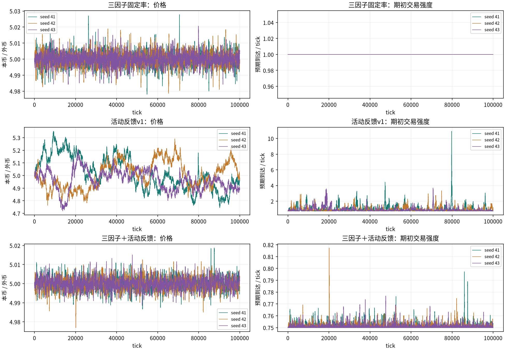
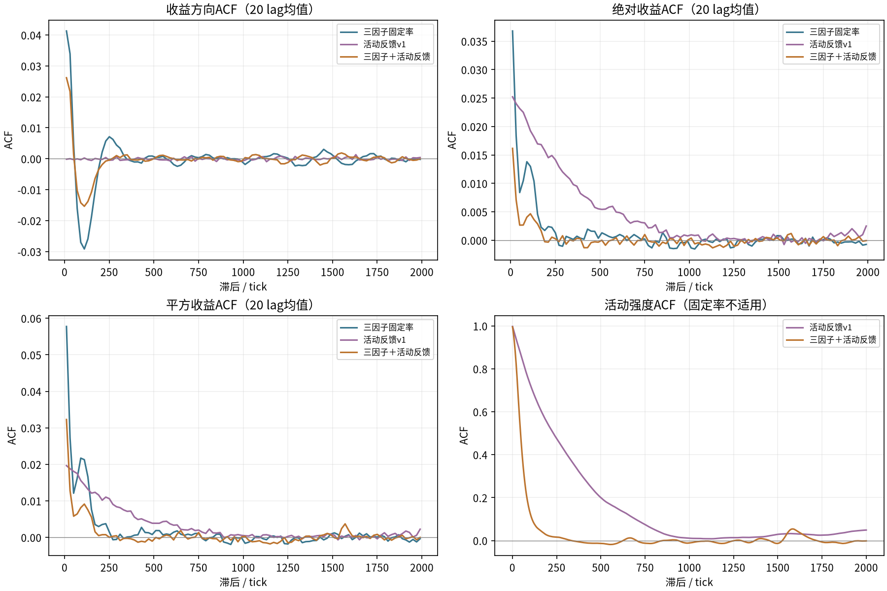

# 三因子与活动反馈组合：第一轮三组对照

2026-10-15。用户批准恢复三因子，并比较原三因子、活动反馈v1、组合模型。本轮三组×三个种子，共9条10万tick路径，预热5000。未扫描参数，未运行央行注资或玩家场景，未修改生产市场、archive、common或冻结v1。

组合组在101–300和301–1000段的绝对/平方收益ACF全部为正的种子为 **1/3**。301–1000段平方收益ACF均值：三因子固定率 **0.00052**，活动反馈v1 **0.00311**，组合 **-0.00023**。方向lag1 ACF均值依次为 **0.03278 / 0.00108 / 0.01933**；必须同时看方向相关和波动持续性，不能只选有利的一列。

本轮问题是：恢复交易者价格判断之后，既有活动反馈还能保留多少作用。三组结果为有限样本描述，不是统计显著性、交易盈利或整体市场复现的证明。完整曲线、DFA和分布均保留在各result.json。

**当前固定组合没有保留v1的中尺度波动持续性。** 组合平均Lambda=0.751232，比公式底值.75仅多0.001232；实际外币绝对成交量/tick为3.538，v1为29.026。组合收益标准差约0.00005261，仍使用psi=.0004，尺度比约0.132。同时，加入三因子后短期方向相关比v1更强。已有研究基线的结论不能直接转移到这次组合。

这些观测与“有界目标调仓使成交和累计价格偏离较小，而固定psi下活动增益很弱”相符；本轮没有单独区分订单规模、库存回复和方向相关各自的贡献，不把结果全部归因于某一个因素。没有为了补救结果自动改psi、订单量或噪声。

## 1. 实验设置与旧模型来源

| 项目 | 本轮固定口径 |
| --- | --- |
| 三组 | factor_fixed：三因子+固定总到达1；activity_v1：原随机订单+活动反馈；factor_activity：三因子+活动反馈 |
| 路径 | 种子41/42/43；每条100000tick；分析tick5001–100000，共95000收益 |
| 账户/池/手续费 | 20户各本币5000、外币1000；池本币1000000、外币200000，初价5；费用0 |
| 三因子 | 窗口30/30；偶数户趋势30/回归.1，奇数户趋势3/回归1；噪声sigma=.0005，每户每tick一次；无动态类型转换 |
| 仓位规则 | 目标净外币=500*tanh(100*g)，相对开局1000外币；每次到达向目标差额调整20%，用真实库存重算 |
| 买卖执行 | 三因子买入将外币意向按期初价折成本币预算，卖出按外币数量；经当前池限额.005和钱包约束，调用生产报价 |
| 活动反馈 | b=.25、tau1000、psi=.0004，z初值0；关闭反馈组b=0；不按新收益波动重新拟合psi |
| v1订单 | 每次到达q=40*独立标准高斯，按原common.execute执行，保持原v1代码 |

三因子来自[归档基线](../../../archive/2026-10-15/configs/baseline.json)及原expectation.py/position.py，保留加法信号、固定异质权重、tanh目标和20%调仓。统一采用当前有限钱包、零费用、分离随机流及期初公开价格。本轮“原三因子”指恢复这些决策规则，不是旧路径原样复现；旧归档用近乎无限钱包、不同随机源和逐账户读价，本轮没有恢复这些条件。锁仓、成绩切换和M/R身份转换不在范围内。

两种订单分布与资金利用率不同，不保证相同成交量或收益尺度。factor_fixed与factor_activity之间只改变反馈开关，是主要比较；与v1的比较同时改变订单策略。

## 2. 单tick时序与信号定义

先读取上一收盘P和历史，保存期初z与Lambda。每个账户更新g=aT+bM+sigma*epsilon；T=(当前对数价格−此前窗口最旧对数价格)/30，M=此前30个收盘对数均值−当前对数价格。历史包含当前观察收盘，没有未来数据；不足30点时相应确定性因子为0。g=ln(主观目标价格/观察价格)，近期均价不代表独立基本价值。

随后每人抽Poisson(Lambda/20)，事件洗牌后逐笔真实成交；同tick重复到达复用该tick预期，重新读取真实库存。最后收盘r=ln(P_t/P_(t−1))，更新z_next=exp(−1/1000)*z+sqrt(1−exp(−2/1000))*r/.0004。三因子每tick消耗一个个人噪声数，不因到达次数变化而改变预期噪声序列；两三因子组该序列配对，价格及信号可以分叉。动态组不要求到达或成交逐点相同。

psi²Lambda不作为三因子/组合的精确条件二阶矩；固定psi下，原v1的条件收益与理论ACF保证不转移到组合模型。净仓位为钱包外币减开局1000，负净仓位表示减持已有外币，没有借币裸卖空。

## 3. 核心结果

以下均为三个种子均值 [最小, 最大]，不是置信区间。


| 模型 | r ACF1 | max \|r ACF\| | \|r\| 101–300 | \|r\| 301–1000 | r² 101–300 | r² 301–1000 |
| --- | --- | --- | --- | --- | --- | --- |
| 三因子固定率 | 0.03278 [0.02730, 0.04212] | 0.06589 [0.06064, 0.07478] | 0.00359 [0.00271, 0.00470] | 0.00028 [-0.00072, 0.00083] | 0.00594 [0.00423, 0.00825] | 0.00052 [-0.00071, 0.00113] |
| 活动反馈v1 | 0.00108 [-0.00495, 0.00667] | 0.01153 [0.00984, 0.01314] | 0.01554 [0.01089, 0.02203] | 0.00443 [0.00231, 0.00630] | 0.01129 [0.00689, 0.01728] | 0.00311 [0.00156, 0.00469] |
| 三因子＋活动反馈 | 0.01933 [0.01694, 0.02167] | 0.04549 [0.04266, 0.04758] | 0.00136 [0.00090, 0.00187] | -0.00022 [-0.00043, 0.00008] | 0.00264 [0.00186, 0.00359] | -0.00023 [-0.00078, 0.00026] |

| 模型 | 平均Lambda | 下一100块 | 下一240块 | 下一1000块 | 超额峰度 |
| --- | --- | --- | --- | --- | --- |
| 三因子固定率 | 1.00000 [1.00000, 1.00000] | 不适用 | 不适用 | 不适用 | 5.29073 [4.81729, 6.14651] |
| 活动反馈v1 | 0.92924 [0.90332, 0.97198] | 0.63764 [0.57063, 0.71292] | 0.53339 [0.50105, 0.59649] | 0.17022 [0.03734, 0.37863] | 3.57978 [3.53444, 3.65043] |
| 三因子＋活动反馈 | 0.75123 [0.75115, 0.75130] | 0.28671 [0.28420, 0.29154] | 0.11776 [0.10009, 0.13617] | 0.00694 [-0.02817, 0.04337] | 5.26261 [5.03956, 5.55660] |


种子级结果：

| 模型 / seed | r ACF1 | \|r\| 301–1000 | r² 301–1000 | 下一100 | 下一240 | 下一1000 |
| --- | --- | --- | --- | --- | --- | --- |
| 三因子固定率 / 41 | 0.02730 | 0.00083 | 0.00112 | 不适用 | 不适用 | 不适用 |
| 三因子固定率 / 42 | 0.04212 | -0.00072 | -0.00071 | 不适用 | 不适用 | 不适用 |
| 三因子固定率 / 43 | 0.02891 | 0.00074 | 0.00113 | 不适用 | 不适用 | 不适用 |
| 活动反馈v1 / 41 | 0.00667 | 0.00468 | 0.00309 | 0.71292 | 0.50105 | 0.03734 |
| 活动反馈v1 / 42 | -0.00495 | 0.00231 | 0.00156 | 0.57063 | 0.50264 | 0.09470 |
| 活动反馈v1 / 43 | 0.00151 | 0.00630 | 0.00469 | 0.62937 | 0.59649 | 0.37863 |
| 三因子＋活动反馈 / 41 | 0.02167 | -0.00043 | -0.00078 | 0.28420 | 0.10009 | 0.04337 |
| 三因子＋活动反馈 / 42 | 0.01939 | 0.00008 | 0.00026 | 0.29154 | 0.11701 | -0.02817 |
| 三因子＋活动反馈 / 43 | 0.01694 | -0.00031 | -0.00017 | 0.28438 | 0.13617 | 0.00563 |




每行是同一模型的三个种子。不同图轴范围应按标签读取，不凭视觉振幅判断显著性。



收益曲线按20个lag平均展示；段均值和每个lag的原数值均保留，常数强度ACF未定义。

## 4. 全部滞后区间


### 方向收益ACF

| 模型 / seed | 1–1 | 2–10 | 11–30 | 31–100 | 101–300 | 301–1000 | 1001–5000 |
| --- | --- | --- | --- | --- | --- | --- | --- |
| 三因子固定率 / 41 | 0.02730 | 0.03937 | 0.05194 | -0.00938 | -0.00595 | -0.00012 | -0.00000 |
| 三因子固定率 / 42 | 0.04212 | 0.03915 | 0.04978 | -0.00872 | -0.00670 | 0.00001 | -0.00003 |
| 三因子固定率 / 43 | 0.02891 | 0.03376 | 0.04760 | -0.00883 | -0.00595 | 0.00018 | -0.00002 |
| 活动反馈v1 / 41 | 0.00667 | -0.00025 | -0.00108 | 0.00079 | 0.00002 | -0.00003 | -0.00012 |
| 活动反馈v1 / 42 | -0.00495 | -0.00017 | 0.00104 | -0.00074 | -0.00005 | -0.00028 | -0.00001 |
| 活动反馈v1 / 43 | 0.00151 | -0.00213 | 0.00020 | -0.00052 | -0.00020 | -0.00023 | 0.00002 |
| 三因子＋活动反馈 / 41 | 0.02167 | 0.02327 | 0.03437 | -0.00551 | -0.00551 | 0.00017 | -0.00001 |
| 三因子＋活动反馈 / 42 | 0.01939 | 0.02221 | 0.03359 | -0.00551 | -0.00551 | -0.00001 | 0.00003 |
| 三因子＋活动反馈 / 43 | 0.01694 | 0.02174 | 0.03174 | -0.00576 | -0.00453 | -0.00006 | 0.00001 |


### 绝对收益ACF

| 模型 / seed | 1–1 | 2–10 | 11–30 | 31–100 | 101–300 | 301–1000 | 1001–5000 |
| --- | --- | --- | --- | --- | --- | --- | --- |
| 三因子固定率 / 41 | 0.05232 | 0.04908 | 0.03515 | 0.01473 | 0.00470 | 0.00083 | 0.00011 |
| 三因子固定率 / 42 | 0.04811 | 0.03861 | 0.02749 | 0.00987 | 0.00271 | -0.00072 | -0.00046 |
| 三因子固定率 / 43 | 0.03577 | 0.03593 | 0.02353 | 0.00825 | 0.00337 | 0.00074 | 0.00061 |
| 活动反馈v1 / 41 | 0.03508 | 0.03678 | 0.03524 | 0.03096 | 0.02203 | 0.00468 | -0.00110 |
| 活动反馈v1 / 42 | 0.02115 | 0.01932 | 0.01853 | 0.01645 | 0.01089 | 0.00231 | -0.00034 |
| 活动反馈v1 / 43 | 0.02304 | 0.01968 | 0.02052 | 0.01977 | 0.01370 | 0.00630 | 0.00166 |
| 三因子＋活动反馈 / 41 | 0.01917 | 0.01861 | 0.01347 | 0.00426 | 0.00187 | -0.00043 | -0.00018 |
| 三因子＋活动反馈 / 42 | 0.02140 | 0.01875 | 0.01196 | 0.00260 | 0.00130 | 0.00008 | 0.00005 |
| 三因子＋活动反馈 / 43 | 0.01486 | 0.01790 | 0.01085 | 0.00288 | 0.00090 | -0.00031 | 0.00009 |


### 平方收益ACF

| 模型 / seed | 1–1 | 2–10 | 11–30 | 31–100 | 101–300 | 301–1000 | 1001–5000 |
| --- | --- | --- | --- | --- | --- | --- | --- |
| 三因子固定率 / 41 | 0.07090 | 0.08524 | 0.05696 | 0.02432 | 0.00825 | 0.00112 | 0.00001 |
| 三因子固定率 / 42 | 0.08327 | 0.05530 | 0.04119 | 0.01368 | 0.00423 | -0.00071 | -0.00039 |
| 三因子固定率 / 43 | 0.05665 | 0.05203 | 0.03497 | 0.01186 | 0.00535 | 0.00113 | 0.00086 |
| 活动反馈v1 / 41 | 0.02909 | 0.03225 | 0.03223 | 0.02799 | 0.01728 | 0.00309 | -0.00088 |
| 活动反馈v1 / 42 | 0.01201 | 0.01125 | 0.01256 | 0.01022 | 0.00689 | 0.00156 | -0.00013 |
| 活动反馈v1 / 43 | 0.01809 | 0.01311 | 0.01443 | 0.01354 | 0.00971 | 0.00469 | 0.00120 |
| 三因子＋活动反馈 / 41 | 0.04462 | 0.03872 | 0.02747 | 0.00950 | 0.00359 | -0.00078 | -0.00031 |
| 三因子＋活动反馈 / 42 | 0.05971 | 0.04646 | 0.02539 | 0.00747 | 0.00248 | 0.00026 | -0.00001 |
| 三因子＋活动反馈 / 43 | 0.02304 | 0.02388 | 0.01457 | 0.00402 | 0.00186 | -0.00017 | 0.00014 |


## 5. 成交尺度及因子量级

全部执行指标去掉前5000tick。三因子裁剪按实际订单输入与“未受钱包/池限制、但已经过同样正常量化的输入预算”比较，避免将两次量化或买入滑点误记为钱包裁剪；v1仍按外币意向/真实填单比较。因此裁剪比例跨订单类型只作辅助描述，成交量和钱包记录应一并阅读。跳过包含目标差额过小的无单事件，不全部代表资金耗尽。


| 模型 | 成交/tick | 外币绝对量/tick | 裁剪比例 | 全程最大强度 |
| --- | --- | --- | --- | --- |
| 三因子固定率 | 1.00430 [0.99740, 1.00780] | 5.09861 [5.00650, 5.15649] | 0.00000 [0.00000, 0.00000] | 1.00000 [1.00000, 1.00000] |
| 活动反馈v1 | 0.92034 [0.89115, 0.96294] | 29.02623 [28.11375, 30.33959] | 0.02724 [0.02580, 0.02865] | 5.98732 [3.34602, 10.92880] |
| 三因子＋活动反馈 | 0.75440 [0.74906, 0.75767] | 3.53801 [3.50904, 3.55944] | 0.00000 [0.00000, 0.00000] | 0.79715 [0.77680, 0.81737] |


各因子已乘权重后的标准差，按预热后所有账户更新计算；它们不是价格方差贡献，未忽略协方差作归因：

| 模型 / seed / 权重 | 趋势std | 回归std | 噪声std |
| --- | --- | --- | --- |
| 三因子固定率 / 41 / [30, 0.1] | 0.0005393 | 0.0000284 | 0.0004998 |
| 三因子固定率 / 41 / [3, 1] | 0.0000539 | 0.0002844 | 0.0004999 |
| 三因子固定率 / 42 / [30, 0.1] | 0.0005382 | 0.0000284 | 0.0004998 |
| 三因子固定率 / 42 / [3, 1] | 0.0000538 | 0.0002845 | 0.0005002 |
| 三因子固定率 / 43 / [30, 0.1] | 0.0005093 | 0.0000269 | 0.0005004 |
| 三因子固定率 / 43 / [3, 1] | 0.0000509 | 0.0002693 | 0.0004994 |
| 三因子＋活动反馈 / 41 / [30, 0.1] | 0.0003777 | 0.0000202 | 0.0004998 |
| 三因子＋活动反馈 / 41 / [3, 1] | 0.0000378 | 0.0002024 | 0.0004999 |
| 三因子＋活动反馈 / 42 / [30, 0.1] | 0.0003717 | 0.0000199 | 0.0004998 |
| 三因子＋活动反馈 / 42 / [3, 1] | 0.0000372 | 0.0001995 | 0.0005002 |
| 三因子＋活动反馈 / 43 / [30, 0.1] | 0.0003661 | 0.0000197 | 0.0005004 |
| 三因子＋活动反馈 / 43 / [3, 1] | 0.0000366 | 0.0001967 | 0.0004994 |


## 6. 分布、聚合与DFA

所有收益含零值，标准差ddof=1、偏度及Fisher超额峰度bias=False，正态超额峰度0；高峰度不单独证明稳定厚尾。聚合为不重叠收益求和、尾部不足一块丢弃。DFA1/2沿用common的固定尺度16–8192及双端分块，斜率不当作已认证长记忆。


| 模型 / seed | 标准差 | 零收益比例 | 偏度 | 超额峰度 |
| --- | --- | --- | --- | --- |
| 三因子固定率 / 41 | 0.00006762 | 36.349% | 0.0602 | 6.1465 |
| 三因子固定率 / 42 | 0.00006742 | 36.668% | -0.0022 | 4.9084 |
| 三因子固定率 / 43 | 0.00006569 | 36.831% | -0.0490 | 4.8173 |
| 活动反馈v1 / 41 | 0.00038679 | 39.995% | -0.0039 | 3.5545 |
| 活动反馈v1 / 42 | 0.00037581 | 41.181% | -0.0306 | 3.5344 |
| 活动反馈v1 / 43 | 0.00037181 | 42.053% | -0.0261 | 3.6504 |
| 三因子＋活动反馈 / 41 | 0.00005297 | 47.021% | 0.0299 | 5.5566 |
| 三因子＋活动反馈 / 42 | 0.00005254 | 46.875% | -0.0580 | 5.1917 |
| 三因子＋活动反馈 / 43 | 0.00005233 | 47.298% | -0.0066 | 5.0396 |


聚合超额峰度：

| 模型 / seed | 1 | 5 | 30 | 60 | 240 | 1000 |
| --- | --- | --- | --- | --- | --- | --- |
| 三因子固定率 / 41 | 6.1465 | 3.9414 | 4.1418 | 3.1553 | 0.8292 | -0.0754 |
| 三因子固定率 / 42 | 4.9084 | 3.2028 | 2.6588 | 2.4394 | 0.0376 | -0.3360 |
| 三因子固定率 / 43 | 4.8173 | 2.4116 | 1.8968 | 1.9631 | 1.2744 | 0.7094 |
| 活动反馈v1 / 41 | 3.5545 | 1.3268 | 1.1726 | 1.9487 | -0.0202 | 1.3625 |
| 活动反馈v1 / 42 | 3.5344 | 0.8560 | 0.4492 | 0.3068 | -0.0975 | 0.8148 |
| 活动反馈v1 / 43 | 3.6504 | 0.8828 | 0.2190 | 0.2150 | 0.7373 | 0.4075 |
| 三因子＋活动反馈 / 41 | 5.5566 | 2.6920 | 3.5030 | 4.1344 | 1.8459 | 5.5606 |
| 三因子＋活动反馈 / 42 | 5.1917 | 3.6155 | 6.6394 | 5.4951 | 1.7287 | -0.2633 |
| 三因子＋活动反馈 / 43 | 5.0396 | 1.9727 | 1.8051 | 1.1300 | 0.0991 | -0.3397 |


收益DFA：

| 模型 / seed | DFA1 32-256 | DFA1 512-8192 | DFA1 2048-8192 | DFA2 32-256 | DFA2 512-8192 | DFA2 2048-8192 |
| --- | --- | --- | --- | --- | --- | --- |
| 三因子固定率 / 41 | 0.8915 | 0.0447 | 0.0134 | 0.7486 | 0.0761 | 0.0207 |
| 三因子固定率 / 42 | 0.8652 | 0.0534 | 0.0187 | 0.7410 | 0.0878 | 0.0301 |
| 三因子固定率 / 43 | 0.8663 | 0.0488 | 0.0144 | 0.7343 | 0.0829 | 0.0246 |
| 活动反馈v1 / 41 | 0.4941 | 0.5186 | 0.5018 | 0.4891 | 0.5403 | 0.5708 |
| 活动反馈v1 / 42 | 0.5077 | 0.4614 | 0.4437 | 0.5047 | 0.4592 | 0.4202 |
| 活动反馈v1 / 43 | 0.4966 | 0.4340 | 0.4185 | 0.5021 | 0.4382 | 0.3678 |
| 三因子＋活动反馈 / 41 | 0.7908 | 0.0872 | 0.0334 | 0.6787 | 0.1353 | 0.0549 |
| 三因子＋活动反馈 / 42 | 0.7719 | 0.0857 | 0.0402 | 0.6730 | 0.1371 | 0.0570 |
| 三因子＋活动反馈 / 43 | 0.7714 | 0.0801 | 0.0275 | 0.6687 | 0.1299 | 0.0495 |


绝对收益DFA：

| 模型 / seed | DFA1 32-256 | DFA1 512-8192 | DFA1 2048-8192 | DFA2 32-256 | DFA2 512-8192 | DFA2 2048-8192 |
| --- | --- | --- | --- | --- | --- | --- |
| 三因子固定率 / 41 | 0.6859 | 0.6115 | 0.5839 | 0.6562 | 0.6787 | 0.6122 |
| 三因子固定率 / 42 | 0.6654 | 0.6061 | 0.5125 | 0.6333 | 0.6725 | 0.6228 |
| 三因子固定率 / 43 | 0.6475 | 0.6216 | 0.5528 | 0.6281 | 0.6443 | 0.5741 |
| 活动反馈v1 / 41 | 0.5734 | 0.9026 | 0.7359 | 0.5262 | 0.9940 | 0.8162 |
| 活动反馈v1 / 42 | 0.5520 | 0.8408 | 0.7030 | 0.5240 | 0.8932 | 0.8540 |
| 活动反馈v1 / 43 | 0.5420 | 0.9037 | 0.8587 | 0.4979 | 0.8703 | 0.8180 |
| 三因子＋活动反馈 / 41 | 0.5877 | 0.5630 | 0.4888 | 0.5838 | 0.6434 | 0.5668 |
| 三因子＋活动反馈 / 42 | 0.5926 | 0.5576 | 0.5415 | 0.5804 | 0.6039 | 0.6056 |
| 三因子＋活动反馈 / 43 | 0.5798 | 0.5314 | 0.4510 | 0.5739 | 0.5775 | 0.4899 |


## 7. 统计口径、复算与验证

ACF为所在95000样本去均值后的lag乘积和/lag0乘积和，不作N/(N−lag)修正；区间是全部整数lag平均，方向max取1–1000。完整曲线保存到5000。块关系为期初Lambda平均值与同/下一块r²均值的Pearson相关，不重叠30/100/240/1000tick块，完整块分别3166/950/395/95，下一块配对再减1；没有在预热或分块边界重置状态。固定率Lambda恒定，相关为null/不适用。

每路径保存series.npz、result.json（参数、来源hash、最终钱包、全指标）；[metrics.csv](metrics.csv)为种子级表。验证见[validation.json](validation.json)：v1三种子全部保存字段与冻结首轮逐点完全一致；两三因子组个人预期噪声序列一致，不要求动态到达配对；全部资产精确守恒、钱包非负，三因子实际净仓位未超±500。

```bash
OPENBLAS_NUM_THREADS=1 python -m research.fx.factor_activity.run
OPENBLAS_NUM_THREADS=1 MPLCONFIGDIR=/tmp/fx-matplotlib python -m research.fx.factor_activity.report
python -m unittest discover -s research/fx/tests -v
```

本轮没有为了提高ACF调整b、psi、因子权重或仓位幅度。组合是否有用要结合方向相关、跨块持续性及成交尺度判断；即使失败，也只针对这次明确的移植组合，不能推论全部三因子模型无效。

相关单元检查13项通过，包含三因子手算、预算买入的实际滑点/重复调仓、无借贷减持、预期噪声配对和反馈时序。审阅发现并修复正常量化误记裁剪的问题：回归用例先复现34次错误计数、修复后为0；修正只涉及诊断分类，全部保存的价格、需求和成交序列与修正前逐项SHA核对，不改变路径或调参。一次最终只读审阅及两图查看完成，详细独立核对记录在validation.json。

