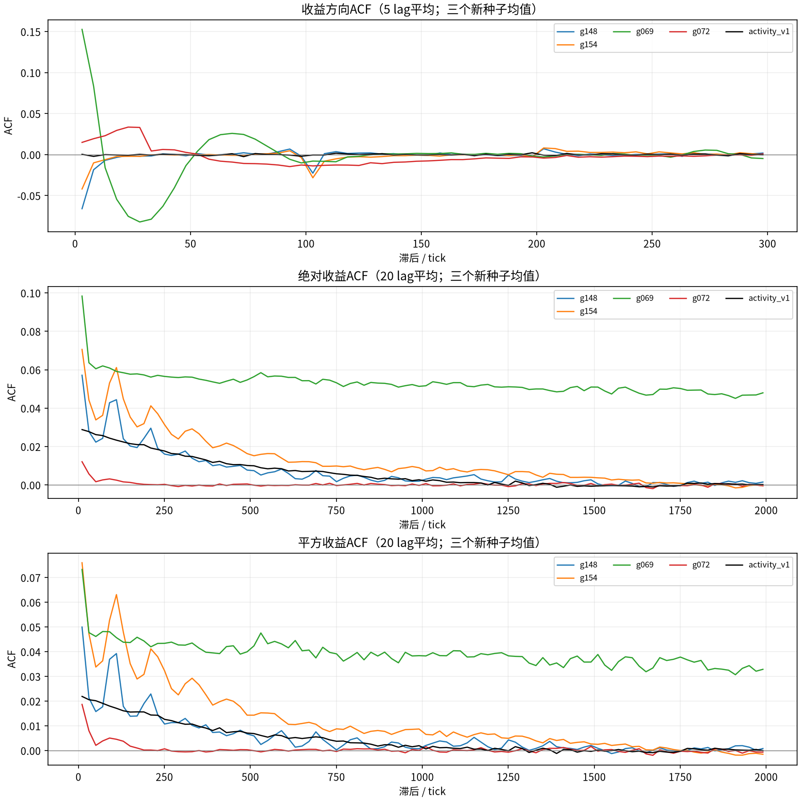
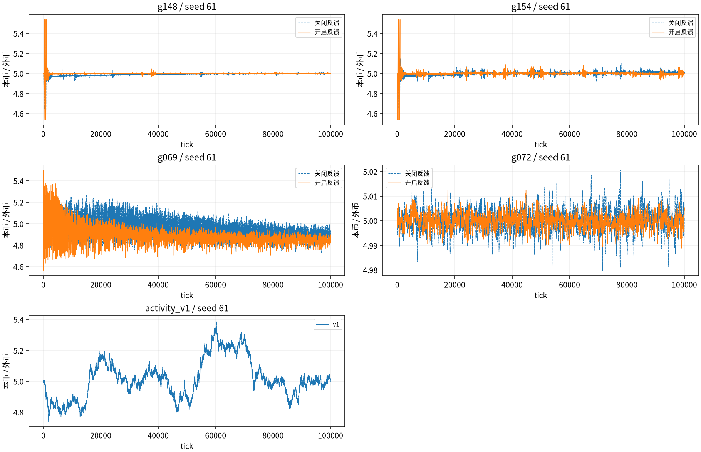
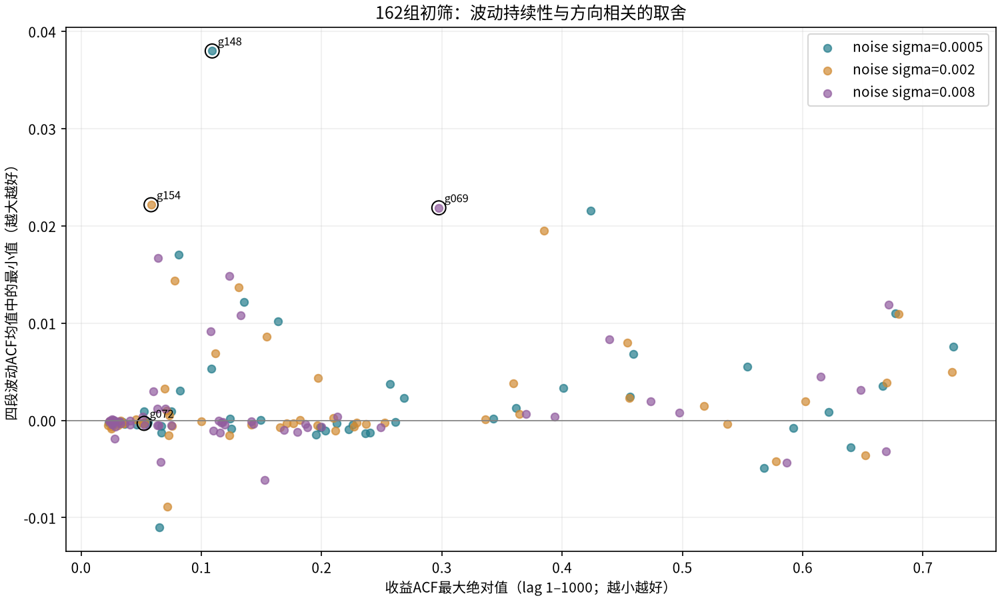
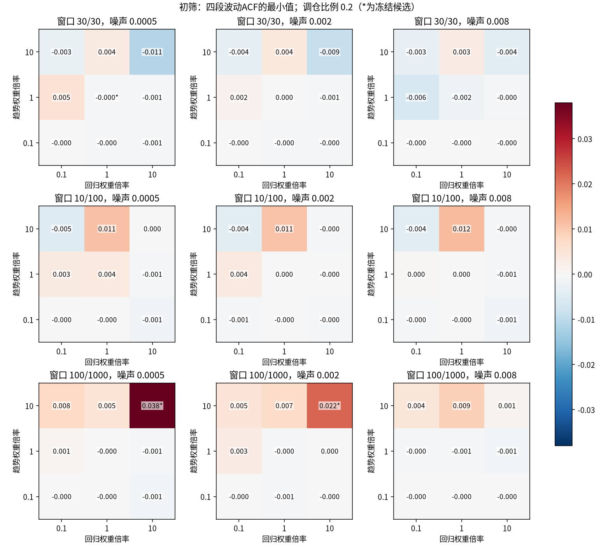
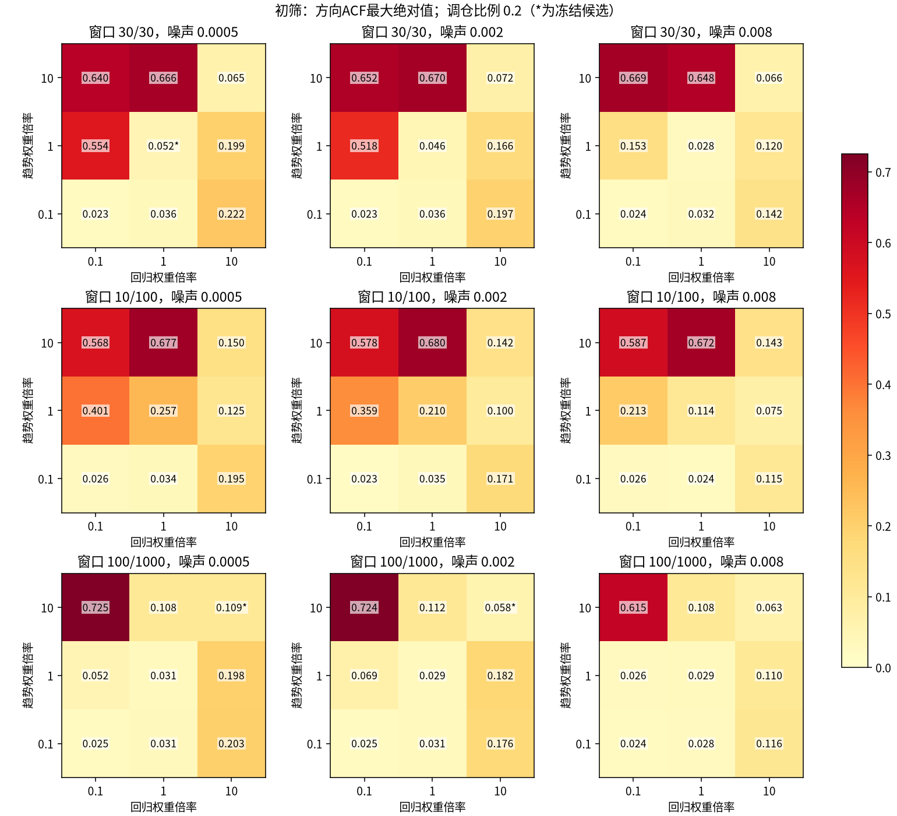
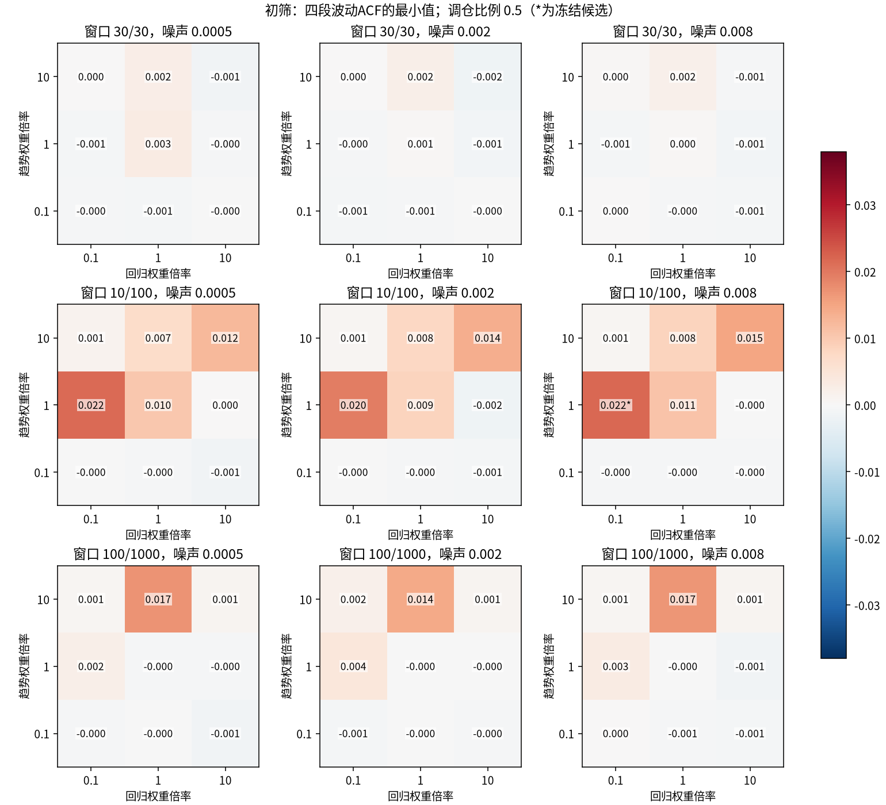
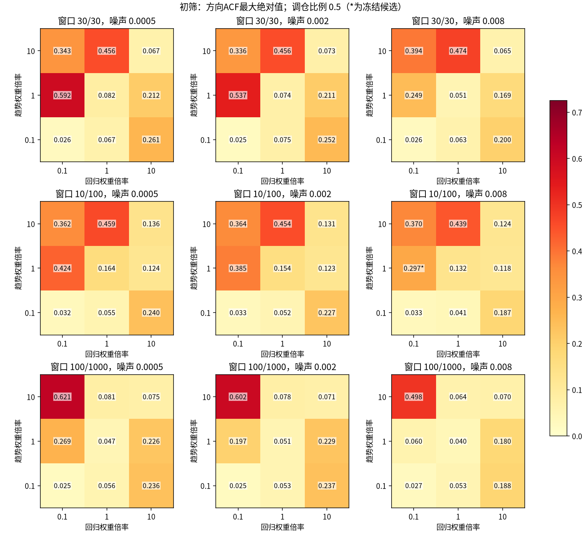

# 三因子参数网格：初筛与独立种子验证

本轮扫描162组参数，每组用种子51/52比较反馈开关，共648条25000tick路径；预热5000。按事先确定的三种排序冻结4个候选（含原参数），再用61/62/63三个新种子、每条100000tick验证，同时重跑同种子v1参照，共27条验证路径。本轮不调整活动反馈的psi、b或tau。

验证中，4个完整候选里，三个种子四段波动ACF均为正的有 **3组**；三个种子四段ACF都高于同参数关闭反馈对照的有 **1组**。这两项只描述重复性，不是显著性门槛；是否值得保留还必须看方向相关和成交规模。全部675条路径中失败0条。


**扫参找到了更大的全程波动相关，同时暴露了方向相关的代价。** 配置g069在验证中，平方收益301–1000段ACF为0.04034，关闭反馈为0.01715，四段增益在3/3种子中同时为正；但收益ACF1为0.18339，方向R为0.18339。同种子v1分别为平方收益ACF 0.00530、方向R 0.01136。不能只凭波动相关更强就将它升级为替代基线。


**g069还存在明显的运行退化与非平稳混杂。** 预热后的前/中/后三段平方收益301–1000段ACF分别为0.02594/0.00138/0.00039；收益标准差由0.002025降到0.001149，裁剪比例由19.8%升到32.3%。最小金币钱包曾触及0（这不等于所有账户永久破产）。全程ACF可能混入波动水平缓慢下降的影响，不能把0.04全部解释为平稳的活动反馈聚集；本轮也没有量化各因素的独立贡献。


另外，g148, g154的验证平方收益301–1000段相关，在关闭反馈时反而更强。它们的波动持续性也可能来自三因子与调仓本身，不能全部记为活动反馈的功劳。初筛排名与独立验证出现差异，报告保留全部候选，不按验证结果重选。


本轮经过验证的候选尚未同时满足持续性、与v1相近的低方向R和无明显运行退化。这不否定整个参数空间；未入选的158组只有短路径初筛证据，不能据此宣布全部三因子模型失败。


## 1. 新种子的结果

以下先对各lag段取平均，再对三个种子取平均；R是每条路径收益ACF在lag1–1000的最大绝对值，再取种子均值。开启反馈的四项指标必须同时阅读。关闭反馈r²301–1000单列作为配对参照，其余完整指标见CSV。


| 配置 | r ACF1 | R | 绝对收益101–300 | 绝对收益301–1000 | 平方收益101–300 | 平方收益301–1000 | 关闭反馈平方收益301–1000 |
| --- | --- | --- | --- | --- | --- | --- | --- |
| g148 | -0.11355 | 0.11355 | 0.02284 | 0.00630 | 0.01746 | 0.00470 | 0.03173 |
| g154 | -0.06486 | 0.07166 | 0.03633 | 0.01411 | 0.03648 | 0.01328 | 0.01834 |
| g069 | 0.18339 | 0.18339 | 0.05720 | 0.05409 | 0.04385 | 0.04034 | 0.01715 |
| g072 | 0.01506 | 0.04531 | 0.00056 | -0.00001 | 0.00114 | 0.00009 | 0.00022 |
| activity_v1 | -0.00062 | 0.01136 | 0.01967 | 0.00763 | 0.01445 | 0.00530 | 不适用 |

| 配置 | V：四项最小均值 | D：四项配对增益最小均值 | 四项为正的种子数 / 3 | 四项增益为正的种子数 / 3 |
| --- | --- | --- | --- | --- |
| g148 | 0.00470 | -0.06143 | 3 | 0 |
| g154 | 0.01328 | -0.00729 | 3 | 1 |
| g069 | 0.04034 | 0.02320 | 3 | 3 |
| g072 | -0.00001 | -0.00643 | 2 | 0 |
| activity_v1 | 不适用 | 不适用 | 不适用 | 不适用 |






价格图只展示验证seed61；各图纵轴不同，不能只凭视觉振幅比较。曲线包括完整预热段，统计均排除前5000tick。反馈开关后的价格、事件数和随机数消费会分叉，不作逐笔因果解释。

## 2. 候选参数和初筛依据

趋势/回归倍率分别乘旧的两类账户权重[(30,0.1),(3,1)]；个人噪声是log价格预期的标准差。三因子仍通过500*tanh(100*g)给出目标净外币，每次到达调整指定比例，净仓位相对开局1000外币。没有恢复锁仓或成绩切换。


| 配置 | 趋势倍率 | 回归倍率 | 噪声sigma | 趋势窗口 | 均价窗口 | 调仓比例 | 入选排序 |
| --- | --- | --- | --- | --- | --- | --- | --- |
| g148 | 10 | 10 | 0.0005 | 100 | 1000 | 0.2 | volatility, paired_gain, volatility_per_direction |
| g154 | 10 | 10 | 0.002 | 100 | 1000 | 0.2 | volatility, volatility_per_direction |
| g069 | 1 | 0.1 | 0.008 | 10 | 100 | 0.5 | paired_gain |
| g072 | 1 | 1 | 0.0005 | 30 | 30 | 0.2 | original_parameters |

初筛依次按V、D、V/(R+0.000001)从大到小排序，每项各取前2，合并去重，再补原参数。排序未设置物理通过线，负V的比值也仍按原公式排序；不将该比值当作独立经济指标。

| 配置 | 初筛V | 初筛D | 初筛R |
| --- | --- | --- | --- |
| g069 | 0.02186 | 0.02202 | 0.29747 |
| g072 | -0.00030 | -0.02211 | 0.05243 |
| g148 | 0.03799 | 0.03382 | 0.10905 |
| g154 | 0.02218 | -0.00080 | 0.05822 |


## 3. 全网格结果

趋势/回归各[0.1,1,10]倍，噪声[0.0005,0.002,0.008]，窗口(30,30)/(10,100)/(100,1000)，调仓[0.2,0.5]，全因子162组。窗口为预先选定的三种组合，本轮未穷举趋势窗口与均价窗口的全部交叉，也未扫描仓位上限、账户数或钱包规模。



初筛热图：星号标记进入独立验证的配置，所有格点保留。每个指标的色标在两种调仓比例下保持一致。












## 4. 活动、成交与资金约束

下表均为预热后种子均值，峰值为全程各路径峰值的平均，不能当作模型上限。三因子裁剪比较已量化订单输入与实际输入，v1保持原裁剪口径；跨策略裁剪比例仅作辅助阅读。完整钱包状态在每路径result.json，最小钱包序列和资产池序列在series.npz。


| 配置 | 反馈 | 平均强度 | 路径峰值均值 | 外币绝对量/tick | 裁剪比例 | 收益标准差 | 超额峰度 | 下一100块 | 下一240块 | 下一1000块 |
| --- | --- | --- | --- | --- | --- | --- | --- | --- | --- | --- |
| g148 | off | 1.0000 | 1.000 | 14.021 | 0.000% | 0.00024116 | 32.024 | 不适用 | 不适用 | 不适用 |
| g148 | on | 0.7502 | 37.897 | 8.322 | 0.000% | 0.00015405 | 28.242 | 0.617 | 0.514 | 0.311 |
| g154 | off | 1.0000 | 1.000 | 40.958 | 0.000% | 0.00055416 | 6.742 | 不适用 | 不适用 | 不适用 |
| g154 | on | 0.7576 | 37.952 | 27.374 | 0.000% | 0.00042939 | 8.976 | 0.726 | 0.609 | 0.301 |
| g069 | off | 1.0000 | 1.000 | 142.538 | 15.158% | 0.00204931 | 4.141 | 不适用 | 不适用 | 不适用 |
| g069 | on | 0.9946 | 25.631 | 101.739 | 26.193% | 0.00152830 | 13.219 | 0.668 | 0.798 | 0.956 |
| g072 | off | 1.0000 | 1.000 | 5.112 | 0.000% | 0.00006721 | 5.362 | 不适用 | 不适用 | 不适用 |
| g072 | on | 0.7511 | 0.771 | 3.499 | 0.000% | 0.00005182 | 4.750 | 0.232 | 0.134 | 0.123 |
| activity_v1 | on | 0.9390 | 4.927 | 29.066 | 3.122% | 0.00037899 | 3.528 | 0.696 | 0.658 | 0.238 |


### 分段检查

查看价格图发现g069振幅随时间减小后，统一对全部验证路径补做相同的三等分分析，没有据此修改参数或候选。分析段为tick5001–36667、36668–68334、68335–100000；每段重新去均值计算ACF，没有重置模拟状态。下表先计算每条路径的段指标再平均三个种子；它不能独立证明非平稳的具体成因，但能检查全程ACF是否掩盖了阶段变化。


| 配置 | 模型 | 段 | 收益标准差 | 平方收益101–300 | 平方收益301–1000 | 平均强度 | 外币量/tick | 裁剪比例 |
| --- | --- | --- | --- | --- | --- | --- | --- | --- |
| g148 | factor_fixed | 1 | 0.0002425 | 0.05366 | 0.02676 | 1.000 | 14.02 | 0.00% |
| g148 | factor_fixed | 2 | 0.0002395 | 0.03974 | 0.01138 | 1.000 | 14.27 | 0.00% |
| g148 | factor_fixed | 3 | 0.0002306 | 0.03913 | 0.02154 | 1.000 | 13.76 | 0.00% |
| g148 | factor_activity | 1 | 0.0001549 | 0.01601 | 0.00203 | 0.750 | 8.31 | 0.00% |
| g148 | factor_activity | 2 | 0.0001536 | 0.02344 | 0.00736 | 0.750 | 8.30 | 0.00% |
| g148 | factor_activity | 3 | 0.0001529 | 0.00879 | 0.00183 | 0.750 | 8.35 | 0.00% |
| g154 | factor_fixed | 1 | 0.0005290 | 0.02977 | 0.01485 | 1.000 | 38.88 | 0.00% |
| g154 | factor_fixed | 2 | 0.0005306 | 0.03394 | 0.01599 | 1.000 | 39.11 | 0.00% |
| g154 | factor_fixed | 3 | 0.0005978 | 0.03532 | 0.01625 | 1.000 | 44.88 | 0.00% |
| g154 | factor_activity | 1 | 0.0004402 | 0.03268 | 0.01258 | 0.758 | 28.13 | 0.00% |
| g154 | factor_activity | 2 | 0.0004319 | 0.03827 | 0.01088 | 0.759 | 27.63 | 0.00% |
| g154 | factor_activity | 3 | 0.0004147 | 0.03342 | 0.01410 | 0.755 | 26.36 | 0.00% |
| g069 | factor_fixed | 1 | 0.0024115 | 0.00007 | 0.00005 | 1.000 | 169.62 | 2.83% |
| g069 | factor_fixed | 2 | 0.0020415 | 0.00384 | 0.00380 | 1.000 | 142.67 | 17.63% |
| g069 | factor_fixed | 3 | 0.0016174 | 0.00328 | 0.00277 | 1.000 | 115.32 | 25.03% |
| g069 | factor_activity | 1 | 0.0020246 | 0.02892 | 0.02594 | 1.231 | 145.32 | 19.79% |
| g069 | factor_activity | 2 | 0.0012600 | 0.00164 | 0.00138 | 0.896 | 85.39 | 29.08% |
| g069 | factor_activity | 3 | 0.0011489 | 0.00060 | 0.00039 | 0.858 | 74.51 | 32.35% |
| g072 | factor_fixed | 1 | 0.0000667 | 0.00559 | 0.00227 | 1.000 | 5.08 | 0.00% |
| g072 | factor_fixed | 2 | 0.0000669 | 0.00562 | -0.00109 | 1.000 | 5.11 | 0.00% |
| g072 | factor_fixed | 3 | 0.0000680 | 0.00936 | -0.00047 | 1.000 | 5.15 | 0.00% |
| g072 | factor_activity | 1 | 0.0000523 | 0.00208 | 0.00078 | 0.751 | 3.52 | 0.00% |
| g072 | factor_activity | 2 | 0.0000516 | 0.00050 | -0.00013 | 0.751 | 3.49 | 0.00% |
| g072 | factor_activity | 3 | 0.0000516 | 0.00067 | -0.00052 | 0.751 | 3.48 | 0.00% |
| activity_v1 | activity_v1 | 1 | 0.0003758 | 0.01065 | 0.00483 | 0.919 | 28.43 | 2.95% |
| activity_v1 | activity_v1 | 2 | 0.0003803 | 0.01096 | 0.00376 | 0.947 | 29.29 | 3.09% |
| activity_v1 | activity_v1 | 3 | 0.0003808 | 0.01953 | 0.00661 | 0.951 | 29.48 | 3.33% |


## 5. 逐种子结果


| 配置 | 模型 | 种子 | R | 绝对收益101–300 | 绝对收益301–1000 | 平方收益101–300 | 平方收益301–1000 |
| --- | --- | --- | --- | --- | --- | --- | --- |
| activity_v1 | activity_v1 | 61 | 0.01184 | 0.01797 | 0.00943 | 0.01293 | 0.00649 |
| activity_v1 | activity_v1 | 62 | 0.01117 | 0.02401 | 0.00760 | 0.01824 | 0.00517 |
| activity_v1 | activity_v1 | 63 | 0.01107 | 0.01702 | 0.00586 | 0.01219 | 0.00425 |
| g069 | factor_activity | 61 | 0.19589 | 0.06073 | 0.05794 | 0.04477 | 0.04247 |
| g069 | factor_activity | 62 | 0.17654 | 0.05508 | 0.05188 | 0.04240 | 0.03935 |
| g069 | factor_activity | 63 | 0.17774 | 0.05579 | 0.05246 | 0.04438 | 0.03921 |
| g069 | factor_fixed | 61 | 0.24455 | 0.01688 | 0.01704 | 0.01687 | 0.01719 |
| g069 | factor_fixed | 62 | 0.24408 | 0.01807 | 0.01768 | 0.01729 | 0.01695 |
| g069 | factor_fixed | 63 | 0.24815 | 0.01850 | 0.01826 | 0.01770 | 0.01730 |
| g072 | factor_activity | 61 | 0.04584 | 0.00007 | 0.00011 | 0.00010 | 0.00021 |
| g072 | factor_activity | 62 | 0.04340 | 0.00093 | 0.00013 | 0.00201 | 0.00035 |
| g072 | factor_activity | 63 | 0.04668 | 0.00066 | -0.00026 | 0.00131 | -0.00030 |
| g072 | factor_fixed | 61 | 0.07043 | 0.00565 | -0.00056 | 0.00759 | -0.00074 |
| g072 | factor_fixed | 62 | 0.06984 | 0.00635 | 0.00078 | 0.00887 | 0.00126 |
| g072 | factor_fixed | 63 | 0.06678 | 0.00399 | 0.00034 | 0.00627 | 0.00013 |
| g148 | factor_activity | 61 | 0.10859 | 0.03041 | 0.01100 | 0.02534 | 0.00890 |
| g148 | factor_activity | 62 | 0.11645 | 0.02061 | 0.00448 | 0.01446 | 0.00305 |
| g148 | factor_activity | 63 | 0.11562 | 0.01751 | 0.00341 | 0.01258 | 0.00216 |
| g148 | factor_fixed | 61 | 0.11573 | 0.06386 | 0.02564 | 0.04483 | 0.01370 |
| g148 | factor_fixed | 62 | 0.09640 | 0.11031 | 0.06894 | 0.08814 | 0.05433 |
| g148 | factor_fixed | 63 | 0.10274 | 0.07863 | 0.03495 | 0.06738 | 0.02715 |
| g154 | factor_activity | 61 | 0.06719 | 0.04232 | 0.01912 | 0.04151 | 0.01839 |
| g154 | factor_activity | 62 | 0.07502 | 0.03076 | 0.00635 | 0.03180 | 0.00583 |
| g154 | factor_activity | 63 | 0.07277 | 0.03591 | 0.01685 | 0.03613 | 0.01561 |
| g154 | factor_fixed | 61 | 0.09875 | 0.02836 | 0.00859 | 0.02444 | 0.00688 |
| g154 | factor_fixed | 62 | 0.08962 | 0.05073 | 0.03151 | 0.04545 | 0.02719 |
| g154 | factor_fixed | 63 | 0.08209 | 0.04476 | 0.02409 | 0.03950 | 0.02094 |


## 6. 实验设置与统计口径

20个账户各本币5000/外币1000，池本币100万/外币20万，初价5、零手续费、每单池限额0.005；不补钱、不重置钱包。活动状态tau1000、psi0.0004，b=0/.25，初始z=0。个人预期每户每tick更新，同tick重复到达仍按真实库存重新调仓；公开价格读取、窗口定义与[上一轮](../comparison/report.md)一致。

初筛分析20000个收益；验证分析95000个收益。r=ln(P_t/P_(t−1))，包含零收益；ACF去均值后用lag乘积和/lag0乘积和，不作N/(N−lag)修正。指标区间包含全部整数lag。方向ACF涉及有符号收益本身，并非仅对sign(r)计算。超额峰度采用Fisher定义及bias=False。下一块关系是期初强度块均值与下一不重叠块r²均值的Pearson相关，常数状态未定义；不是涨跌预测或交易收益。

初筛只计算ACF、矩和块关系；验证额外保存完整lag1–5000曲线、聚合分布、DFA1/2。DFA沿用公共固定尺度16–8192；本轮不按DFA挑选参数，也不据此宣称幂律长记忆。完整结果在每条路径result.json。

筛选使用两个种子的均值，会受到多重比较和罕见路径影响。候选由[selection.json](selection.json)在验证前冻结，含初筛文件hash；验证种子没有参与选参。三个验证种子的范围不能替代置信区间，未经过验证的网格点不作长期结论。只有配对反馈开关比较能较直接判断活动反馈增益，和v1比较同时改变了订单规则。有限样本方向ACF小也不能证明不可预测或不可套利。

## 7. 文件和复算

- [网格/源代码清单](manifest.json)
- [全部初筛路径指标](screen-paths.csv)、[全部参数及筛选指标](screen-parameters.csv)
- [全部验证路径指标](validation-paths.csv)、[冻结候选](selection.json)
- [全部验证路径的三段指标](segments.csv)
- [独立数值核对](audit.json)
- [计划与选择规则](../../GRID_PLAN.md)

每条路径目录保存series.npz、result.json及来源SHA256；失败路径保留异常，不隐去格点。既有冻结v1、common、archive和生产市场未修改。单元检查命令：`OPENBLAS_NUM_THREADS=1 python -m unittest discover -s research/fx/tests -v`，15项通过。

```bash
OPENBLAS_NUM_THREADS=1 OMP_NUM_THREADS=1 python -m research.fx.factor_activity.grid
OPENBLAS_NUM_THREADS=1 MPLCONFIGDIR=/tmp/fx-matplotlib python -m research.fx.factor_activity.grid_report
```

