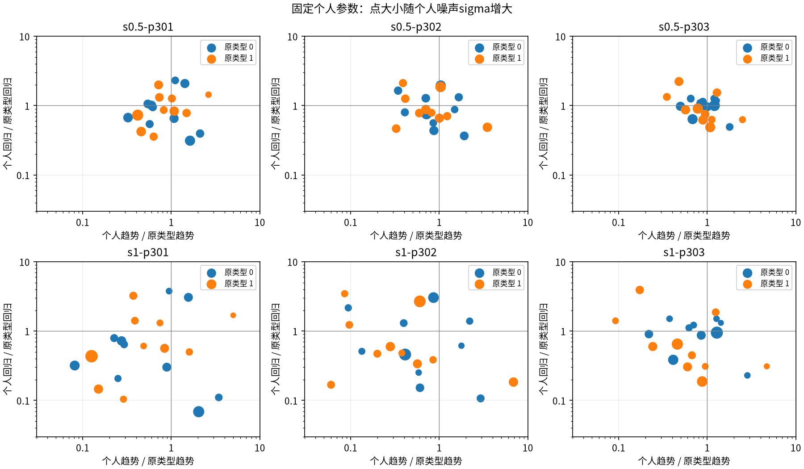
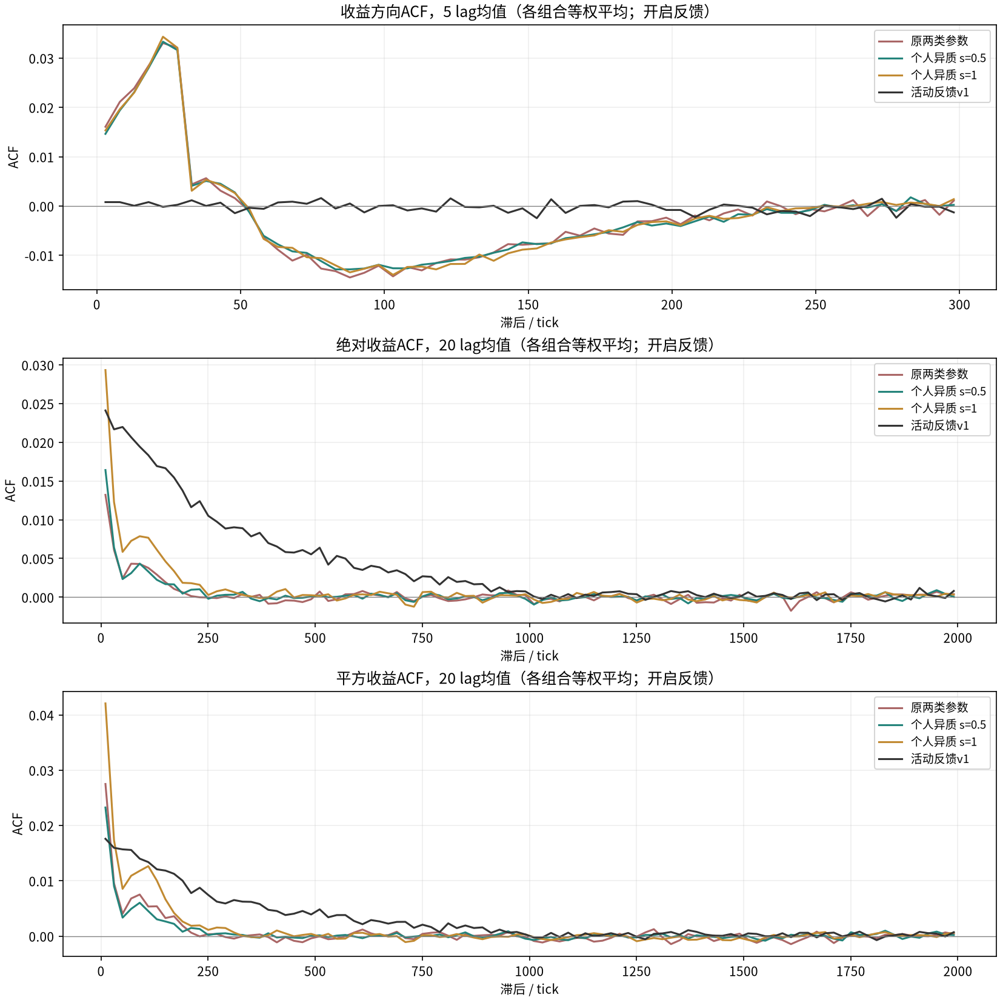
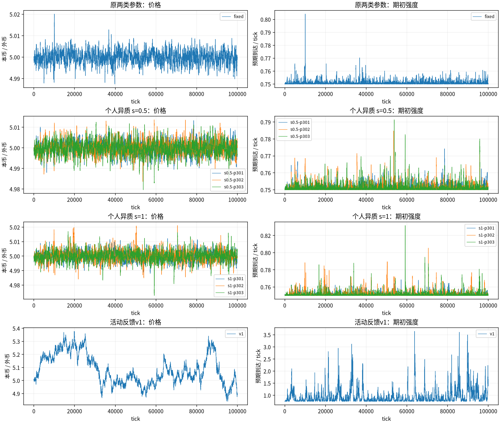
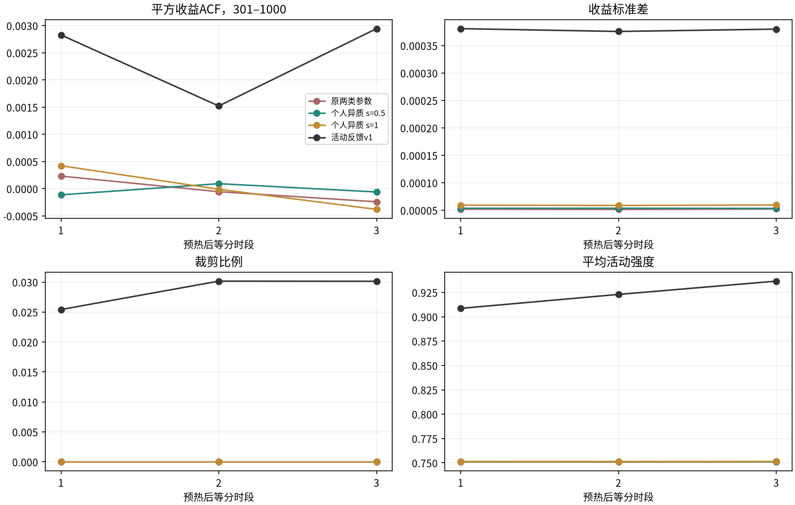

# 随机个人三因子与活动反馈：三人口×三行情对照

用户确认检验“个人参数固定随机化＋公共价格活动反馈”。本轮完成45条10万tick路径，预热5000，失败0条。两个异质程度各包含3批交易者×3个行情种子×反馈开关；原两类参数作同种子开关对照，v1作同种子反馈参照。没有按结果重抽人口、改参或扩大扫描。

**在当前参数中心和两档异质程度下，固定随机个人参数没有恢复v1的中尺度波动持续性。** 方向R仅小幅变化，平均活动强度仍贴近底值.75。本轮不支持“只需打散个人系数，就足以解决上一轮问题”的判断；也不能推广成其他参数分布、窗口或交易规则下的异质性都无效。


个人异质 s=0.5：方向R均值0.04251（原两类0.04468、v1 0.01206）；平方收益301–1000段ACF均值0.00005，范围[-0.00072, 0.00069]；平均强度0.751163，四段波动ACF同时为正4/9条。


个人异质 s=1：方向R均值0.04303（原两类0.04468、v1 0.01206）；平方收益301–1000段ACF均值0.00005，范围[-0.00087, 0.00130]；平均强度0.751409，四段波动ACF同时为正6/9条。


这些是交叉组合的描述统计，9条不是9个完全独立样本。总体参数矩保持一致，也不保证实际订单、收益尺度和活动强度一致。是否改善需要同时阅读方向相关、配对波动增益、分段变化与钱包。

判断同向程度在原两类、s=.5、s=1开启反馈组分别为0.1945/0.1916/0.1976，只小幅变化且不随异质程度单调下降。关闭反馈组的平均到达率为1，开启组约.751；开关同时改变有效交易频率，不能把开组方向R较低全部解释为有益的活动记忆。

本轮异质组的三段成交量与收益尺度大致稳定，全部三因子路径的裁剪均为0；没有出现上一轮强参数候选那种共同的持续耗损。当前现象更接近“活动反馈很弱”，不能用资金耗尽解释本轮失败。开启反馈后每tick绝对外币成交约3.44/3.38，v1约28.84；沿用同一psi时，实际收益尺度也不同。这与反馈未被充分激活相符，但尚未隔离订单规模、目标仓位回复和方向效应的独立贡献。

## 1. 实验设置与抽样规则

20户原先交替两类权重(30,.1)/(3,1)。每位交易者的趋势、回归、噪声参数各用独立标准高斯u乘exp(s*u)，s=.5/1；在每个原类型的10人内，把趋势/回归倍率各归一化到平均1，噪声倍率归一化到均方1。开局固定参数，s=0精确退回旧两类模型。没有参数每tick重抽、学习或策略类型切换。

人口种子301/302/303与行情种子71/72/73交叉；同人口在两种反馈下完全相同，人口参数流独立于行情随机流，不消费到达/预期/洗牌随机数。两档异质程度使用同一人口的标准高斯抽样。正系数归一化造成同一类型内约束相关，不能把20个参数称为互不相关抽样。

保留窗口30/30、每tick每户更新信号g=a_i*T+b_i*M+sigma_i*epsilon_i，g仍为log(主观目标价/观察价)；T与M沿用旧历史定义，不引用独立基本价值。目标净外币500*tanh(100*g)，相对开局1000外币，每到达向目标差额调整20%，真实成交后按真实库存重算。买入以观察价格换算金币预算，卖出以外币数量输入。sensitivity100、公共窗口和调仓规则固定，没有随机化账户到达偏好。

账户各金币5000/外币1000，池金币100万/外币20万，初价5、零手续费、单笔池限额.005；钱包非负、不补钱或重置。共享活动状态tau1000、psi.0004、z初始0，期初Lambda=(1−b)+b*z²，b=0/.25；当期真实收益后更新z_next=exp(−1/1000)*z+sqrt(1−exp(−2/1000))*r/.0004。z累计带符号变化，同向积累、反向抵消后再平方；并非直接r²估计。各户Poisson(Lambda/20)，事件洗牌执行。

所有人口参数在正式运行前保存于[manifest.json](manifest.json)，[profiles.csv](profiles.csv)列出每人参数。新驱动复用原AMM、时钟、信号组件与执行函数；s=0对反馈开关分别与旧simulate全部21个公共字段逐点一致，见[compatibility.json](compatibility.json)。旧来源和冻结数据未改。



## 2. 全程结果

以下各路径先计算指标再取等权均值；原两类和v1各3个行情，异质组各9个交叉组合。R为收益ACF在lag1–1000最大绝对值；波动指标为全部整数lag均值。


| 组别 / 反馈 | 路径数 | 收益ACF1 | 方向R | 绝对收益101–300 | 绝对收益301–1000 | 平方收益101–300 | 平方收益301–1000 | 四段同时为正数 |
| --- | --- | --- | --- | --- | --- | --- | --- | --- |
| 原两类参数 / b=0 | 3 | 0.03975 | 0.06613 | 0.00543 | -0.00017 | 0.00824 | 0.00012 | 1 |
| 原两类参数 / b=0.25 | 3 | 0.01596 | 0.04468 | 0.00104 | 0.00002 | 0.00207 | 0.00001 | 1 |
| 个人异质 s=0.5 / b=0 | 9 | 0.03665 | 0.06519 | 0.00773 | 0.00007 | 0.01034 | 0.00031 | 4 |
| 个人异质 s=0.5 / b=0.25 | 9 | 0.01175 | 0.04251 | 0.00117 | 0.00005 | 0.00172 | 0.00005 | 4 |
| 个人异质 s=1 / b=0 | 9 | 0.02901 | 0.06237 | 0.01155 | 0.00035 | 0.01253 | 0.00080 | 6 |
| 个人异质 s=1 / b=0.25 | 9 | 0.01420 | 0.04303 | 0.00291 | 0.00017 | 0.00442 | 0.00005 | 6 |
| 活动反馈v1 / b=0.25 | 3 | 0.00036 | 0.01206 | 0.01343 | 0.00400 | 0.00947 | 0.00293 | 3 |

| 组别 / 反馈 | R最小 | R最大 | 平方收益301–1000最小 | 平方收益301–1000最大 | 平均强度 | 判断同向程度 |
| --- | --- | --- | --- | --- | --- | --- |
| 原两类参数 / b=0 | 0.06386 | 0.06993 | -0.00082 | 0.00075 | 1.000000 | 0.1974 |
| 原两类参数 / b=0.25 | 0.04078 | 0.04969 | -0.00025 | 0.00050 | 0.751091 | 0.1945 |
| 个人异质 s=0.5 / b=0 | 0.05958 | 0.07409 | -0.00128 | 0.00300 | 1.000000 | 0.1923 |
| 个人异质 s=0.5 / b=0.25 | 0.03961 | 0.04914 | -0.00072 | 0.00069 | 0.751163 | 0.1916 |
| 个人异质 s=1 / b=0 | 0.05450 | 0.07312 | -0.00127 | 0.00460 | 1.000000 | 0.1991 |
| 个人异质 s=1 / b=0.25 | 0.03875 | 0.04762 | -0.00087 | 0.00130 | 0.751409 | 0.1976 |
| 活动反馈v1 / b=0.25 | 0.01173 | 0.01265 | 0.00212 | 0.00402 | 0.922692 | 不适用 |

判断同向程度为每tick 20人的sign(g)均值取绝对值，再取时间均值；0表示方向各半，1表示全同向。它只衡量预期方向，不代表到达后的真实成交方向，也不是收益不可预测性的检验。





价格图展示行情seed71，各批人口均保留；统计均排除前5000tick，图含预热，各图纵轴不同。

## 3. 配对比较

每个异质路径分别减同人口同种子关闭反馈、同种子原两类开启反馈。方向R差值越小表示方向相关越弱；波动差值为正表示该指标上升，不单独代表成功。

| 配对差 | 配对数 | 方向R差 | 绝对收益101–300差 | 绝对收益301–1000差 | 平方收益101–300差 | 平方收益301–1000差 | 四段差同时为正数 |
| --- | --- | --- | --- | --- | --- | --- | --- |
| 个人异质 s=0.5：异质开启−同人口关闭 | 9 | -0.02268 | -0.00657 | -0.00002 | -0.00863 | -0.00026 | 0 |
| 个人异质 s=0.5：异质开启−原两类开启 | 9 | -0.00217 | 0.00012 | 0.00004 | -0.00035 | 0.00004 | 2 |
| 个人异质 s=1：异质开启−同人口关闭 | 9 | -0.01935 | -0.00864 | -0.00018 | -0.00811 | -0.00074 | 0 |
| 个人异质 s=1：异质开启−原两类开启 | 9 | -0.00165 | 0.00187 | 0.00015 | 0.00235 | 0.00004 | 3 |

## 4. 每批交易者的结果

同一批人口先对三个行情平均，全部人口均列出，没有挑选有利人群。

| 人口 | 方向R | 绝对收益101–300 | 绝对收益301–1000 | 平方收益101–300 | 平方收益301–1000 | 平均强度 | 判断同向程度 |
| --- | --- | --- | --- | --- | --- | --- | --- |
| fixed | 0.04468 | 0.00104 | 0.00002 | 0.00207 | 0.00001 | 0.751091 | 0.1945 |
| s0.5-p301 | 0.04090 | 0.00068 | 0.00020 | 0.00122 | 0.00021 | 0.751114 | 0.1836 |
| s0.5-p302 | 0.04074 | 0.00156 | -0.00001 | 0.00245 | -0.00005 | 0.751156 | 0.1921 |
| s0.5-p303 | 0.04590 | 0.00125 | -0.00003 | 0.00149 | 0.00001 | 0.751219 | 0.1990 |
| s1-p301 | 0.04142 | 0.00319 | -0.00009 | 0.00548 | -0.00029 | 0.751329 | 0.1780 |
| s1-p302 | 0.04306 | 0.00314 | 0.00024 | 0.00455 | 0.00007 | 0.751463 | 0.1899 |
| s1-p303 | 0.04459 | 0.00241 | 0.00035 | 0.00322 | 0.00038 | 0.751435 | 0.2250 |

## 5. 分段、成交与资金约束

预热后按tick5001–36667、36668–68334、68335–100000三等分，每段重新去均值计算ACF，不重置模拟状态。分段在运行前已列为必要检查，防止长期波动衰减抬高全程相关。

| 组别 / 反馈 | 段 | 平方收益101–300 | 平方收益301–1000 | 收益标准差 | 平均强度 | 外币绝对量/tick | 裁剪比例 |
| --- | --- | --- | --- | --- | --- | --- | --- |
| 原两类参数 / b=0 | 1 | 0.00506 | 0.00079 | 0.00006729 | 1.00000 | 5.143 | 0.000% |
| 原两类参数 / b=0 | 2 | 0.00611 | 0.00018 | 0.00006848 | 1.00000 | 5.195 | 0.000% |
| 原两类参数 / b=0 | 3 | 0.01148 | -0.00118 | 0.00006770 | 1.00000 | 5.128 | 0.000% |
| 原两类参数 / b=0.25 | 1 | 0.00339 | 0.00023 | 0.00005208 | 0.75114 | 3.514 | 0.000% |
| 原两类参数 / b=0.25 | 2 | 0.00109 | -0.00005 | 0.00005154 | 0.75102 | 3.489 | 0.000% |
| 原两类参数 / b=0.25 | 3 | 0.00076 | -0.00024 | 0.00005240 | 0.75111 | 3.537 | 0.000% |
| 个人异质 s=0.5 / b=0 | 1 | 0.00687 | 0.00137 | 0.00007187 | 1.00000 | 5.187 | 0.000% |
| 个人异质 s=0.5 / b=0 | 2 | 0.00977 | 0.00011 | 0.00007280 | 1.00000 | 5.212 | 0.000% |
| 个人异质 s=0.5 / b=0 | 3 | 0.01255 | -0.00108 | 0.00007120 | 1.00000 | 5.110 | 0.000% |
| 个人异质 s=0.5 / b=0.25 | 1 | 0.00193 | -0.00011 | 0.00005356 | 0.75114 | 3.438 | 0.000% |
| 个人异质 s=0.5 / b=0.25 | 2 | 0.00148 | 0.00009 | 0.00005363 | 0.75119 | 3.451 | 0.000% |
| 个人异质 s=0.5 / b=0.25 | 3 | 0.00139 | -0.00006 | 0.00005334 | 0.75116 | 3.443 | 0.000% |
| 个人异质 s=1 / b=0 | 1 | 0.00880 | 0.00097 | 0.00008410 | 1.00000 | 5.319 | 0.000% |
| 个人异质 s=1 / b=0 | 2 | 0.01219 | 0.00053 | 0.00008476 | 1.00000 | 5.311 | 0.000% |
| 个人异质 s=1 / b=0 | 3 | 0.01422 | -0.00010 | 0.00008299 | 1.00000 | 5.211 | 0.000% |
| 个人异质 s=1 / b=0.25 | 1 | 0.00260 | 0.00042 | 0.00005928 | 0.75141 | 3.388 | 0.000% |
| 个人异质 s=1 / b=0.25 | 2 | 0.00346 | -0.00001 | 0.00005870 | 0.75136 | 3.369 | 0.000% |
| 个人异质 s=1 / b=0.25 | 3 | 0.00599 | -0.00038 | 0.00005949 | 0.75146 | 3.388 | 0.000% |
| 活动反馈v1 / b=0.25 | 1 | 0.00832 | 0.00283 | 0.00038083 | 0.90860 | 28.516 | 2.542% |
| 活动反馈v1 / b=0.25 | 2 | 0.00994 | 0.00152 | 0.00037568 | 0.92292 | 28.814 | 3.016% |
| 活动反馈v1 / b=0.25 | 3 | 0.00832 | 0.00294 | 0.00037994 | 0.93656 | 29.184 | 3.013% |



三因子裁剪比较正常量化后的意向输入与实际输入，v1保持原外币意向/执行口径，跨策略裁剪比例仅作辅助。最小钱包触及0不等于所有账户永久破产，钱包和裁剪必须同时看。

| 组别 / 反馈 | 收益标准差 | 超额峰度 | 外币绝对量/tick | 裁剪比例 | 路径最低金币均值 | 路径最低外币均值 | 路径峰值均值 | 下一100块 | 下一240块 | 下一1000块 |
| --- | --- | --- | --- | --- | --- | --- | --- | --- | --- | --- |
| 原两类参数 / b=0 | 0.00006783 | 5.342 | 5.155 | 0.000% | 4513.787 | 912.604 | 1.000 | 不适用 | 不适用 | 不适用 |
| 原两类参数 / b=0.25 | 0.00005201 | 5.506 | 3.513 | 0.000% | 4616.903 | 936.703 | 0.781 | 0.284 | 0.134 | 0.029 |
| 个人异质 s=0.5 / b=0 | 0.00007197 | 8.062 | 5.170 | 0.000% | 4189.991 | 840.829 | 1.000 | 不适用 | 不适用 | 不适用 |
| 个人异质 s=0.5 / b=0.25 | 0.00005351 | 6.907 | 3.444 | 0.000% | 4540.595 | 913.329 | 0.781 | 0.254 | 0.118 | 0.065 |
| 个人异质 s=1 / b=0 | 0.00008398 | 15.880 | 5.280 | 0.000% | 3751.560 | 739.675 | 1.000 | 不适用 | 不适用 | 不适用 |
| 个人异质 s=1 / b=0.25 | 0.00005917 | 13.138 | 3.381 | 0.000% | 4140.460 | 841.294 | 0.803 | 0.352 | 0.157 | 0.051 |
| 活动反馈v1 / b=0.25 | 0.00037894 | 3.485 | 28.838 | 2.844% | 0.000 | 0.000 | 4.096 | 0.643 | 0.525 | 0.201 |

## 6. 全部逐路径结果

| 路径 | 方向R | 绝对收益301–1000 | 平方收益301–1000 | 平均强度 | 裁剪比例 |
| --- | --- | --- | --- | --- | --- |
| fixed-b0-seed71 | 0.06386 | -0.00022 | 0.00044 | 1.000000 | 0.000% |
| fixed-b0-seed72 | 0.06459 | -0.00101 | -0.00082 | 1.000000 | 0.000% |
| fixed-b0-seed73 | 0.06993 | 0.00073 | 0.00075 | 1.000000 | 0.000% |
| fixed-b0.25-seed71 | 0.04969 | -0.00020 | -0.00025 | 0.751128 | 0.000% |
| fixed-b0.25-seed72 | 0.04357 | 0.00022 | 0.00050 | 0.751054 | 0.000% |
| fixed-b0.25-seed73 | 0.04078 | 0.00003 | -0.00023 | 0.751090 | 0.000% |
| s0.5-p301-b0-seed71 | 0.06232 | 0.00063 | 0.00128 | 1.000000 | 0.000% |
| s0.5-p301-b0-seed72 | 0.06185 | -0.00166 | -0.00128 | 1.000000 | 0.000% |
| s0.5-p301-b0-seed73 | 0.06456 | 0.00102 | 0.00128 | 1.000000 | 0.000% |
| s0.5-p301-b0.25-seed71 | 0.03961 | -0.00001 | 0.00005 | 0.751082 | 0.000% |
| s0.5-p301-b0.25-seed72 | 0.04193 | 0.00059 | 0.00069 | 0.751145 | 0.000% |
| s0.5-p301-b0.25-seed73 | 0.04114 | 0.00002 | -0.00013 | 0.751116 | 0.000% |
| s0.5-p302-b0-seed71 | 0.06436 | -0.00069 | -0.00045 | 1.000000 | 0.000% |
| s0.5-p302-b0-seed72 | 0.05958 | -0.00130 | -0.00124 | 1.000000 | 0.000% |
| s0.5-p302-b0-seed73 | 0.06587 | 0.00004 | -0.00008 | 1.000000 | 0.000% |
| s0.5-p302-b0.25-seed71 | 0.04097 | -0.00018 | -0.00033 | 0.751210 | 0.000% |
| s0.5-p302-b0.25-seed72 | 0.03975 | -0.00020 | -0.00003 | 0.751055 | 0.000% |
| s0.5-p302-b0.25-seed73 | 0.04149 | 0.00035 | 0.00021 | 0.751203 | 0.000% |
| s0.5-p303-b0-seed71 | 0.06540 | 0.00005 | 0.00048 | 1.000000 | 0.000% |
| s0.5-p303-b0-seed72 | 0.07409 | -0.00035 | -0.00017 | 1.000000 | 0.000% |
| s0.5-p303-b0-seed73 | 0.06869 | 0.00292 | 0.00300 | 1.000000 | 0.000% |
| s0.5-p303-b0.25-seed71 | 0.04914 | -0.00049 | -0.00072 | 0.751376 | 0.000% |
| s0.5-p303-b0.25-seed72 | 0.04609 | 0.00014 | 0.00043 | 0.751192 | 0.000% |
| s0.5-p303-b0.25-seed73 | 0.04248 | 0.00027 | 0.00032 | 0.751089 | 0.000% |
| s1-p301-b0-seed71 | 0.05698 | 0.00065 | 0.00076 | 1.000000 | 0.000% |
| s1-p301-b0-seed72 | 0.05938 | 0.00003 | 0.00087 | 1.000000 | 0.000% |
| s1-p301-b0-seed73 | 0.05917 | 0.00340 | 0.00460 | 1.000000 | 0.000% |
| s1-p301-b0.25-seed71 | 0.03875 | -0.00002 | -0.00025 | 0.751182 | 0.000% |
| s1-p301-b0.25-seed72 | 0.04373 | 0.00028 | 0.00027 | 0.751390 | 0.000% |
| s1-p301-b0.25-seed73 | 0.04177 | -0.00053 | -0.00087 | 0.751417 | 0.000% |
| s1-p302-b0-seed71 | 0.06499 | -0.00170 | -0.00127 | 1.000000 | 0.000% |
| s1-p302-b0-seed72 | 0.05450 | 0.00002 | 0.00092 | 1.000000 | 0.000% |
| s1-p302-b0-seed73 | 0.06030 | 0.00062 | 0.00030 | 1.000000 | 0.000% |
| s1-p302-b0.25-seed71 | 0.04674 | 0.00032 | 0.00014 | 0.751649 | 0.000% |
| s1-p302-b0.25-seed72 | 0.04340 | 0.00015 | 0.00005 | 0.751394 | 0.000% |
| s1-p302-b0.25-seed73 | 0.03905 | 0.00027 | 0.00002 | 0.751346 | 0.000% |
| s1-p303-b0-seed71 | 0.06443 | -0.00052 | -0.00028 | 1.000000 | 0.000% |
| s1-p303-b0-seed72 | 0.07312 | -0.00066 | -0.00001 | 1.000000 | 0.000% |
| s1-p303-b0-seed73 | 0.06849 | 0.00128 | 0.00129 | 1.000000 | 0.000% |
| s1-p303-b0.25-seed71 | 0.04762 | -0.00016 | -0.00030 | 0.751620 | 0.000% |
| s1-p303-b0.25-seed72 | 0.03977 | 0.00007 | 0.00014 | 0.751337 | 0.000% |
| s1-p303-b0.25-seed73 | 0.04639 | 0.00113 | 0.00130 | 0.751350 | 0.000% |
| v1-b0.25-seed71 | 0.01179 | 0.00326 | 0.00212 | 0.935910 | 2.624% |
| v1-b0.25-seed72 | 0.01265 | 0.00501 | 0.00402 | 0.926097 | 3.091% |
| v1-b0.25-seed73 | 0.01173 | 0.00373 | 0.00263 | 0.906069 | 2.817% |

## 7. 统计口径、验证与边界

每路径分析95000个含零值收益，r=ln(P_t/P_(t−1))。ACF去均值后用lag乘积和/lag0乘积和，不作N/(N−lag)修正；方向指标使用有符号收益，不是仅sign(r)。段均值含所有整数lag；图按5或20lag平均，仅作展示，完整曲线到5000保存在result.json。std用ddof=1，偏度/超额峰度bias=False，Fisher正态超额峰度0。

活动块关系是期初Lambda平均与下一不重叠100/240/1000tick块r²平均的Pearson相关；固定率状态恒定，相关为null。每路径同时保存聚合收益分布、DFA1/2固定尺度16–8192；未用DFA挑参数或宣称严格长记忆。高峰度不证明稳定幂律尾部。

这轮同时随机化三种个人系数，能够检验这一整套异质性设定，不能拆分每个系数的独立贡献。总体矩约束并不控制a/b协方差、非线性目标或成交尺度。三个市场种子跨人口复用、三个参数人口跨市场复用，范围只是组合间最小/最大，不是置信区间。没有检验随机窗口、独立活动状态、玩家/注资响应或真实市场复现，也不据此宣称不可套利。有限样本结果不能排除其他参数分布或中心下的作用。

- [预先固定的实验计划](../../PLAN.md)
- [人口与参数清单](manifest.json)、[每人参数](profiles.csv)、[逐路径指标](metrics.csv)
- [配对比较](paired.csv)、[全部分段指标](segments.csv)、[汇总指标](aggregates.csv)
- [零异质性兼容检查](compatibility.json)、[独立数值核对](audit.json)

每路径保存完整series.npz、result.json（个人参数、资金状态、来源hash、完整统计）。运行命令：

```bash
OPENBLAS_NUM_THREADS=1 OMP_NUM_THREADS=1 python -m research.fx.heterogeneous.run
OPENBLAS_NUM_THREADS=1 MPLCONFIGDIR=/tmp/fx-matplotlib python -m research.fx.heterogeneous.report
OPENBLAS_NUM_THREADS=1 python -m unittest discover -s research/fx/tests -v
```

相关单元检查17项通过，包含人口总体矩、固定可重复性、s=0真实旧路径兼容与反馈开关的个人噪声配对。来源和冻结文件的核对记录在audit.json。

