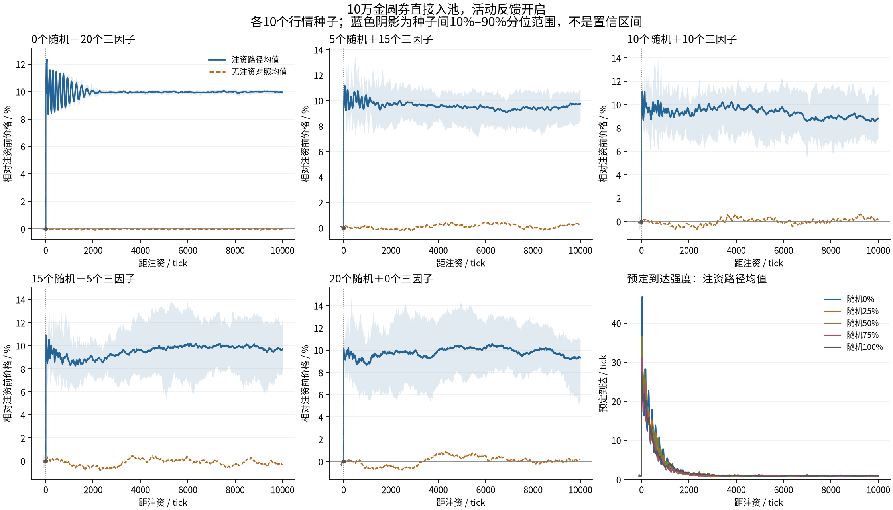
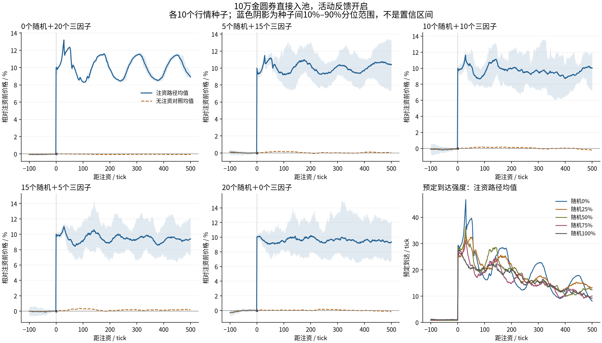
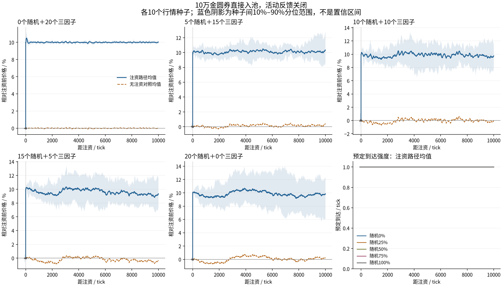
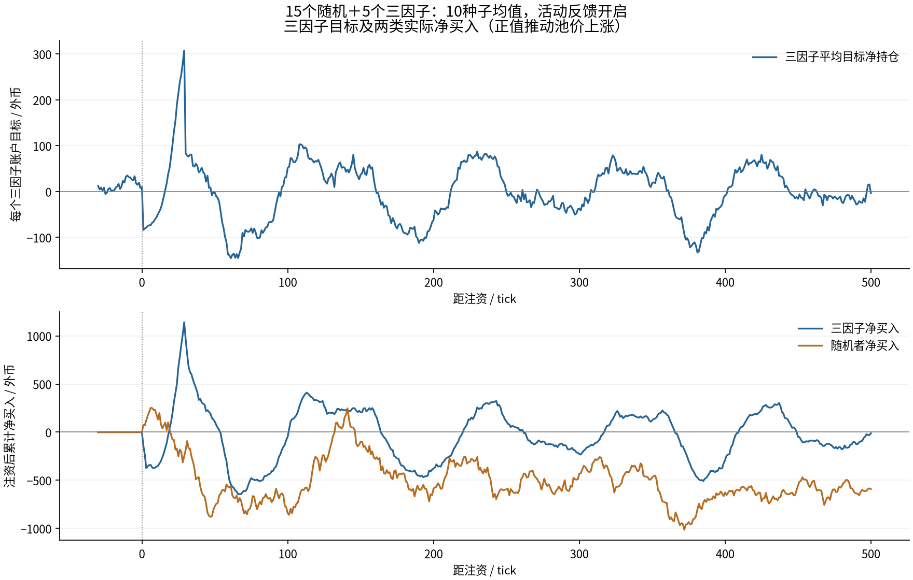

# 10万金圆券注资冲击：回落检验

**本轮未观察到可靠的旧价恢复。** 所有100条注资路径（含反馈开关）在注资后1万tick内均未触及实际注资前价格，末500tick均价也均未回到注资前±1%。存在短期冲高回吐和少数回落一半的路径；这不等于持续消化这次约10%的价格上移。

## 实验设置

沿用刚完成的五种混合：20户中纯随机0/5/10/15/20人，其余为个人参数三因子。人口种子301、spread=1，按账户编号嵌套替换，不重抽或为剩余账户归一化。行情种子81–90，每格10个；活动反馈b=0/.25，注资/不注资配对，共100对200条，每条11000tick。只测试一个人口和一个冲击时刻，未搜索新参数。

池初始100万金圆券/20万外币，各户5000金圆券/1000外币，初价5、零手续费。纯随机每次到达抽N(0,40²)外币需求；三因子沿用30/30窗口、原两类权重(30,.1)/(3,1)乘固定个人倍率、噪声基准.0005，目标净外币500*tanh(100g)，每次到达调整目标缺口20%。两套原执行/钱包裁剪方式保留。

活动状态z_(t+1)=a*z_t+sqrt(1-a²)*r_t/.0004，a=exp(-1/1000)，Lambda_t=(1-b)+b*z_t²；各户独立Poisson(Lambda_t/20)到达并洗牌，tick收盘对数收益r包含本次外部跳价。没有新增固定基本价值、价格锚、强度上限或补钱。完整逐户参数与来源见[manifest.json](manifest.json)。

**注资时序：第1000tick常规机器人成交完成后，直接向池本币侧加100000，外币及所有钱包不变；作为第1000tick收盘价。** 从1001tick起，机器人信号和活动状态都反映跳价。复用现有Pool.inject。此操作改变池乘积，不属于交易，不计入机器人到达/成交量；本币资产守恒口径为期初110万＋发行10万=120万，外币总量仍22万。若改成央行下买单，会是另一种冲击，不能照抄本报告。

每对路径在注资前逐点相同；实际注资前即时价格P_minus由完成第1000tick常规交易后的池价确定，而非取999tick收盘或强制设5。注资后价格P_plus=(G_before+100000)/F_before；因此直接涨幅=100000/G_before，约10%，各种子略不同。对照第1000tick收盘恰等于该P_minus。

## 回落指标口径

令Delta=P_plus-P_minus。原始回落比例R=(P_plus-P_h)/Delta：0%为保持注资后水平，100%为回到注资前，负数为继续上涨，超过100%为跌穿旧价；不截断。对照校正回落R_pair=1-(P_shock_h-P_control_h)/Delta。后者消除同种子对照路径的价格移动，但两条路径的事件数、执行和随机数消费会分叉，不是逐笔订单因果分解。

h=30/100/300/1000/5000/10000分别保存点值与末min(100,h)tick均价。主表用注资后第9501–10000tick（绝对tick10501–11000）500tick价格均价；先逐路径算比例，再等权平均10个种子。表中区间为种子间最小/最大，不是置信区间。短暂触及一半/旧价与末段恢复分别计数；“末段±1%”指末500tick均价，未声称这500个tick每一步都在区间内。

## 开启活动反馈：主要结局

|随机／三因子人数|注资直接涨幅均值|末500tick仍高于注资前|原始冲击回落比例|对照校正回落|曾回落一半|曾触及旧价|末段均价回到旧价±1%|
|---:|---:|---:|---:|---:|---:|---:|---:|
|0／20|10.00%|9.97%|0.3%|-0.2%|0/10|0/10|0/10|
|5／15|10.00%|9.72%|2.8%|5.7%|0/10|0/10|0/10|
|10／10|10.01%|8.68%|13.2%|15.4%|1/10|0/10|0/10|
|15／5|10.02%|9.64%|3.8%|1.9%|1/10|0/10|0/10|
|20／0|10.03%|9.29%|7.3%|8.6%|3/10|0/10|0/10|

蓝线为注资路径，橙虚线为无注资对照；价格均先按各自实际注资前价格归一化，再平均10个种子。阴影是注资路径种子间10%–90%经验分位范围，不是均值置信区间。注资瞬间的灰点是实际注资前价格；第1000tick收盘蓝线已包含注资跳价。第六图展示下一tick起的活动反馈。

## 短期冲高回吐

确实可以从注资后的进一步上冲中回落。下面额外上冲是注资后前300tick最高价/P_plus−1，包含瞬时高点；它不能替代前面的旧价恢复指标。

纯三因子组图上还出现较整齐的衰减振荡，最终回到约+10%的新水平。这属于冲击后的往复响应，没有形成向旧价格持续收敛的轨迹；本轮未单独消融共同窗口来归因振荡。

|随机／三因子人数|前300tick额外上冲均值|观察到的最大预定强度|末段涨幅种子最小～最大|
|---:|---:|---:|---:|
|0／20|2.90%|48.06|9.76%～10.20%|
|5／15|1.97%|40.48|7.71%～10.77%|
|10／10|2.70%|46.01|4.98%～11.84%|
|15／5|2.43%|45.96|2.70%～13.93%|
|20／0|2.16%|46.14|5.02%～10.92%|

大跳价会直接进入带符号收益状态z；10%跳价单独贡献约10.65的z变化，下一tick强度约29（实际还叠加既有z及同tick机器人收益），远高于原平静期水平。后续机器人交易还能进一步推高或压低强度。本轮没有过滤央行收益，也没有临时限制热度；图与峰值反映当前机制的真实响应，不是实际游戏吞吐性能验证。

## 各时点的回落进度（开启反馈）

下表均为截至该时点末min(100,h)tick均价对应的原始回落比例，可能因继续上冲为负。

|随机／三因子人数|+30|+100|+300|+1000|+5000|+10000|
|---:|---:|---:|---:|---:|---:|---:|
|0／20|-8.2%|-4.1%|4.2%|-1.7%|0.5%|0.4%|
|5／15|0.7%|-1.2%|3.6%|-1.8%|5.1%|2.7%|
|10／10|-2.5%|2.9%|3.5%|5.2%|4.7%|12.6%|
|15／5|-1.0%|6.0%|5.5%|12.2%|2.8%|3.7%|
|20／0|1.9%|6.1%|4.2%|12.7%|-3.3%|6.7%|

## 关闭反馈对照

|随机／三因子人数|无反馈末段仍高于旧价|有反馈末段仍高于旧价|无反馈原始回落|有反馈原始回落|
|---:|---:|---:|---:|---:|
|0／20|10.00%|9.97%|0.0%|0.3%|
|5／15|10.11%|9.72%|-1.1%|2.8%|
|10／10|9.57%|8.68%|4.4%|13.2%|
|15／5|9.07%|9.64%|9.5%|3.8%|
|20／0|9.75%|9.29%|2.8%|7.3%|

关闭反馈同样未恢复旧价格。反馈扩大事件后的交易活动与路径分散，但本轮没有显示它能够稳定地消除注资造成的水平变化；不同配比下末段回落也没有简单单调关系。

## 为什么三因子没有把价格拉回去

当前均值因子追随最近30tick的对数均价。旧价格会逐渐退出窗口，近期均价随新价格抬高；当价格在高位趋稳时，趋势项和均价偏离都能再次接近零。现有策略没有继续把注资前价格作为应返回的价值。目标持仓回到接近初始持仓，也会把先前的反向仓位平掉，削弱持续卖压。此解释来自实际规则与轨迹，未通过新增机制做因果消融。

注资的储备变化也很重要：k_after=(G_before+100000)*F_before。若后续机器人的外币库存回到注资前水平，池外币也相应回到原水平，零费理想池价就会接近P_plus。要把价格压回P_minus，需机器人净卖入约F_before*(sqrt(1+100000/G_before)−1)外币，以当前规模约9800外币。现有短窗目标规则没有持续要求这么大的净卖出；这里是储备恒等关系，不是强制价格必须保持高位的证明。

下面的净卖出覆盖注资后10000tick，正数表示机器人向池子卖入外币，负数表示净买入；与末500tick均价口径不同。

|随机／三因子人数|回到旧价所需净卖出（理想近似）|三因子实际净卖出均值|随机者实际净卖出均值|注资后裁剪比例均值|
|---:|---:|---:|---:|---:|
|0／20|9758|39|0|0.00%|
|5／15|9764|-65|307|0.50%|
|10／10|9772|24|1091|1.07%|
|15／5|9799|38|308|1.62%|
|20／0|9818|0|655|2.24%|

15/5组合图显示三因子平均目标与实际成交响应随时间变化。它能产生买卖和阶段性回吐；长期回到旧价所需的持续净卖出并未在本轮形成。不能把纯随机带来的偶然回撤认作价值纠偏成功。

## 验证与范围

200条路径、7400条有限数组、100对注资前前缀和1300项价格响应重算均通过。注资当tick常规成交数和成交量与对照相同，额外发行只增加池本币；真实收益、下一tick强度、两类净流与持仓、终值发行守恒和记录的钱包非负已核对。10个模型开关/配比格在不注资时与旧混合循环全部31字段短路径逐点相同。1737个既有研究文件哈希未变。

运行`OPENBLAS_NUM_THREADS=1 OMP_NUM_THREADS=1 python -m unittest discover -s research/fx/tests -v`，19项通过，其中两项新增覆盖注资不冒充交易/影响后续强度，以及零注资路径兼容。没有修改旧源、公共模块、生产市场或旧结果。

结论只适用于当前人口、这一注资方向/规模/时刻和后续10000tick；不证明更久永不回归，也不验证真实股市或玩家游戏表现。若把“央行抬价之后有持续卖压并明显恢复旧价”列为硬目标，本轮现有模型尚未满足；下一步应先明确需要保留多少永久价格冲击，再决定修改交易者规则。本轮没有为得到回落而临时加价格锚或调参。

- [配置、人口、来源哈希](manifest.json)；[全部100对及期末钱包](summary.json)
- [逐对主要结局](paths.csv)；[全部时点点值及末段指标](horizons.csv)；[图表汇总数据](curves.csv)
- [零注资兼容](compatibility.json)；[原序列审计](audit.json)
- 每对目录均保存control.npz、shock.npz和result.json，包含完整逐tick价格、活动、分类型交易与持仓。

重现：`python -m research.fx.injection.run`，再运行`python -m research.fx.injection.audit`和`python -m research.fx.injection.report`。报告与审计不重跑模拟。
