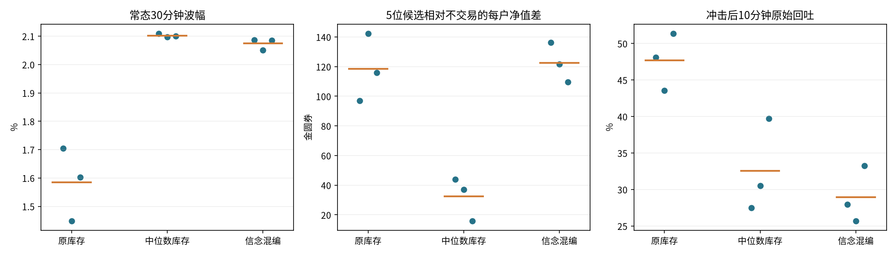
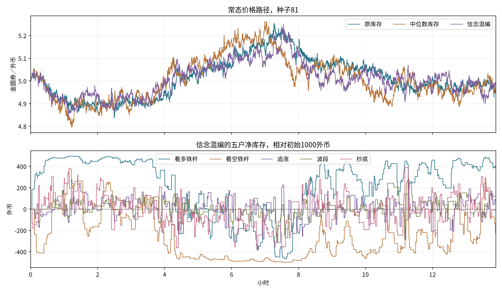

# LMSR 策略借到 FX AMM：首轮探索

2026-10-16。更值得继续探索的是信念人格：它在本轮增加了常态波动与行为差异，但削弱了冲击回归。中位数库存也能增加波动，不过没有明显减少交易，候选账户相对不交易的市值优势下降。两者均不自动替换已冻结配置。

## 实验范围

20户=10随机+5候选库存+5原短线；每tick5秒，每户5000金圆券+1000外币。每次只替换5位库存户，其他规则保留。三组×三个种子81/82/83×常态/冲击=18条，每条10000tick约13小时53分钟。无玩家、无借贷、不补钱、零手续费。参数在结果出现前固定，没有扫参。

策略移植的是行为部件：中位数库存借鉴quant的volharvest；信念混编借鉴后端believer家族。FX用对数价格替代logit或主观概率，保留研究的±500净库存上限与50%调整。没有完整移植原策略的建仓、现金下注和退出规则，详见[实验说明](../README.md)。

## 结果与取舍

下表先在每条路径内计算指标，再对三个种子等权平均。波幅是完整、不重叠30分钟窗口的最高最低差除期初价中位数；持仓只统计5位原短线户已完成轮次。

|常态指标|原库存|中位数库存|信念混编|
|---|---:|---:|---:|
|30分钟波幅中位数|1.59%|2.10%|2.07%|
|全部成交／分钟|7.88|8.51|8.24|
|5位候选合计成交／分钟|2.38|2.37|2.41|
|候选每户期末净值相对不交易／金圆券|+118.38|+32.38|+122.51|
|原短线每户已实现盈亏／金圆券|-53.81|-31.92|-45.74|
|原短线持仓中位数／分钟|7.36|5.40|5.31|

|冲击指标|原库存|中位数库存|信念混编|
|---|---:|---:|---:|
|冲击后10分钟原始回吐|47.7%|32.6%|29.0%|
|候选每户期末净值相对不交易／金圆券|+224.02|+90.26|+233.88|
|原短线每户已实现盈亏／金圆券|+72.87|-32.58|-4.62|

图中蓝点为三条种子路径，橙线为均值，散点不是置信区间。冲击回吐的多个事件在同一路径内相关；每条9个可观察事件，不把27个事件视为独立样本。10分钟以最后60秒均价衡量，终点冲击无后续不计入。

### 信念人格：更有区别，也更少回归

信念混编常态30分钟波幅约2.07%，原配置约1.59%；原短线已完成轮次的持仓中位数由7.36分钟降至5.31分钟。但冲击后10分钟回吐由47.7%降至29.0%，且三个种子分别均低于原配置。若仍重视冲击后较快回归，这是一项明显代价。

常态候选五户均值相对不交易为+122.51，与原库存+118.38接近，不能称为整体盈利升级：同种子差值一正两负。内部差别更有趣，三个种子中追涨户均落后于不交易、抄底户均领先；这符合让玩家能理解和针对不同对手的探索方向，但尚未放入玩家，不能说玩家已经能稳定利用。

|信念人格|常态期末净值相对不交易，三个种子均值／金圆券|三个种子的范围|
|---|---:|---:|
|看多铁杆|+159.44|+124.15 ～ +215.17|
|看空铁杆|+317.43|+278.40 ～ +386.95|
|追涨|-89.29|-116.50 ～ -67.92|
|波段|-20.47|-37.37 ～ +2.16|
|抄底|+245.44|+202.27 ～ +273.85|

这些数值包含未实现损益和初始外币重估后的对照，并非已实现交易盈利；人格也各只有一户，不能据此得出人格类别的普遍收益排名。看空铁杆的锚点可以逐步变化，价格下跌后也会转为净买入，并非永久只卖。

### 中位数库存：不适合直接替代当前库存户

最初假设是用鲁棒中心和偏离门槛减少细小波动的追逐。实际5位候选每分钟成交2.37笔，原库存2.38笔，几乎不变；进出门槛后回到中性库存仍会交易，且原有执行会成交很小的余额调整。本轮没有测出明显的成交次数节省。

候选相对不交易的每户净值差从+118.38降到+32.38，三个种子都下降；冲击回吐也变弱。它可能适合少量较迟钝的背景户，但这组参数不支持将其当作更好的回归主力。中位数、门槛及尺度一起改变，不能单独归因于其中某个部件，也不能断言volharvest本身无效。

## 可继续考虑的方向

优先保留信念模型作为少量人格：例如多空铁杆、追涨和抄底，配合现有库存回归力量，而非让所有库存户都变成人格户。这是基于本轮的下一步假设，尚未测“只替换一两户”的效果，不作为已验证配置。旧LMSR的跟风羊需要真实净流量信号，活动模式的慢改信需要真人成交，本轮未测。

固定网格和定投死拿没有进入首轮：前者增加了固定价格区间选择，后者长期单向消耗现金，较难回答本轮要解决的对手差异问题。它们可以成为特定活动角色，但目前证据不足以优先。

图用第一个预定种子81展示路径及库存，不按结果挑选。三种策略价格是各自内生形成的，不是共同外生行情。

## 验证和边界

运行内核的18条路径检查通过：两币守恒、真实钱包净值、余额非负、成交计数、候选钱包变化及目标上限；六条基线逐字段精确复现冻结轨迹；同种子常态/冲击首事件前轨迹相同。5626个已有研究文件的哈希保持不变。

已有检查命令：`python -m unittest research.fx.tests.test_execution research.fx.tests.test_entry_policies research.fx.tests.test_population_physical_metrics research.fx.tests.test_episodes`，10项通过。未新增永久测试；已查看生成图片。

仅三个已使用过的种子，不提供置信区间或显著性结论；初始锚点、信号尺度和门槛是这轮研究选择，未做稳健性扫参。无真人、正手续费、持续单边行情、24小时或线上性能验证。常态短线仍亏损，不能把更快退出当盈利证明。候选收益按各自路径的期末价与不交易比较，未进行共同外生价格下的收益检验，也没有剔除候选自身价格影响。

数据：[逐种子指标](metrics.json)、[聚合指标](aggregate.json)、[执行参数和哈希](manifest.json)、[执行检查](audit.json)。每条路径保留完整npz、钱包、成交记录和短线轮次。报告复现：`MPLCONFIGDIR=/tmp/sunyunbo/matplotlib python -m research.fx.lmsr_borrowing.report`。
