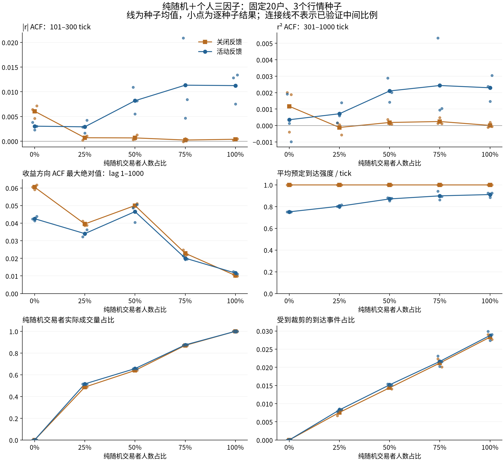
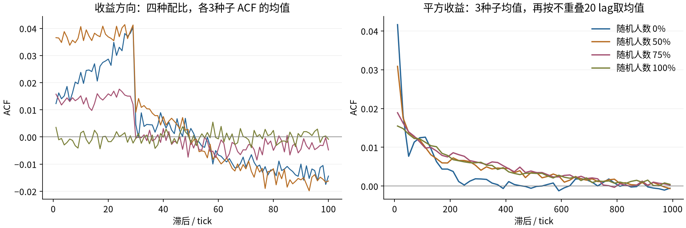

# 纯随机交易者与个人三因子交易者混合：探索报告

本轮暂停交易商论文复现，直接在现有有限钱包 AMM 中混合两套既有规则。固定参数、单个人口、三个行情种子；不将探索结果当作最优配比或正式稳健性结论。

## 本轮观察

75%纯随机＋25%个人三因子时，平方收益301–1000 tick ACF均值为0.00243，纯随机端点为0.00229；幅度101–300 tick ACF分别为0.01134和0.01125。这支持在当前人口下，加入部分三因子账户仍可保留接近v1的有限尺度波动相关。

但75%随机组方向R为0.02009，仍高于纯随机组的0.01164。50%随机组方向R反而为0.04655，所以混合比例与方向相关没有在本轮表现出简单单调关系。不能把波动相关保留等同于两项目标全部达成，也不能从三种子均值的细差宣布超过v1。

所有非零随机比例的平方收益301–1000 tick反馈增量均为3/3种子正；75%随机组的纯随机实际成交量占比为87.5%，所以它仍主要由随机者贡献成交量。75%随机组三段收益尺度接近，但中段波动相关更强；这与纯随机端点同样存在分段起伏，不构成长期稳健性证明。

## 设置与指标

总人数20，纯随机人数0/5/10/15/20，替换账户而不追加资金；各户基准到达机会相同。三因子参数沿用上一轮spread=1、人口种子301，账户编号小于纯随机人数的改用v1随机规则。剩余三因子类型人数最多差1，个人参数不重新归一化。完整参数见[manifest.json](manifest.json)。

每条100000 tick，前5000预热，三个未见行情种子81/82/83；每个比例分别运行反馈b=0和.25，共30条、300万tick。池金币100万、外币20万；每户金币5000、外币1000，零手续费，单笔池外币比例上限.005。

纯随机：每次到达独立抽N(0,40²)外币需求，使用原v1的实际钱包裁剪和精确外币输出购买。三因子：趋势/均价窗口30/30，原两类权重(30,.1)/(3,1)加固定个人倍率，噪声基准.0005；每tick生成预期g，净外币目标500*tanh(100g)，每次到达调整当前实际净持仓与目标差的20%，购买预算使用tick开始报价。两者保留各自既有下单方式及订单大小。

共享活动状态：a=exp(-1/1000)，Lambda_t=(1-b)+b*z_t²，z_(t+1)=a*z_t+sqrt(1-a²)*r_t/.0004；各户独立Poisson(Lambda_t/20)到达并洗牌。r_t为真实池收盘价的对数变化，先确定到达强度再成交并更新状态。没有额外限强度、重置钱包、注资、外生基本价值或参数学习。

ACF使用预热后的全部95000个tick（保留无成交/零收益tick），减样本均值后，以滞后乘积和除零滞后平方和，不作N/(N-lag)修正。幅度ACF作用于|r|，平方ACF作用于r²；区间数字是该区间逐lag ACF的算术均值。R=max(|ACF_r(k)|), k=1..1000，是描述性值，不是显著性检验或不可套利证明。

跨块指标先对100/240/1000 tick不重叠完整块分别计算平均预定强度与平均r²，再计算本块强度与下一块r²的Pearson相关，末尾不足块丢弃；常数强度时未定义。峰度为去掉正态基准3的超额峰度（SciPy无偏校正），不是尾指数。成交量为逐笔实际外币转移绝对值之和。裁剪沿用各模型原口径，比较意向与可执行订单，不能把买入量化细差当钱包耗尽。

最大已观察强度使用整条100000 tick的峰值，其他主表指标使用预热后的95000 tick；峰值是观测值，不是模型上限。

主表对三个种子等权平均，不拼接路径再算ACF；种子区间是最小/最大，不是置信区间。人数占比与成交量占比分开报告。反馈开关的路径、交易次数和随机数消耗会分叉，不作逐笔因果分解。

## 反馈开启时

|随机人数占比|\|r\| ACF 101–300|r² ACF 301–1000|方向R|平均强度|随机成交量占比|
|---:|---:|---:|---:|---:|---:|
|0%|0.00304|0.00035|0.04252|0.75140|0.0%|
|25%|0.00291|0.00071|0.03404|0.80271|51.6%|
|50%|0.00819|0.00210|0.04655|0.87010|65.7%|
|75%|0.01134|0.00243|0.02009|0.89843|87.5%|
|100%|0.01125|0.00229|0.01164|0.91031|100.0%|

## 反馈开关与种子差异

|随机人数占比|关闭反馈 r² 301–1000|开启反馈 r² 301–1000（最小～最大）|配对增量均值|三个种子中增量为正|
|---:|---:|---:|---:|---:|
|0%|0.00117|-0.00099～0.00192|-0.00082|1/3|
|25%|-0.00012|0.00016～0.00138|0.00083|3/3|
|50%|0.00018|0.00142～0.00288|0.00192|3/3|
|75%|0.00024|0.00094～0.00532|0.00219|3/3|
|100%|0.00001|0.00147～0.00304|0.00229|3/3|

图中展示随机人数0%/50%/75%/100%四组并保留负相关。左图显示lag1–100原始方向ACF的种子均值；右图仅为降低绘图噪声，显示3个种子的平方收益ACF均值再按不重叠20个lag平均。R指标仍按每条路径未平滑的lag1–1000计算，不能由左图的平均曲线直接读出。

## 成交、钱包与高阶统计

|随机人数占比|每tick实际外币成交量|裁剪比例|收益标准差|超额峰度|下一100tick块相关|最大已观察强度|
|---:|---:|---:|---:|---:|---:|---:|
|0%|3.316|0.00%|0.000059|15.11|0.378|0.860|
|25%|12.051|0.83%|0.000215|9.13|0.264|1.885|
|50%|20.497|1.52%|0.000313|6.00|0.466|4.877|
|75%|23.919|2.16%|0.000339|4.37|0.553|5.740|
|100%|28.284|2.88%|0.000377|3.59|0.624|4.777|

## 前中后三段（开启反馈，种子均值）

预热后95000 tick按顺序分为31667/31667/31666 tick，逐段单独去均值并计算统计。分段ACF不可与全路径ACF相加；这里只描述运行过程，不证明平稳性。

|随机人数占比|前/中/后 r² ACF 301–1000|前/中/后收益标准差|前/中/后裁剪比例|
|---:|---:|---:|---:|
|0%|0.00108 / -0.00044 / 0.00019|0.000060 / 0.000060 / 0.000058|0.00% / 0.00% / 0.00%|
|25%|-0.00005 / 0.00056 / 0.00140|0.000217 / 0.000214 / 0.000214|0.75% / 0.77% / 0.96%|
|50%|0.00037 / 0.00200 / 0.00293|0.000307 / 0.000315 / 0.000315|1.42% / 1.52% / 1.62%|
|75%|0.00039 / 0.00393 / 0.00072|0.000336 / 0.000343 / 0.000339|1.96% / 2.41% / 2.11%|
|100%|0.00217 / 0.00180 / 0.00035|0.000384 / 0.000373 / 0.000373|2.50% / 3.06% / 3.10%|

## 解释边界与可复核文件

本轮改变的是交易者构成，人数及总资金不变。即使随机者人数较少，其订单也可能贡献多数成交量；由随机订单提供主要波动、由三因子订单吸收偏离，是一种可能解释，须结合逐类型实际成交与开关对照判断。相反，方向ACF下降也可能只是被更大随机订单稀释，不能据此宣称三因子决策本身已改善。

只有一组个人参数和固定嵌套账户分配、每格三个行情种子；未测试其他人口、玩家订单、手续费或游戏性能。不选择新参数，也不把混合模型直接升格为新基线。此次是短范围探索，未追加DFA、幂律尾拟合或严格长记忆检验。

- [配置、完整人口与模拟来源哈希](manifest.json)
- [四组端点短路径与原算法共同字段逐点一致](compatibility.json)
- [全部30路径指标](paths.csv)、[10格均值](cells.csv)、[90分段](segments.csv)
- [完整结果及钱包](summary.json)，每条路径目录含series.npz与result.json
- [图示ACF原始数据](plotted_acf.npz)
- [原序列独立复核](audit.json)

验证：`OPENBLAS_NUM_THREADS=1 OMP_NUM_THREADS=1 python -m unittest discover -s research/fx/tests -v`，17项通过；额外核对30路径、90分段及2160次直接滞后乘积，与独立卷积结果一致，反馈时序和逐类型成交加总一致，终值资产守恒、记录的钱包非负。1659个既有研究文件哈希未变。两个端点分别在反馈开关下与原模型19个共同字段短路径逐点相同。未测试游戏交互、玩家参与或跨人口重复性。

重现命令：`OPENBLAS_NUM_THREADS=1 OMP_NUM_THREADS=1 python -m research.fx.mixed.run`，随后`python -m research.fx.mixed.report`。已有结果仅在配置与模拟源哈希相同时复用。
