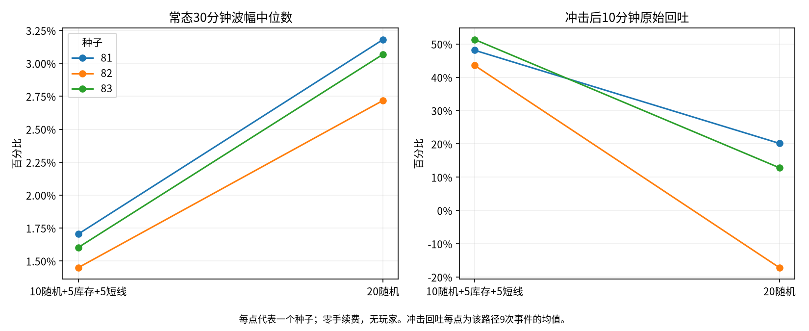

# 混合20户与纯随机20户离线比较

两组仅改变角色分配。冻结混合组为10随机、5库存、5短线；对照为20随机。两组均使用同一个新研究模拟器，角色边界的具体差异见 model.diff。原模拟器和全部既有研究文件保持不变。

每条10000个5秒tick，约13小时53分；种子81/82/83，常态和相同10次±5%冲击，共12条。每户5000金圆券与1000外币，池100万/20万；随机订单标准差120，热度psi=.0008，其他冻结参数见 manifest.json。零费、无玩家、无补资、无资产重置。

这三个种子参与过混合参数选择，本轮属于探索性对照，不是未见种子验证。相同种子共享随机流构造，但路径分化后到达强度及事件顺序随市场状态变化，不能当作固定外生价格的配对回放。

## 常态：三种子等权均值

|指标|混合20户|纯随机20户|
|---|---:|---:|
|成交笔数/分钟|7.88|11.28|
|外币成交量/分钟|707.01|1058.97|
|30分钟波幅中位数|1.59%|2.99%|
|收益标准差/5秒|0.00094|0.00115|
|方向ACF lag1|-0.030|-0.002|
|裁剪/尝试|4.44%|7.55%|
|未成交/尝试|2.10%|3.66%|
|无意向/到达|18.06%|0.00%|
|现金耗尽账户时点占比|1.62%|3.74%|
|外币耗尽账户时点占比|2.00%|3.62%|
|终点现金耗尽户数|0.33|1.00|
|终点外币耗尽户数|0.00|1.00|
|末值相对同路径HODL/每户|+3.02|+9.19|
|各户独立清算估值合计|198249.09|201780.76|
|全部钱包合并清算估值|190909.09|190909.09|
|资产低于3账户时点占比|0.00%|0.00%|

混合组已完成短线持仓中位数 7.36 分钟，每位短线已实现盈亏 -53.81；纯随机组无短线轮次，这两项为 N/A。

## 冲击：三种子等权均值

|指标|混合20户|纯随机20户|
|---|---:|---:|
|成交笔数/分钟|11.77|17.07|
|外币成交量/分钟|1030.52|1588.07|
|30分钟波幅中位数|2.16%|3.86%|
|收益标准差/5秒|0.00102|0.00124|
|方向ACF lag1|-0.020|-0.013|
|裁剪/尝试|4.40%|7.94%|
|未成交/尝试|2.11%|3.91%|
|无意向/到达|17.96%|0.00%|
|现金耗尽账户时点占比|1.54%|4.00%|
|外币耗尽账户时点占比|1.83%|3.43%|
|终点现金耗尽户数|0.67|1.67|
|终点外币耗尽户数|0.33|0.33|
|末值相对同路径HODL/每户|+86.35|-67.26|
|各户独立清算估值合计|191680.15|188595.80|
|全部钱包合并清算估值|184729.05|182057.04|
|资产低于3账户时点占比|0.00%|0.00%|
|10分钟原始回吐|47.7%|5.2%|
|上涨冲击回吐|45.0%|1.2%|
|下跌冲击回吐|49.8%|8.5%|

混合组已完成短线持仓中位数 4.12 分钟，每位短线已实现盈亏 +72.87；纯随机组无短线轮次，这两项为 N/A。

## 口径与限制

波幅使用27个完整非重叠30分钟窗口，各窗口最高最低差除该窗口期初价，先逐路径取中位数，再跨3种子平均。收益统计剔除冲击瞬间跳变，仍保留冲击后的内生变化；方向ACF的lag1/12/60对应5秒/1分钟/5分钟。

冲击响应沿用既有 event_response：观察120tick，用最后12个收盘均价计算相对即时冲击的原始回吐。每条9个可观察事件，终点冲击没有后续，排除；27个事件相关，独立种子数仍为3。回吐可小于0或超过100%，不裁剪。

耗尽阈值为余额≤1e-6。裁剪含余额或池上限/精度造成的限制，不全部等同资金不足；未成交与无意向分开统计，零现金买入/零外币卖出尝试见种子级CSV。未实现正式机器人死亡状态；资产低于3仅按实际钱包边际市值计算，不能替代正式系统死亡机制。

末值相对HODL仅是钱包边际市值减同路径初始钱包持有末值。零费封闭AMM里机器人自身交易会改变池价，因此该差额不能解释为真实盈利或可复制套利。清算调用既有AMM卖出报价：每户独立清算都从同一终点池出发，不能相加当作实际同时可得；另列全部钱包合并清算值。均为估值，不是已实现盈亏。未验证正手续费、玩家参与、长期单边趋势或24小时运行。

## 验证

12条全部完成。两币守恒（含冲击注资）、逐时点钱包非负、个人市值、成交计数及正常/冲击首1000tick前缀核对通过。混合组6条与冻结 profit_trail04 的全部trace字段逐值完全一致。 5731个既有研究/AMM/量化文件哈希保持不变。

复现命令：`OPENBLAS_NUM_THREADS=1 OMP_NUM_THREADS=1 PYTHONPATH=backend:. python -m research.fx.reversion.repeated.random20_comparison.run`。仅生成报告：`PYTHONPATH=backend:. python -m research.fx.reversion.repeated.random20_comparison.finalize`。没有追加种子、情景、费用网格或永久测试。

[逐种子CSV](comparison.csv)、[完整指标](metrics.json)、[均值](summary.json)、[参数与哈希](manifest.json)、[验证](validation.json)、[模型差异](model.diff)。

当前环境缺少 nbformat/nbclient，未安装新依赖；CLI、保存源码与输出是主要复现交付。
