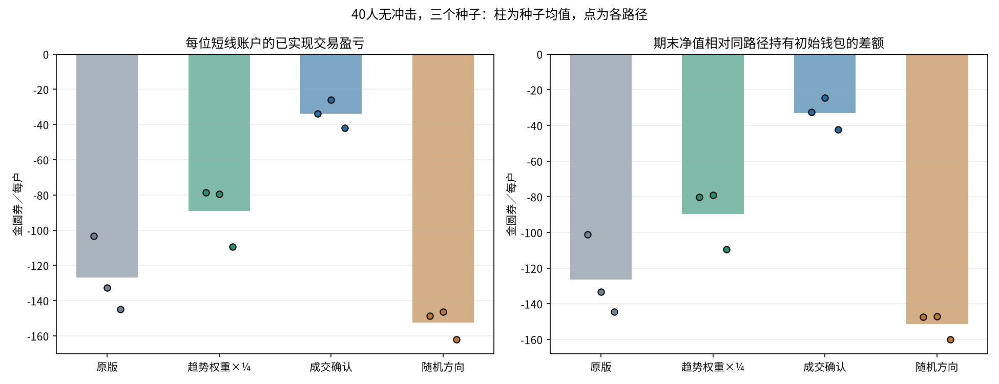

# 短线入场规则四组对照

## 固定设置与假设

40人=20随机+10库存+10短线，10000tick×10秒约27小时47分钟，无外部冲击、手续费、补钱、重置、期末强制退出。市场种子预先固定81/82/83，人口参数为原301分布按角色复制；每户5000金圆券+1000外币，池100万/20万。psi=.0008、tau1000、总强度2×(.75+.25z²)。

四组：原版三因子；仅趋势项系数×.25后重新求和和判断入场；原版信号中绝对贡献最大的项为趋势时才要求成交确认；随机方向保留原版信号幅度与abs(signal)>=个人sigma资格，在每次合格空闲到达独立随机买卖方向。随机方向使用独立SeedSequence([市场种子,账户ID,20261015,511])，不消耗原预测随机流。所有组仍为每轮200外币、相同钱包约束、到达查看与退出规则。

成交确认只看截至上一tick的过去30tick：排除自己，按每个其他账户的净外币变动统计方向，至少3个同向账户，且同向占具有非零净方向账户至少2/3；前15tick和后15tick的其他账户合计净流入都需同向。净额绝对值≤.000001视为零；不是逐笔买入人数统计，也不要求这些账户拥有独立信息。前30tick历史不全时趋势入场不通过，其他主导项不受门槛限制。买卖完全对称。

每组分别改变内生市场，不能视为在同一外生价格上逐笔回放。相同种子只固定初始化与随机流规则，成交数量、钱包、到达路径会分叉。这里的对照支持整个入场方案效果，不能单独分离由市场路径变化造成的影响。

## 三个种子等权均值

|指标|原版|趋势权重×¼|成交确认|随机方向|
|---|---:|---:|---:|---:|
|每位短线已实现盈亏|-126.86|-89.17|-33.92|-152.35|
|每位短线相对初始钱包持有差额|-126.32|-89.58|-33.06|-151.52|
|每个完成轮次平均盈亏|-1.76|-1.34|-0.82|-2.06|
|完成轮次盈利占比|35.6%|37.3%|41.9%|34.6%|
|每位短线完成轮次|72.6|66.3|41.3|74.1|
|短线持仓中位数/分钟|12.06|13.08|17.14|11.31|
|短线每户期末净值|9855.66|9902.83|9946.70|9851.02|
|30分钟市场波幅中位数|1.58%|1.54%|1.39%|1.65%|
|市场收益ACF lag1|-0.05979|-0.04728|-0.06004|-0.03943|

均值逐路径先计算，再按种子等权；胜率不是把种子交易拼接后算。已实现盈亏只含已实际平仓部分；期末仍有未平轮次，净值包含它们的浮动盈亏。持有基准H=5000+1000×本方案自己的期末价；相对差额仍含浮盈亏，不是同一价格路径上的策略净效应。30分钟波幅=(高−低)/期初价，55个完整非重叠180tick窗口，尾部不足丢弃。

## 每个种子的短线结果

|种子|方案|每户已实现盈亏|相对持有差额|盈利轮次占比|每户完成轮次|
|---|---|---:|---:|---:|---:|
|81|原版|-103.19|-101.02|39.1%|78.3|
|81|趋势权重×¼|-78.58|-80.11|38.8%|67.0|
|81|成交确认|-33.81|-32.61|43.7%|45.3|
|81|随机方向|-148.58|-147.45|34.8%|78.1|
|82|原版|-132.59|-133.42|34.2%|69.6|
|82|趋势权重×¼|-79.42|-79.13|36.5%|63.1|
|82|成交确认|-26.09|-24.36|44.6%|38.3|
|82|随机方向|-146.29|-146.96|34.4%|71.3|
|83|原版|-144.81|-144.53|33.6%|69.9|
|83|趋势权重×¼|-109.51|-109.51|36.5%|68.7|
|83|成交确认|-41.86|-42.21|37.3%|40.2|
|83|随机方向|-162.19|-160.15|34.6%|72.8|

## 成交确认与交易选择

|种子|趋势项主导合格候选|通过确认|被否决|已完成确认趋势轮次|这些轮次合计盈亏|
|---|---:|---:|---:|---:|---:|
|81|1135|20|1115|20|-87.95|
|82|929|25|904|24|-114.26|
|83|1042|42|1000|42|-288.51|

候选按空闲且信号达标的到达事件计，可含同一账户不同时间的重复候选；通过不必然成交。门槛更少交易可能减少总损失，因此同时报告每轮盈亏、胜率、交易次数与确认趋势子集，不能把少做等同于识别到了有利趋势。

## 验证与复现

原版seed81全部10001点序列及账户终态摘要与已保存40人无冲击路径完全一致。12条路径逐tick核对两币守恒、钱包非负、个人净值、账户成交计数；已完成盈亏与账本摘要一致。确认函数已有排除自己、当tick/未来数据及前后段方向测试，退出仍调用原BehaviorTrader。源哈希与固定参数见manifest.json，验证见audit.json。

本轮只测40人、无冲击和三个种子，没有证明新门槛在大事件、80人或玩家参与场景中的表现；确认阈值未搜索或事后调整。

运行：`python -m research.fx.reversion.repeated.entry_experiment`；仅重建报告加`--report-only`。

[种子级CSV](comparison.csv)、[全部指标与子集](metrics.json)、[种子间均值与范围](aggregate.json)、[设置及来源](manifest.json)。每条路径目录包含normal.npz个人钱包矩阵、短线轮次/成交、库存成交及入场候选decisions.jsonl。
