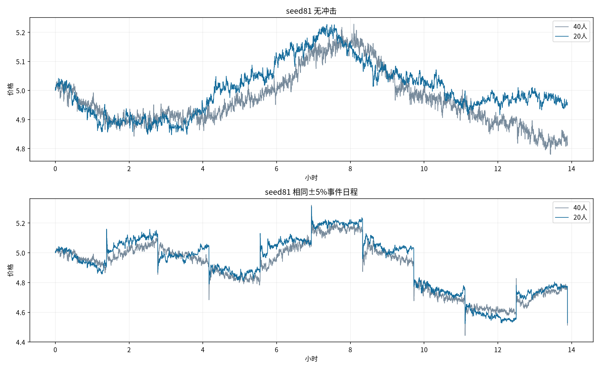

# 5秒tick：20人低干预候选与40人对照

## 设置

保持5秒tick、库存参考360tick=30分钟、热度tau540tick=45分钟、psi=.0008、短线趋势权重¼。20人=10随机+5库存+5短线；40人=20随机+10库存+10短线。池100万金圆券/20万外币固定，每户5000金圆券+1000外币、短线每轮200、随机订单标准差120、库存净目标±500、调整差额50%、退出规则均不变。

总到达率Lambda_N=(N/20)×(.75+.25z²)。相同z下每人查看频率不变，20人的整体强度减半；实际历史内生变化，不保证所有时段的成交恰好减半。总初始机器人资金从池市值的20%减到10%，因此人数、总资金和总活动共同减少。新增20人使用40人各角色参数的第一份副本，个人随机流仍独立。

种子81/82/83，每条10000tick约13小时53分钟。每种人数都有常态与相同10次±5%冲击日程；冲击每1000tick（83分20秒），4涨6跌，最后一次在终点无后续。40人六条直接复用前轮，20人新跑六条，不增加玩家或持续趋势情景。

## 常态：三个种子等权均值

|指标|40人|20人|
|---|---:|---:|
|30分钟波幅中位数|1.92%|1.57%|
|实际成交笔数/分钟|15.86|7.85|
|实际成交绝对量/分钟（外币）|1479.1|695.5|
|平均到达次数/tick|1.632|0.829|
|短线中位持仓/分钟|6.69|9.40|
|每位短线已实现盈亏|-103.94|-52.48|
|每位短线相对持有差额|-103.96|-51.64|
|短线完成轮次盈利占比|36.7%|42.5%|
|裁剪/订单尝试|4.44%|4.46%|
|实际/意向绝对量|96.02%|95.65%|
|收益ACF lag1（5秒）|-0.06552|-0.03522|
|绝对收益ACF5–30分钟|0.00190|0.00071|

## 冲击：三个种子等权均值

|指标|40人|20人|
|---|---:|---:|
|10分钟平均原始回吐|68.1%|43.4%|
|冲击后100秒平均成交笔数|84.9|50.7|
|短线中位持仓/分钟|4.32|4.97|
|实际成交笔数/分钟（全程）|21.21|11.55|
|曾回吐一半的事件数/9（种子均值）|9.00|6.67|
|保持半幅约2分钟事件数/9（种子均值）|8.33|5.33|
|每位短线已实现盈亏|-99.52|-78.42|
|裁剪/订单尝试|4.50%|4.48%|

## 玩家体验与指标边界

没有玩家订单，不能测定机器人占玩家成交的份额、挤占玩家机会或真实玩家体验。这里的每分钟成交、绝对量、总钱包规模和冲击回吐只用于衡量背景市场力量；减少人数并不自动保证玩家体验改善。

30分钟波幅使用360tick完整非重叠窗口，27窗；10分钟回吐观察120tick后，取最后60秒12个收盘；持续半幅用24个收盘。回吐相对当次即时跳幅，不扣除长期偏移，最后终点事件留空；每条路径9个事件相关，不能当独立重复。ACF5–30分钟为lag61–360，含零收益、全局去均值的有偏估计；冲击收益仅替换瞬时发行跳价，保留随后响应。已实现短线盈亏按实际5/10个账户归一化，期末净值另含未平仓浮盈亏。

20人与40人价格路径会分叉，同种子不代表逐笔交易配对；比较的是整个机器人规模的变化，非纯账户数量因果效应。尚未测试24小时全程、玩家介入、手续费或持续单边行情。

## 复现与验证

运行`python -m research.fx.reversion.repeated.population_5s`；只重建报告加`--report-only`。20人逐tick两币守恒、钱包非负、个人净值和成交计数核对；正常/冲击在首事件前逐字段一致。新人数通用指标在40人全部字段与已保存结果一致，20人的短线账户切片和盈亏分母使用实际人数，避免沿用40人常量。源与旧结果哈希保持。

[种子级CSV](comparison.csv)、[完整指标](metrics.json)、[逐次事件](events.csv)、[配置与源哈希](manifest.json)、[运行核对](audit.json)。
