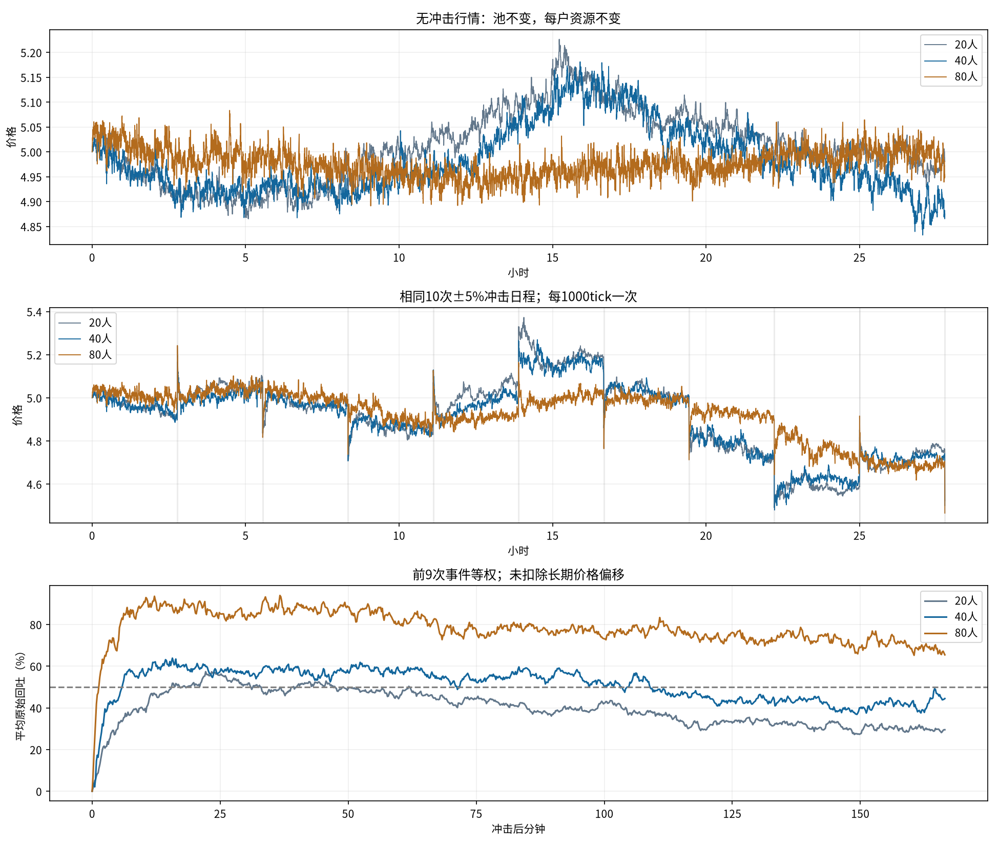

# 增加人数：20、40、80人对照

问题：在高敏感psi=.0008版本上，增员能否改善30分钟约2%常态波幅和冲击回归。只试预先指定的40/80人，没有按结果追加搜索。

## 实验设置

1tick10秒，每条10000tick；市场81、人口原301的角色参数成倍复制、冲击种子20261015。人数比例固定为一半随机、四分之一库存、四分之一短线。复制系数不复制随机决策：每个ID仍有独立到达与订单/噪声流，共享公开历史热度。新增资金只在初始化分配，过程中不补钱或重置。

池固定100万金圆券/20万外币，每户固定5000金圆券+1000外币，短线每轮200外币、库存净目标±500、随机订单标准差120。20/40/80人的机器人初始总市值分别20万/40万/80万，相当于初始池市值的10%/20%/40%。因此本轮是人口、总资金和总活动的共同扩张，不是固定总资金的纯账户拆分。

总到达率Lambda_N=(N/20)×[.75+.25z²]；z递推不变，psi=.0008、tau1000。相同价格历史下每人到达率保持一致；不能只把人数改大却把原总强度原封不动地分摊。实际内生历史不同，频率不保证严格成倍。未新增热度上限或调整策略。

每个人数都有无冲击和相同10次±5%事件日程路径；20人复用刚才已保存的高敏感结果，40/80各运行两条新路径。相同种子不代表分叉后逐笔交易配对；每次发行额随当时池储备变化。前9次事件可观察，第10000tick最后冲击无后续。

## 常态行情（无外部冲击）

|指标|20人|40人|80人|
|---|---:|---:|---:|
|30分钟波幅中位数|1.31%|1.67%|1.94%|
|30分钟波幅P10–P90|0.90%～1.72%|1.26%～2.13%|1.53%～2.40%|
|平均总到达率/tick|0.81|1.63|3.06|
|最大总到达率/tick|1.55|2.88|3.96|
|单tick最大实际到达次数|5|9|12|
|实际成交笔数|6466|13331|25544|
|短线中位持仓/分钟|17.17|11.33|10.00|
|收益ACF lag1|-0.03314|-0.06209|-0.08118|
|收益ACF最大绝对值1–100|0.03504|0.06209|0.08248|
|绝对收益ACF31–180|0.00233|0.00342|0.00150|
|平方收益ACF31–180|0.00122|0.00199|0.00149|
|超额峰度|4.87|2.66|1.44|
|裁剪订单/实际订单尝试|4.20%|4.67%|4.59%|
|实际执行/意向绝对量|95.98%|95.74%|96.12%|

## 冲击响应

|指标|20人|40人|80人|
|---|---:|---:|---:|
|事件后100秒平均到达强度/tick|2.56|4.90|6.36|
|事件后100秒平均成交笔数|22.1|45.0|56.2|
|事件后100秒平均参与人数|13.7|26.4|40.6|
|10分钟平均原始回吐|39.3%|56.2%|86.8%|
|曾回吐一半的事件数/9|8|8|9|
|回吐一半且连续保持12收盘的事件数/9|8|8|9|
|最大到达强度/tick|5.81|12.27|15.54|
|单tick最大实际到达数|10|18|16|
|裁剪/订单尝试|4.69%|4.84%|4.61%|
|实际执行/意向绝对量|95.42%|95.48%|96.04%|
|短线中位持仓/分钟|8.50|7.50|8.17|

20人平均回吐曲线首次到50%：15.67分钟；峰值57.4%。这是首次触及，不是持久半衰期。

40人平均回吐曲线首次到50%：6.0分钟；峰值63.8%。这是首次触及，不是持久半衰期。

80人平均回吐曲线首次到50%：1.33分钟；峰值93.9%。这是首次触及，不是持久半衰期。

## 指标口径与验证

30分钟波幅=(最高价−最低价)/窗口期初价；无冲击路径55个非重叠完整180tick窗口，尾部100tick不计。收益为收盘对数收益，含零收益，ACF使用common.diagnostics全局去均值的有偏估计，区间各lag等权平均；超额峰度正态为0。完整原始分布与较远滞后见metrics.json。

10分钟回吐使用事件后49～60tick均价，相对于该次即时跳幅计算；涨跌统一用带符号跳幅。半幅观察在下次事件tick之前截断，连续12个收盘约2分钟。原始回吐没有扣除长期偏移，也不能用没有任何此前事件的对照逐次做边际因果校正。事件来自同一路径，共享钱包和历史，9个事件不等于9个独立种子。

只改变人口、初始总资金、整体到达规模；未改变池、每户额度、psi或策略规则。不能把结果当作单独的人数因果效应、真实市场校准或多种子稳健性。新模拟逐tick核对两币守恒、钱包非负、个人净值及成交总数、首个事件前路径一致、±5%事件大小与终点处理。20人扩展模拟器与原模拟器有短路径逐字段与账本完全相同的检查。旧源码和原始结果哈希保持。

运行：`python -m research.fx.reversion.repeated.population`；只重建报告：`python -m research.fx.reversion.repeated.population --report-only`。

[完整指标](metrics.json)、[逐次事件](events.csv)、[紧凑CSV](comparison.csv)、[设置与源哈希](manifest.json)、[运行核对](audit.json)。20人原始路径见../sensitivity-psi0008；40/80人的个人钱包、短线轮次及成交账本保存在n40/n80子目录。
