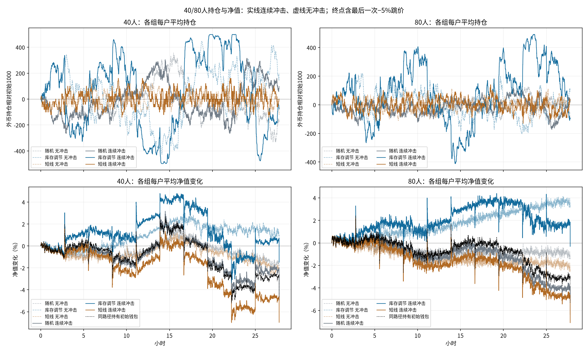

# 40/80人的持仓与净值

复用已保存路径，不改变设置、不重跑。各账户初始5000金圆券+1000外币，初始价格5，初始市值10000。净值=现金+外币×当时池边际价，含浮动盈亏；不是全量清仓后的滑点所得。

## 整体终态

|人数|场景|期末价格|每户平均净值|净值变化|持有初始钱包的期末价值|个人期末净值范围|
|---|---|---:|---:|---:|---:|---:|
|40|无冲击|4.8750|9879.00|-1.21%|9875.05|9530.19～10173.50|
|40|连续冲击|4.5009|9558.18|-4.42%|9500.94|8872.42～10173.36|
|80|无冲击|4.9497|9950.00|-0.50%|9949.68|9386.99～10414.28|
|80|连续冲击|4.4656|9497.36|-5.03%|9465.57|8769.08～10101.68|

## 连续冲击下的三组终态

|人数|类型|人数|每户平均现金|每户平均外币|每户平均净值|净值变化|相对初始钱包持有基准差额|
|---|---|---:|---:|---:|---:|---:|---:|
|40|随机|20|4598.99|1097.61|9539.28|-4.61%|+38.33|
|40|库存调节|10|5694.08|923.64|9851.35|-1.49%|+350.41|
|40|短线|10|4801.88|1000.00|9302.82|-6.97%|-198.12|
|80|随机|40|4732.77|1037.20|9364.46|-6.36%|-101.12|
|80|库存调节|20|5943.58|901.49|9969.26|-0.31%|+503.68|
|80|短线|20|4691.75|1030.00|9291.29|-7.09%|-174.29|

基准H=5000+1000×同一路径期末价，差额W−H用来区分初始外币重估与持仓调整结果，仍含未实现盈亏；不是可复制超额收益或已实现利润。组均值会掩盖随机账户的大幅分化，逐人结果在wallet_accounts.csv。

## 状态解释

随机组容易走到接近单币持仓，连续冲击终点40人中的20个随机户有4户、80人中的40个随机户有5户某一资产为零；库存和短线户期末两币均有余额。空掉一种资产不等于净值为零，继续按可用余额裁剪。

库存组在本路径上比持有初始钱包的基准多保留每户约350/504金圆券；短线组比基准少约198/174金圆券。短线已实现轮次盈亏分别为−1981.889804/−3359.329734金圆券，这与整个钱包的市值变化是不同口径。常态下库存组净值变化分别+0.97%/+3.22%，短线组−2.26%/−2.47%；这些是本种子的描述，不能推出一般策略排名。

短线只交易相对初始钱包的一批200外币，未加仓叠仓，终态外币只在800、1000、1200三档。40人中的10个短线账户有4个买入待卖、4个卖出待回购、2个空闲；80人中的20个有8个买入待卖、5个卖出待回购、7个空闲。卖出待回购使用自有外币，不借贷做空。

期末包括第10000tick的最后一次−5%事件，之后没有机器人反应或强制平仓，因此终态不是最后冲击完全回吐后的状态。前面观察到回归很强，并不意味着终点汇率必然回到初始5。两个场景的事件前历史和期末价格不同，不将净值差简单当作人数因果效果。

[每户终态、持仓与最大回撤](wallet_accounts.csv)、[三组汇总](wallet_groups.csv)、[整体汇总](wallet_overview.csv)。逐tick个人完整矩阵保存在n40/n80的control.npz与shock.npz；来源与分析脚本哈希见wallet_sources.json。
