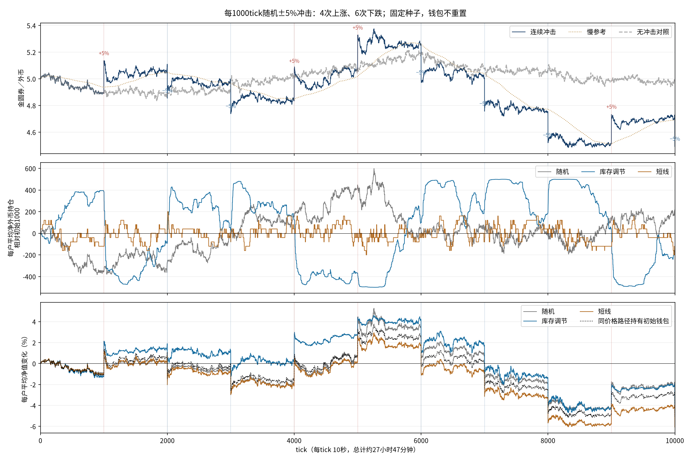
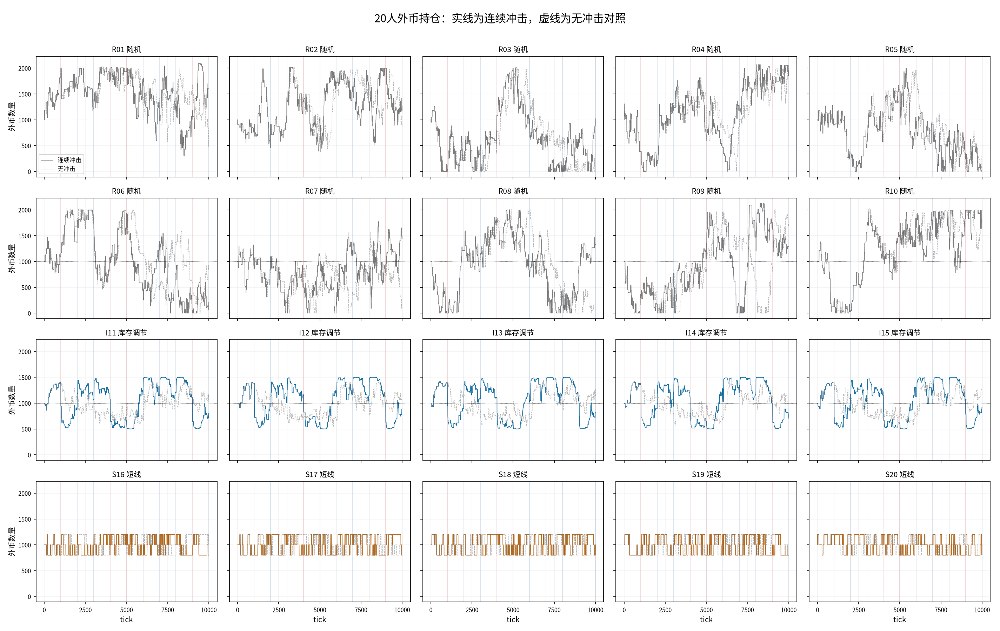
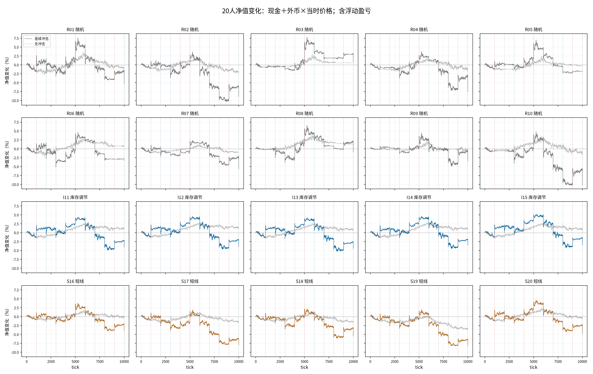

# 10000tick、每1000tick随机央行冲击

价格从5.0000到4.4924（-10.15%），全程范围4.4846～5.3751。20人总市值净值从200,000.00到190,372.16（-4.81%）。这是一次固定种子演示，不是多种子稳健性结论。

## 设置与计价

10随机（R01～R10）＋5慢参考库存调节（I11～I15）＋5短线（S16～S20）；原账户ID为0～19，表格使用1～20方便阅读。池100万金圆券/20万外币，户均5000/1000，初始每户市值10000。随机订单标准差120、psi=.0012、b=.25、tau1000；短线每轮200、止盈止损±.5%、移动启动/回撤各.25个百分点；库存目标±500、每次调整差额50%、过去最多720tick参考。无费用、借贷、钱包补钱、重置或期末强制平仓。

10000tick×10秒约27小时47分钟；市场种子81、人口301。独立冲击种子20261015事先生成10个方向，本次4涨6跌，顺序为＋、−、−、＋、＋、−、−、−、＋、−。没有为得到平衡或好看结果重抽种子。涨跌相同百分比也不完全抵销。

每个事件在对应tick常规成交后发生：上涨通过向池发行本币储备的5%，下跌通过向池发行外币储备的1/.95−1，实际瞬时约±5%。发行直接进入池，不给机器人加余额。随后收益进入下一tick的活动反馈和历史参考。两类事件是不同资产发行，分开核对守恒。

净值W=钱包本币＋外币数量×当时池边际价，含未实现盈亏，未扣假设全量清仓的滑点。每次事件同时保存机器人实际钱包、冲击前与冲击后净值；冲击当下钱包数量不变，市值因汇率重估而变化。净值变化不能全部叫已实现交易利润。

同一路径初始钱包持有基准H=5000＋1000×P：仅用于区分初始外币重估与持仓调整。W−H仍含浮盈亏，不是已实现利润或无机器人市场的超额收益。无冲击对照用相同初始参数和市场种子，路径会在首个事件后分叉；它没有承诺逐笔复用事件组的到达或成交。

## 整体行情与三组持仓

|组别|人数|期末每户平均净值|相对初始变化|期末每户平均外币|相对同路径初始钱包持有基准的差额|
|---|---:|---:|---:|---:|---:|
|随机|10|9534.75|-4.65%|1217.23|+42.30|
|库存调节|5|9611.50|-3.89%|828.30|+119.05|
|短线|5|9393.44|-6.07%|880.00|-99.00|

同路径持有初始钱包，期末每户为9492.44（-5.08%）。因此，本次三组平均净值均下降，并不代表三组的持仓调整都逊于该基准；相对差额见上表。随机组有账户在部分时段现金或外币为零，后续仍由真实余额裁剪，未自动恢复资金。

## 20人逐个跟踪

|账户|类型|期末金圆券|期末外币|期末净值|净值变化|相对初始钱包持有差额|
|---|---|---:|---:|---:|---:|---:|
|R01|随机|2232.52|1610.74|9468.66|-5.31%|-23.79|
|R02|随机|3452.28|1259.77|9111.73|-8.88%|-380.72|
|R03|随机|5504.90|1018.45|10080.25|+0.80%|+587.81|
|R04|随机|489.27|1949.90|9249.08|-7.51%|-243.37|
|R05|随机|9689.84|27.71|9814.33|-1.86%|+321.89|
|R06|随机|8723.67|210.31|9668.45|-3.32%|+176.01|
|R07|随机|2778.62|1480.86|9431.31|-5.69%|-61.13|
|R08|随机|3936.50|1328.15|9903.14|-0.97%|+410.69|
|R09|随机|3856.39|1289.13|9647.72|-3.52%|+155.28|
|R10|随机|0.00|1997.31|8972.81|-10.27%|-519.63|
|I11|库存调节|5980.97|804.85|9596.71|-4.03%|+104.26|
|I12|库存调节|5615.00|888.35|9605.87|-3.94%|+113.42|
|I13|库存调节|5844.77|825.79|9554.57|-4.45%|+62.12|
|I14|库存调节|6469.84|708.06|9650.76|-3.49%|+158.32|
|I15|库存调节|5541.39|914.47|9649.58|-3.50%|+157.14|
|S16|短线|6012.59|800.00|9606.55|-3.93%|+114.10|
|S17|短线|5608.17|800.00|9202.12|-7.98%|-290.32|
|S18|短线|4961.81|1000.00|9454.25|-5.46%|-38.19|
|S19|短线|5583.22|800.00|9177.18|-8.23%|-315.27|
|S20|短线|5034.65|1000.00|9527.09|-4.73%|+34.65|

期末数值均包含第10000tick的最后一次下跌冲击。该时点之后没有机器人反应，部分短线交易尚未完成，未假装清仓。现金与外币最小余额、最大净值回撤、逐人交易次数和无冲击期末净值另见account_summary.csv。

## 每次事件及10分钟回吐

10分钟数值为事件后第9～10分钟12tick均价；原始回吐=(冲击后即时价−观察均价)/(冲击后即时价−冲击前即时价)，上下方向使用带符号跳幅。50%指回吐一半，不作逐事件及格线。无冲击对照没有任何此前事件，同期价差包含整段冲击历史，不能当作本次冲击的边际回吐。表中因此只列原始回吐和同期无冲击路径价差，不计算单事件配对回吐。

|tick|方向|冲击前价格|冲击后价格|10分钟观察价格|原始回吐|与无冲击路径价差|
|---:|---|---:|---:|---:|---:|---:|
|1000|上涨|4.8898|5.1343|4.9921|58.1%|+0.1123|
|2000|下跌|5.1099|4.8544|4.9436|34.9%|+0.0643|
|3000|下跌|4.9873|4.7379|4.8264|35.5%|-0.1365|
|4000|上涨|4.8346|5.0764|5.0099|27.5%|-0.0225|
|5000|上涨|5.0725|5.3262|5.2319|37.2%|+0.1079|
|6000|下跌|5.2530|4.9903|5.0441|20.5%|-0.0880|
|7000|下跌|5.0072|4.7569|4.8306|29.5%|-0.2349|
|8000|下跌|4.7583|4.5204|4.5679|20.0%|-0.4741|
|9000|上涨|4.5072|4.7326|4.6716|27.1%|-0.3281|
|10000|下跌|4.7289|4.4924|—|—|—|

前9次可观察事件的10分钟原始回吐全部为正，均值32.2%。这些事件在同一资金与历史路径上相互依赖，不能当9个独立种子。第10000tick事件正好在终点，后续观测留空，不能计入回吐成功或失败。

## 数据与验证

实际运行两条10000tick路径：事件组和无冲击对照。研究测试`OPENBLAS_NUM_THREADS=1 OMP_NUM_THREADS=1 python -m unittest discover -s research/fx/tests -v`共29项通过。逐tick核对400040个个人净值记录、两币资产守恒、账户余额/组汇总/成交计数及200个事件钱包快照；旧正常路径前8640tick逐字段一致，首个事件前全部字段含个人矩阵一致，2072个既有文件哈希保持。未测玩家交互、实际运行时延或多种子重复性。

- [20人逐tick现金、外币、净值CSV](accounts.csv)（200020行，含初始tick0）
- [每人期末与风险统计](account_summary.csv)、[三组汇总](groups.csv)、[行情与池储备](market.csv)、[事件及回吐](event_responses.csv)
- [设置与源哈希](manifest.json)、[实际账户终态及10次事件钱包快照](summary.json)、[审计](audit.json)、[冲击完整序列](shock.npz)、[无冲击完整序列](control.npz)
- 重现：`python -m research.fx.reversion.repeated.run`，随后`python -m research.fx.reversion.repeated.report`。
