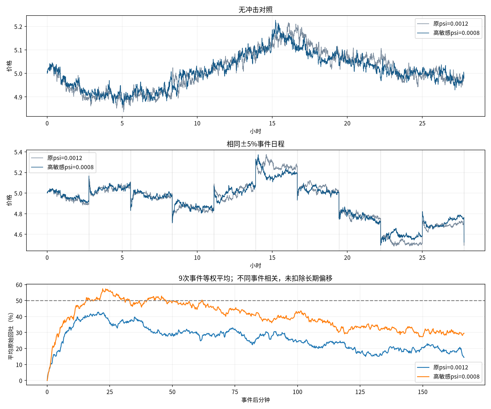

# 仅上调活动敏感性：psi 0.0012 → 0.0008

只改psi，1/psi提高50%。在给定同一段收益历史时，z放大1.5倍、平方反馈项放大2.25倍；内生路径会改变，实际热度不保证同比例变化。b=.25、tau1000、三组策略、订单120和钱包均不变。市场种子81、人口301、冲击种子20261015，同一10次±5%日程。注资金额随当时池储备变化，不是固定金额配对。

旧两条路径直接读取，新参数运行无冲击和连续冲击各10000tick。第10000tick冲击无后续，事件均值只含前9次。相同种子不意味着轨迹分叉后逐笔交易配对。

|指标|原无冲击|新无冲击|原连续冲击|新连续冲击|
|---|---:|---:|---:|---:|
|平均到达强度/tick|0.783|0.812|0.987|1.140|
|最大到达强度/tick|0.981|1.553|2.866|5.808|
|单tick最大实际到达数|6|5|9|10|
|成交笔数|6315|6466|7965|9159|
|避开事件及随后10分钟的30分钟波幅中位数|1.35%|1.31%|1.36%|1.47%|
|收益ACF lag1|-0.01959|-0.03314|-0.01310|-0.01713|
|绝对收益ACF31–180|0.00086|0.00233|0.01245|0.02312|
|平方收益ACF31–180|0.00143|0.00122|0.00706|0.01196|
|超额峰度（含零收益）|4.95|4.87|4.52|5.50|
|裁剪/实际订单尝试|4.02%|4.20%|4.18%|4.69%|
|实际/意向绝对量|96.20%|95.98%|95.89%|95.42%|
|短线中位持仓/分钟|14.08|17.17|12.17|8.50|
|短线已实现盈亏|-553.418046|-338.786255|-627.732909|-588.834005|

收益统计中，冲击组仅替换10次事件tick为发行前收益，保留随后反应与时序；不是无冲击收益。完整30分钟波幅仍含事件后的价格路径，剔除掩码仅用来挑选完整窗口。ACF沿用common.diagnostics有偏估计；无预热，含所有零收益。

|事件响应（9次）|原参数|高敏感参数|
|---|---:|---:|
|事件后100秒平均到达强度/tick|1.525|2.560|
|事件后100秒平均成交笔数|14.33|22.11|
|事件后100秒平均成交人数|10.11|13.67|
|10分钟平均原始回吐|32.2%|39.3%|
|下次冲击前曾回吐一半的事件数|7|8|
|回吐一半保持12个收盘的事件数|5|8|

10分钟回吐使用第9～10分钟12个收盘均价；半幅按冲击前后价格中点，严格在下次事件前截断，不扣除长期偏移。持续半幅用连续12个收盘，时间记首个收盘。单路径9个事件不是独立样本，不能据此宣布稳健性。

保存新两条完整npz、个人钱包矩阵、短线轮次、短线/库存成交账本及终态。逐tick核对两币守恒、钱包非负、个人净值和成交笔数；首个事件前新组两路径完全一致；原报告、旧结果及其原始依赖哈希保持。

复现：`python -m research.fx.reversion.repeated.sensitivity`。详细数据见[metrics.json](metrics.json)、[逐次响应](events.csv)、[设置与原文件哈希](manifest.json)。
