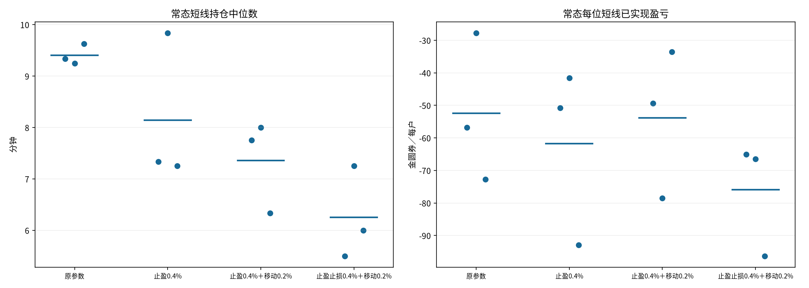

# 20人短线持仓小幅缩短

## 固定设置与比较档位

20人=10随机+5库存+5短线，5秒tick、库存30分钟、热度tau45分钟、psi=.0008，短线趋势权重¼；每户5000金圆券+1000外币，每轮200，不改人数、到达热度、订单力度或策略结构。每条10000tick约13小时53分钟，种子81/82/83，常态与相同10次±5%日程；终点事件无后续，不计入响应。原六条复用，其余三档各六条新跑，共24条。

预先固定三档：A只将止盈从.5%降至.4%；B在A基础上把移动启动/回撤从.25%各降为.2%，止损仍.5%；C再把止损降至.4%。没有强制持仓超时，也不增加独立退出检查或全市场热度；所有退出仍由原BehaviorTrader在随机到达时检查。

## 常态：三个种子等权均值

|指标|原参数|止盈0.4%|止盈0.4%＋移动0.2%|止盈止损0.4%＋移动0.2%|
|---|---:|---:|---:|---:|
|持仓中位数/分钟|9.40|8.14|7.36|6.25|
|持仓平均值/分钟|11.80|11.27|10.15|8.15|
|持仓P90/分钟|26.01|25.55|21.57|17.49|
|每位短线已实现盈亏|-52.48|-61.78|-53.81|-75.94|
|每完成轮次平均盈亏|-0.98|-1.07|-0.90|-1.05|
|盈利轮次占比|42.5%|42.8%|43.5%|39.5%|
|止损轮次占比|44.5%|47.2%|44.2%|49.4%|
|每户每小时止损轮次|1.75|1.93|1.93|2.56|
|全部成交笔数/分钟|7.85|7.82|7.88|8.01|
|短线成交笔数/分钟|0.66|0.68|0.74|0.87|
|30分钟波幅中位数|1.57%|1.59%|1.59%|1.63%|
|裁剪/订单尝试|4.46%|4.45%|4.44%|4.35%|

## 冲击：三个种子等权均值

|指标|原参数|止盈0.4%|止盈0.4%＋移动0.2%|止盈止损0.4%＋移动0.2%|
|---|---:|---:|---:|---:|
|持仓中位数/分钟|4.97|4.64|4.12|3.67|
|每位短线已实现盈亏|-78.42|-66.06|+72.87|-2.37|
|止损轮次占比|45.4%|45.2%|39.0%|44.9%|
|每户每小时止损轮次|2.81|2.97|2.81|3.67|
|全部成交笔数/分钟|11.55|11.59|11.77|11.86|
|10分钟平均原始回吐|43.4%|45.0%|47.7%|47.1%|

## 口径与验证

持仓统计仅包括完成轮次，时间按5秒换算；P90先逐路径计算再按种子平均，不是硬上限。未完成轮次及最老持仓年龄见metrics.json，未用强制退出缩短统计。已实现盈亏按实际5个短线户归一化，止损次数同时报告占比和每户每小时频率，防止以更频繁亏损换取较短持仓。各档改变市场自身路径，不是固定外生价格的逐笔配对回放。

30分钟波幅使用360tick完整窗口；10分钟回吐观察120tick，取最后60秒12个收盘均价。各路径9个可观察事件相关，不把27个事件当独立种子。此轮无玩家，不将参数变化直接解释为玩家体验已改善。

直接复用现有模拟器、三因子入口和退出算法；只覆盖退出阈值。逐tick核对两币守恒、钱包非负、个人净值与成交计数、正常/冲击首事件前缀、退出原因盈亏总和及旧文件哈希。没有新增永久测试；运行已有研究检查。

复现`python -m research.fx.reversion.repeated.short_exit_tuning`；仅重建报告加`--report-only`。

[种子级CSV](comparison.csv)、[完整指标与退出分解](metrics.json)、[固定参数和源哈希](manifest.json)、[运行核对](audit.json)。
