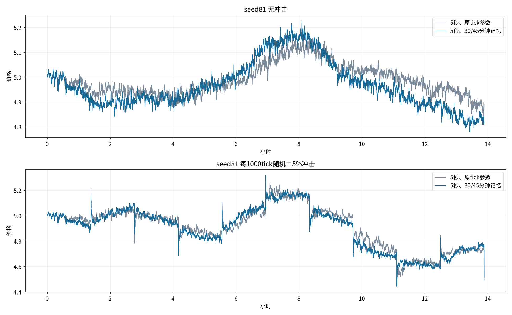

# 5秒tick与几十分钟记忆

## 本轮固定设置

采用40人=20随机+10库存+10短线，短线趋势项×¼。每户5000金圆券+1000外币，短线每轮200，随机订单标准差120，库存净目标±500、每次调整差额50%；止盈止损各.5%、移动启动/回撤各.25个百分点。psi=.0008、b=.25，总到达强度2×(.75+.25z²)。池100万金圆券/20万外币，无费用、补钱、重置或期末强平。

本轮两组都使用5秒tick。对照保留库存720tick（60分钟）和tau1000（83.33分钟）；新候选为库存360tick（30分钟）和tau540（45分钟）。短线两窗口仍为30tick，即2.5分钟；不增加成交确认机制。

tau是z的指数e倍衰减尺度，45分钟不是硬截断；无新价格变化时z半衰期约31.19分钟，z²超出基线部分半衰期约15.60分钟。此处只描述无进一步收益输入的机械衰减，不是市场冲击回吐半衰期。

保留psi不变时，缩短tau还使单次收益输入系数sqrt(1−exp(−2/tau))/psi从55.874变为76.002，增强36.0%；这不是纯粹只改变衰减、不改变输入增益的实验。

市场种子81/82/83。每组每种子各有无冲击和随机±5%冲击路径，共12条；对照无冲击的三条原始tick路径可直接复用前轮趋势权重¼结果，仅按5秒重新计时与统计；其余9条新模拟。每条10000tick约13小时53分钟。冲击方向独立种子20261015，每1000tick一次，即83分钟20秒一次，4涨6跌；最后一次在终点，无后续。没有新增持续趋势场景。

## 无冲击：种子等权均值

|指标|5秒、原tick参数|5秒、30/45分钟记忆|
|---|---:|---:|
|30分钟波幅中位数|1.84%|1.92%|
|短线持仓中位数/分钟|6.54|6.69|
|每位短线已实现盈亏|-89.17|-103.94|
|每位短线相对持有基准差额|-89.58|-103.96|
|短线完成轮次盈利占比|37.3%|36.7%|
|平均到达强度/tick|1.574|1.632|
|实际成交笔数|12,761|13,216|
|裁剪/实际订单尝试|4.42%|4.44%|
|实际/意向绝对量|96.04%|96.02%|
|收益ACF lag1（5秒）|-0.04728|-0.06552|
|绝对收益ACF 5–30分钟|0.00102|0.00190|
|平方收益ACF 5–30分钟|0.00065|0.00115|

## 冲击：种子等权均值

|指标|5秒、原tick参数|5秒、30/45分钟记忆|
|---|---:|---:|
|10分钟平均原始回吐|61.5%|68.1%|
|事件后100秒平均成交笔数|66.7|84.9|
|曾回吐一半的事件数/9（种子均值）|9.00|9.00|
|保持半幅约2分钟的事件数/9（种子均值）|8.33|8.33|
|短线持仓中位数/分钟|4.00|4.32|
|每位短线已实现盈亏|-84.97|-99.52|
|观测强度峰值（种子均值）|10.54|13.87|
|裁剪/实际订单尝试|4.41%|4.50%|

## 指标与验证

全部时间由tick_seconds=5换算。30分钟窗口为360tick，取27个完整非重叠窗口，尾部280tick不计；波幅=(窗口最高−最低)/期初价。持仓时间=(退出tick−入场tick)×5/60。10分钟响应为120tick后，取最后60秒的12个收盘均价（第109～120tick），上下冲击统一按带符号跳幅计算。持续半幅要求24个连续收盘，标记起始收盘，约2分钟；下一次事件tick前截断。各路径9个事件相关，先路径内汇总再种子等权，不把27次当独立样本。

不复用旧报告硬编码的/6、180tick、60tick时间口径。旧版回吐曾将第49～60tick的12个收盘称为9～10分钟，按10秒实际对应8分10秒～10分钟；本轮明确按实际秒数计算最后1分钟，两个新列口径完全一致。原报告保留历史结果，不修改旧文件。

收益统计仅将事件tick替换为常规成交后、发行前收益，保留之后的响应，不等于无冲击市场。ACF含零收益、全局去均值、采用滞后乘积和/零滞后平方和；5–30分钟对应lag61–360。净值=现金+外币×当时边际价，含未实现盈亏；持有基准H=5000+1000×本路径期末价。

逐tick核对两币守恒、钱包非负、个人净值和成交计数；每组每种子的正常/冲击路径在首事件前逐字段完全一致；事件幅度与终点处理核对。新时间指标已有360tick窗口和120tick响应的实际行为检查。旧源码与结果哈希保持。未验证玩家介入、24小时全程或游戏性能。

运行：`python -m research.fx.reversion.repeated.timing_experiment`；仅重建报告加`--report-only`。

[种子级CSV](comparison.csv)、[逐次事件](events.csv)、[完整指标](metrics.json)、[设置与来源](manifest.json)、[运行核对](audit.json)。
