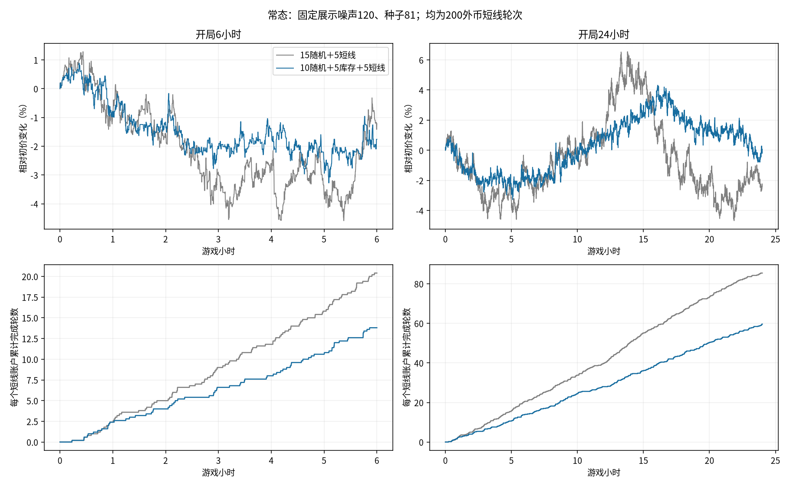
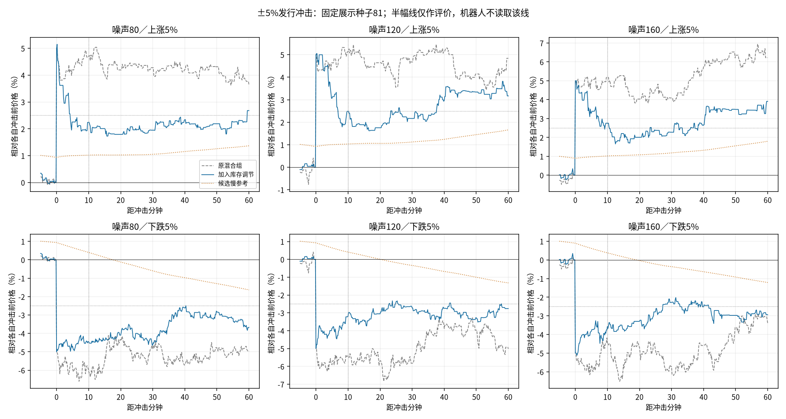

# 200外币轮次：半小时幅度与冲击回吐

慢参考库存调节产生了明显的短期回吐，并允许较长时间后仍保留价格偏移；本轮尚未同时达到30分钟约2%幅度与两个方向10分钟约半幅回吐。原混合组噪声120的常态幅度已接近2%，加入库存调节后行情会收窄。

## 目标和冻结设置

用户选择常态30分钟内约2%的波动；单次约5%冲击后10分钟回吐约一半，允许不完全恢复及较持久的价格偏移。持仓5～15分钟是典型节奏目标。以上均为统计评价，不写成目标价格、事件倒计时或强制退出。

20户、池100万金圆券/20万外币、每户5000金圆券/1000外币、零费用、10秒tick。用户指定200外币解释为短线每轮意向数量从100提高至200，初始钱包不变。对照15随机＋5短线；候选把10～14号替换为5个库存调节者，短线15～19号及个人参数保持。

短线三因子仍用30/30窗口和人口301/spread1，只有到达且空闲、信号达到个人sigma才入场。止盈止损±.5%，移动启动+.25%、回撤.25个百分点；实际成本、滑点和钱包决定退出。每户每tick最多一笔短线实际成交，部分平仓保持原退出意图。

库存调节复用旧目标仓位：gap=过去最多720tick对数价格均值−上一tick对数收盘价；target=500*tanh(100*gap)，目标相对初始外币库存。历史不足时用已发生的历史。每次到达执行目标差额的50%，最多每户每tick一笔实际成交，可以保持净减持/净增持，不按短线成本强制回补。目标上限±500不是实际持仓的硬裁剪；预算报价与真实滑点可能造成小幅偏离。所有价格参考来自市场自身历史，没有独立基本价值。

噪声标准差80/120/160分别配psi=.0008/.0012/.0016，tau1000、b=.25、原到达基准1保持。同比缩放控制线性参照的反馈尺度，真实AMM不保证等比例。替换五个随机账户同时减少随机成交，不能把常态收窄全部归因于反向交易。

三尺度×两构成×行情81/82/83×常态/上冲/下冲，共54条8640tick路径、466560tick。包含启动，无预热删除。第1000tick成交后，上冲向池本币侧增加当时储备5%；下冲向外币侧增加F*(1/.95−1)，均取六位小数。这是两种不同资产发行，不是同一政策的对称买卖；分别核对资产总量。

## 常态：幅度与短线持有

每条24小时路径取48个不重叠30分钟窗口，高低价差/窗口初价；先求各路径中位数再平均三个种子。不是收益标准差，亦不是每条窗口硬性幅度限制。6小时是同一路径前缀，非独立重复。持有只统计已完成轮，期末未完成者另列原表。

|噪声|库存账户数|30分钟幅度中位数均值|三个种子幅度中位数范围|完成持有均值（分钟）|完成持有中位数（分钟）|6小时完成轮/短线户|
|---|---:|---:|---:|---:|---:|---:|
|80|0|1.52%|1.45%～1.57%|15.72|13.33|14.87|
|80|5|0.99%|0.91%～1.11%|33.23|23.36|9.33|
|120|0|1.95%|1.93%～1.98%|12.19|10.06|19.53|
|120|5|1.28%|1.21%～1.39%|20.55|14.44|11.80|
|160|0|2.36%|2.33%～2.40%|10.81|8.89|21.53|
|160|5|1.59%|1.56%～1.62%|15.22|11.94|15.93|

## 冲击后10分钟：回吐与净反向交易

r_raw=(P_plus−观察均价)/(P_plus−P_minus)，上下冲击均使用带符号跳幅；50%为回吐一半，100%才是回到冲击前价。r_paired=1−(冲击观察均价−同期无冲击均价)/(P_plus−P_minus)，100%代表追上同期对照，不能解释成必回旧价。主表观察均价取第9～10分钟共12tick；点值另保留，非重复试验。净反向量在上冲为净卖外币，下冲为净买外币，负值说明顺冲击方向交易。

|噪声|库存数|冲击|原始回吐均值|三个种子原始回吐范围|配对回吐均值|原始回吐≥50%路径数|库存账户净反向外币量均值|
|---|---:|---|---:|---:|---:|---:|---:|
|80|0|上冲|1.2%|-10.9%～9.0%|8.4%|0/3|0.0|
|80|0|下冲|6.7%|-16.2%～26.8%|-0.5%|0/3|0.0|
|80|5|上冲|51.6%|47.5%～59.5%|57.2%|1/3|3057.1|
|80|5|下冲|33.8%|11.4%～45.9%|28.2%|0/3|1307.2|
|120|0|上冲|10.7%|-3.6%～22.3%|8.6%|0/3|0.0|
|120|0|下冲|-2.0%|-11.7%～3.4%|0.1%|0/3|0.0|
|120|5|上冲|48.2%|36.8%～58.1%|49.2%|1/3|2648.4|
|120|5|下冲|31.2%|31.1%～31.3%|30.2%|0/3|1512.4|
|160|0|上冲|-3.3%|-13.1%～2.9%|2.4%|0/3|0.0|
|160|0|下冲|-3.5%|-18.1%～9.8%|-9.2%|0/3|0.0|
|160|5|上冲|35.2%|21.5%～45.6%|43.8%|0/3|2713.5|
|160|5|下冲|34.9%|20.3%～50.4%|26.3%|1/3|1221.0|

库存组18条事件路径的10分钟原始回吐均为正，其中3/18达到至少50%。50%计数仅作描述，不设为逐路径及格线；约半幅目标应结合均值、范围及两个方向判断。对照有顺势继续移动的路径。库存净反向成交量不是价格贡献的因果分解；初始库存、参考偏离、随机订单和反馈路径均会影响结局。

## 回吐之后保留多少偏移

下表为库存组，相对各自冲击前即时价：10分钟取第9～10分钟均价，60分钟取最后2分钟均价，24小时取局末30分钟均价。不是永久均衡的估计；无冲击路径也会漂移，同期配对价差保留在CSV。

|噪声|冲击|10分钟剩余价差|60分钟剩余价差|24小时剩余价差|
|---|---|---:|---:|---:|
|80|上冲|2.42%|2.33%|4.72%|
|80|下冲|-3.31%|-3.95%|-4.70%|
|120|上冲|2.59%|2.66%|5.17%|
|120|下冲|-3.44%|-3.31%|-4.70%|
|160|上冲|3.24%|3.00%|4.78%|
|160|下冲|-3.25%|-3.75%|-4.48%|

较慢参考会吸收新价格历史，库存账户不永久守住旧价；当前模型确实出现短期回吐后，较晚价格又接近事件后水平的路径。能保留全局偏移，与已经证明“过冲一半＋永久影响一半”是两回事，不能据10分钟结果给两者作严格分解。

## 常态相关、成交与资金

ACF含所有零收益、全局减均值，按滞后乘积和/零滞后平方和计算，不作无偏修正；方向最大绝对值取lag1–100，幅度相关取31–180tick。各路径统计再等权平均，不拼接种子。事件跳点不混入常态ACF；目标要求事件后方向性回归，不能同时将该时段的可预测性当成无条件失败。

|噪声|库存数|收益ACF lag1|收益ACF最大绝对值1–100|abs(r) ACF31–180|库存成交占比|短线成交占比|订单裁剪比例|
|---|---:|---:|---:|---:|---:|---:|---:|
|80|0|-0.01000|0.03255|0.00487|0.0%|27.7%|3.60%|
|80|5|-0.03083|0.04591|0.00415|18.1%|20.8%|2.41%|
|120|0|-0.01481|0.03028|0.00314|0.0%|25.0%|5.90%|
|120|5|-0.02380|0.03721|0.00072|15.5%|22.1%|4.00%|
|160|0|-0.01308|0.03663|0.00100|0.0%|22.1%|7.95%|
|160|5|-0.02843|0.04044|0.00164|15.2%|21.9%|5.53%|

## 当前结论与验证

本轮支持“常态波动规模”和“冲击后净库存反应”应分别控制。200外币轮次与较宽阈值已实际运行；库存调节提供短期回归，参考更新允许较持久偏移。新组合仍未同时达到两个市场目标，不替换冻结基线，也不事后追加噪声或库存网格。结果只覆盖一个参数人口和三个既有种子，不构成真人行为、事件频率或游戏性能验证。

研究测试：`OPENBLAS_NUM_THREADS=1 OMP_NUM_THREADS=1 python -m unittest discover -s research/fx/tests -v`，27项通过。保存序列审计：54路径、466560参考时点、35603笔短线报价、45050笔库存报价；实际生产报价重放、两币发行守恒、历史参考因果与目标、下一tick反馈、真实账户及短线/库存账户的单tick限制核对通过。原2062文件哈希未变。

复现：`python -m research.fx.reversion.run` → `python -m research.fx.reversion.audit` → `python -m research.fx.reversion.report`。未改生产、公共AMM或旧分支。

- [配置](../../config.json)、[来源及保护快照](manifest.json)、[审计](audit.json)、[全部账户与结局](summary.json)
- [常态6/24小时指标](normal.csv)、[全部864个30分钟窗口](ranges30.csv)、[5/10/30/60分钟及局末响应](responses.csv)。各路径保存npz、短线轮次与成交、库存成交账本。
